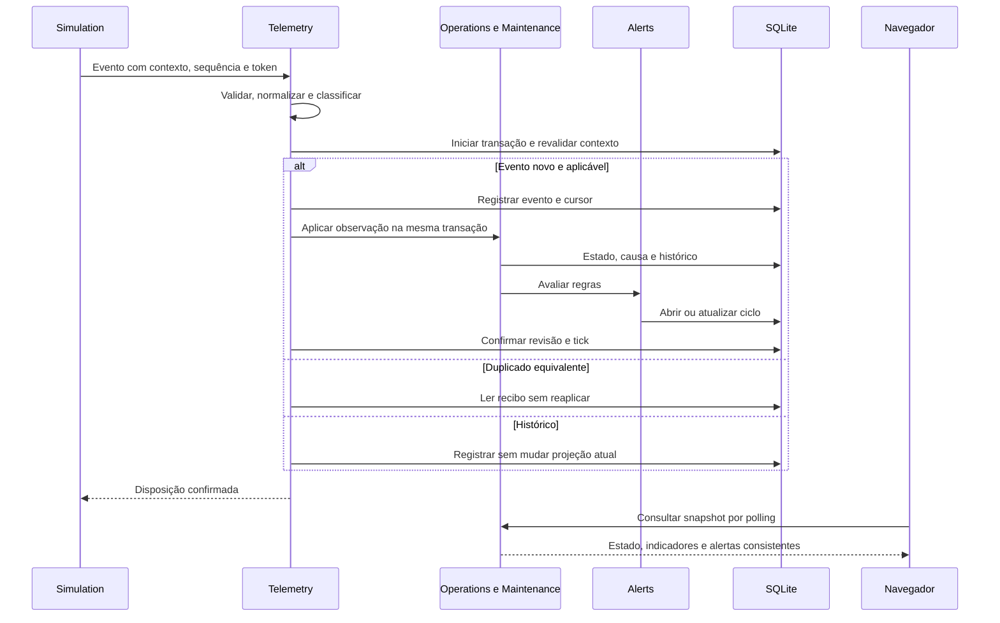

# Contratos e fluxos técnicos do MVP

<a id="contrato-c03-ratificado"></a>
## Adendo vigente — C03 HUMAN_RATIFIED, 26/10/2026

Por decisão humana **“PROJECT IGNIS — Registro formal da ratificação C03”**, o [contrato normativo específico C03](C03_TELEMETRY_CONTRACT.md) consolida **D01–D12 RATIFIED**, inclusive os refinamentos finais de identidade/episódios, perfis FX exclusivamente de fixture, relógios e snapshots. Especializa as seções 1/3/4/5/6 deste documento apenas nesses pontos; C02/canonicalização e demais regras permanecem. As menções anteriores a C03 pendente abaixo são históricas e superadas contratualmente por esse adendo, sem reclassificar testes como PASS.

Em particular, [identidade/início de episódio e corte inclusivo](C03_TELEMETRY_CONTRACT.md#episodios), [tempos e confiança do relógio](C03_TELEMETRY_CONTRACT.md#tempos), [disposições por dimensão](C03_TELEMETRY_CONTRACT.md#pipeline) e [revisão/corte do snapshot](C03_TELEMETRY_CONTRACT.md#snapshot) têm definição na fonte vinculada. EpisodeStartedAt passa a integrar values/Ce dos eventos de falha; causeCode é atributo imutável, não parte da chave que permita reutilizar episodeId. Os metadados de processamento continuam fora da identidade C02. Troca/reativação de fonte não apaga cursores/recibos nem reinicia sequência da mesma fonte.

**Schema 5; migration 0006 RESERVED / NOT_CREATED; T0007 PLANNED / NOT_STARTED / NOT_AUTHORIZED; V05/V06 NOT YET ACCEPTED.** Ratificação documental não inicia implementação. [Estado/gates](TICKETS.md#ratificacao-c03), [verificação](VERIFICATION_GUIDE.md#verificacao-c03) e [limites](KNOWN_ISSUES.md#limites-c03). Estados antigos de tickets preservados abaixo não substituem o acompanhamento vigente.

**Estado vigente em 25/10/2026:** T0001–T0004 DONE / HUMAN_ACCEPTED. [Contratos T0005](#t0005-contrato) T5-D01–D16/A01–A05 HUMAN_RATIFIED e [GF-T5-01–12](SYSTEM_DESIGN_FUNCTIONAL.md#gate-funcional-t0005) HUMAN_APPROVED, por autorização exclusivamente documental. T0005 PLANNED / NOT_AUTHORIZED; T0006–T0020 não autorizados. [Baseline e evidência humana](TICKETS.md#contratos-t0005). Seções de preparação e declarações de execução futura abaixo são históricas e não substituem os aceites posteriores; condições C01–C05/J01 mantidas.

Histórico de 24/10/2026: T0001–T0003 aceitos em main/236d2e2; adendo T0004 ratificado e gate complementar aprovado antes de sua implementação/aceite posterior. Este texto de rastreabilidade não altera os contratos de 12.1–12.8.

**Arquitetura aprovada condicionalmente em 23/10/2026; contratos v1.1 com correções pendentes.** T0001 recebeu autorização individual posterior e implementou somente bootstrap, estáticos técnicos e `/health/live`; demais endpoints/schemas/algoritmos continuam futuros. Este documento é a fonte de verdade dos contratos, regras e cálculos; [arquitetura](SYSTEM_ARCHITECTURE.md) mantém justificativas e limites dos módulos; [brief](PROJECT_BRIEF.md) mantém requisitos. Parâmetros P01/P02 aceitos como heurísticos demonstrativos, sem validade preditiva estatística comprovada. Demais tickets sem autorização. Evidências: [estado real](REPO_CURRENT_STATE.md). Condições: [ADRs](adr/README.md).

<a id="contratos"></a>
## 1. Convenções e invariantes

Entrega incremental v1.1: estes são contratos finais, aplicáveis quando a operação for introduzida. O primeiro uso seguro e seus testes estão na [fundação mínima](SYSTEM_ARCHITECTURE.md#fundacao-minima). T0002 não implementa todas as rotas, tabelas ou modos de publicação desta especificação. Escrita pública interativa depende da fronteira de segurança completa; até lá, somente leitura pública e operação local restrita.

| ID | Regra normativa proposta |
|---|---|
| I01 | Toda operação resolve contexto autenticado `{datasetId, epoch}`; acesso externo somente à geração ativa e pronta. IDs enviados não concedem acesso. FKs de dados contextuais incluem dataset e geração |
| I02 | Cada comando mutável contextual tem `commandId` e hash canônico conforme [contrato de idempotência](#idempotencia). Repetição equivalente retorna o resultado persistido; mesma chave com conteúdo diferente resulta em conflito, sem efeitos |
| I03 | Histórico, estado atual, necessidades/alertas afetados e recibo idempotente são confirmados na mesma transação; nenhuma chamada de rede ocorre dentro dela |
| I04 | Revisão de dataset aumenta uma vez por transação com alteração de domínio; versões de recursos/solicitações aumentam quando alterados. Escritas concorrentes usam comparação de versão e retornam conflito |
| I05 | Situação física/administrativa, comunicação, atividade, posição e manutenção são dimensões independentes. Ausência de comunicação nunca implica furto ou falha física confirmada |
| I06 | Simulação, generator, missões e tour não alteram tabelas operacionais diretamente. Efeitos passam pelos serviços de domínio e controles do contexto |
| I07 | Resultado de jogo só produz manutenção simulada, após validação no servidor, no máximo uma intervenção por missão |
| I08 | Snapshot, indicadores e fatores analíticos informam contexto, corte temporal, revisão e cobertura; falta de dados é explícita, nunca convertida em zero favorável |

IDs de recurso, evento e comando são strings opacas UUID; dados gerados podem usar UUID determinístico a partir de versão/seed/identidade lógica. A unicidade operacional é contextual, não global entre gerações. UTF-8; timestamps ISO 8601 UTC; datas civis de manutenção são `YYYY-MM-DD`, interpretadas em `America/Sao_Paulo`. API representa coordenadas como `{latitude, longitude}`; GeoJSON usa `[longitude, latitude]`.

Relógios: `wallNow` é tempo real UTC, usado para recebimento, logs, autenticação e expiração de sessão. `dataNow` é tempo do domínio: igual a wallNow em dados operacionais, ou relógio lógico persistido do cenário em demonstração. Transições/histórico usam `effectiveAt=dataNow`; `recordedAt` registra quando o fato ficou conhecido no relógio do domínio. Auditoria também registra `receivedAt=wallNow`. Pausar cenário não expira telemetria pelo relógio real, mas sessões de usuário/missão continuam expirando por segurança. Snapshots expõem ambos os tempos.

### Correções contratuais exigidas pelo aceite

O [backlog](TICKETS.md#condicoes-do-aceite) estabelece os gates. A preparação documental específica de 23/10/2026 define C02 abaixo; não comprova implementação/testes nem autoriza T0002. C03/C04 permanecem sem fechamento detalhado:

- **C02, especificação documental preparada:** [identidade, canonicalização e atomicidade](#idempotencia) e [projeção imutável de eventos](#identidade-eventos) substituem a exclusão isolada de `receivedAt`. Verificação técnica continua NOT RUN: V00 em T0002 e V05 em T0007; ADR-0002 continua Accepted — Conditional.
- **C03, antes de T0007:** seções 3/5 precisam definir precedência temporal entre observações e conclusão de manutenção, inclusive empate/episódio e concorrência. Cursores por fluxo não bastam para impedir reabertura por observação anterior à intervenção; falhas genuinamente posteriores devem permanecer aceitas.
- **C04, antes de T0015:** seção 8 precisa especificar as guardas de propriedade/versão da reserva e liberação condicional sob concorrência. Expiração, falha ou cancelamento não reabrem solicitações resolvidas/canceladas e não sobrescrevem `disabled`/`stolen` ou demais estados administrativos.

### Limites de entrada e erro

Limites iniciais: corpo JSON até 64 KiB; strings até 256 caracteres, notas até 2.000; até 32 atributos específicos; paginação de 1 a 200, padrão 50; ingestão unitária; geração manual até 200 equipamentos/30 agentes; até 50 mil eventos por geração. Dados de seed em lotes internos limitados. Limitar mutações a 60/min por sessão e ingestão a 20/s por fonte, com resposta 429 e retry informado; ajustar somente após medição. Não aceitar tipos, filtros, campos de ordenação ou atributos fora da lista/schema permitido.

Resposta de erro: `{code, message, requestId, details?}`. `details` contém somente campos/códigos seguros. 400: estrutura inválida; 401/403: credencial/capacidade; 404: entidade inacessível/inexistente sem vazar outro dataset; 409: versão, geração, idempotência ou estado incompatível; 422: regra semântica; 429: limite; 503: banco indisponível/ocupado após retry limitado. Falha interna retorna 500 sanitizado. Nunca retornar 2xx para alteração parcialmente confirmada.

<a id="idempotencia"></a>
### 1.1. Identidade de comandos e fronteira de aplicação — C02

Contrato normativo documental `canonicalVersion=1`, preparado em 23/10/2026 sob autorização exclusiva “IGNIS — T0002 | Preparação Contratual e Fechamento de Idempotência”. Não é implementação nem aceite técnico. As regras se aplicam a comandos contextuais de domínio e seus testes de infraestrutura; abrir/revogar sessão (`/session`) é controle de autenticação, sem recibo de domínio, hash de segredo ou persistência de cookie. Leituras/health não são comandos. T0002 não cria uma API pública de teste para demonstrar recibos.

**Chave Kc:** `(datasetId, epoch, actorId, operation, commandId)`, igual à unicidade já prevista em CommandReceipt. `datasetId` identifica o conjunto; `epoch` identifica a geração solicitada, nunca substituída silenciosamente pela atual. Ambos são conferidos contra autorização e ponteiro ativo; a exceção de preparo interno de geração preparing é somente a capability da seção 7, introduzida nos tickets posteriores, nunca acesso externo. `actorId` é identidade estável do principal resolvido no servidor, com namespace de tipo (operador/fonte/capability interna), não cookie, token ou ID transitório de sessão. Duas sessões do mesmo operador usam o mesmo principal; renová-las não elimina recibos. Datasets, gerações, atores e operações diferentes têm espaços de chave distintos, sempre sujeitos a autorização.

Reinício e rotação de segredo/credencial não criam outro principal para o mesmo operador/fonte; a identidade estável deve ser recuperável junto à infraestrutura de contexto de T0002. Caso contrário, um retry após reinício abriria outra Kc e violaria o contrato. Não persistir o segredo em recibos para obter essa estabilidade.

`operation` é código estável e versionado atribuído pelo servidor ao contrato da ação, não URL bruta ou nome arbitrário do cliente. Método/rota da seção 6 mapeiam para um único código; mudar a ação muda esse código. Exemplo futuro: `inventory.equipment.update.v1`. `commandId` é UUID fornecido pelo chamador e preservado no retry. Não é globalmente único. O alvo **não** integra Kc: reutilizar a mesma chave para outro recurso da mesma operação deve conflitar, não abrir outro espaço de deduplicação.

**Objeto de identidade Cc**, antes da serialização: exatamente `{canonicalVersion:1, datasetId, epoch, actorId, operation, target, body}`. `target` é `null` quando não há alvo individual, ou `{type,id}` com tipo estável e UUID do alvo da rota; IDs de referências do corpo também permanecem em `body`. `body` contém **todos e somente** os campos aceitos pelo schema estático/versionado da operação, exceto `commandId`, contexto/alvo já representados acima e metadados explicitamente excluídos na tabela abaixo. Se contexto/alvo também forem enviados no corpo, devem coincidir com rota/contexto resolvido; divergência é rejeitada, nunca descartada para fabricar equivalência.

| Entrada | Participação na identidade/hash |
|---|---|
| Contexto autorizado, principal estável, ação e alvo | Sempre em Cc; conferir antes de ler/devolver recibo |
| Campos de negócio aceitos, referências, motivos, valores, evidências, `expectedVersion`/versões esperadas e `expectedEpoch` quando presentes | Sempre em `body`; não retirar precondições para fazer um retry diferente parecer igual |
| Tempos explicitamente enviados como fatos/intenção: `occurredAt`, `completedAt`, `asOf`, `baseTime`, `dueDate`, quando o schema da operação os admitir | Incluídos e normalizados pelo tipo; não passar a aceitar esses campos em operações que não os tenham |
| `commandId` | Só em Kc, não em Cc; outra chave não tem garantia de evitar o mesmo efeito por si só |
| `requestId`, `correlationId`, headers, IP, user agent, cookies, segredos, CSRF, credencial e token de fencing | Fora do hash; credenciais/guardas de acesso continuam obrigatórias em cada tentativa |
| `receivedAt`, `recordedAt` gerado no servidor, `wallNow`, `dataNow`, `effectiveAt` calculado, instante de clamp, `appliedAt`, duração, revisão/versão resultante, IDs gerados e resposta | Fora do hash; nenhum valor derivado do processamento entra em Cc |

Exclusão não é permissão para aceitar campos extras: metadados reservados enviados no corpo de uma API que não os admite são 400; valores internos gerados pelo servidor são projetados para fora antes do hash. Não usar espalhamento de um objeto enriquecido de persistência como identidade. `expectedVersion` do cliente é diferente de versão/revisão **resultante** calculada no servidor. `dataNow` não pode ser promovido a entrada do cliente para contornar esta exclusão.

<a id="canonicalizacao"></a>
### 1.2. Normalização e hash determinísticos

Dois pedidos são equivalentes quando geram o mesmo objeto tipado normalizado deste contrato, não quando apenas produzem efeito físico parecido. O normalizador é função do input e do schema imutável da operação/versão; não consulta relógio, estado atual, catálogo mutável, locale, sessão transitória ou aleatoriedade para decidir bytes. Alteração dessa regra exige revisão de contrato/migração, sem mudar a versão para escapar de recibos existentes na geração ativa.

1. Validar JSON e tipos sem coerção: `1` não é `"1"`; `false` não é 0. Nomes de propriedades duplicados, UTF-8 inválido, surrogates isolados e estrutura inválida são 400, sem recibo. Campos desconhecidos não são ignorados. IDs UUID válidos tornam-se representação textual minúscula com hífens; epoch e versões/sequências são inteiros seguros no intervalo permitido pelo schema. Incompatibilidade semântica de valor é 422.
2. Aplicar somente normalizações expressas no schema versionado. Fora delas, preservar texto, caixa e espaços; não aplicar NFC/NFD, trim, tradução ou conversão global de strings. Escapes JSON equivalentes representam a mesma string. A normalização específica de série/matrícula da seção 2 pertence à operação de inventário futura, não a um normalizador genérico de texto.
3. Ausente permanece ausente; `null` permanece explícito somente em campo nullable, sendo diferente de ausência. Defaults **estáticos** expressos no schema são materializados, tornando omissão equivalente ao valor default. Não há default de tempo atual, geração atual, versão corrente ou ID aleatório no objeto canônico. Arrays preservam posição e ordem; não ordená-los como se todos fossem conjuntos. Nenhum campo de conjunto é criado nesta fundação.
4. Números seguem binary64 finito e serialização numérica de JCS: `1`, `1.0` e `1e0` são iguais; `-0` normaliza para 0. Rejeitar NaN/Infinity e inteiro fora de `[-9007199254740991,9007199254740991]`, antes de perder precisão. Não arredondar para apresentação nem aplicar epsilon; 0.3 e 0.30000000000000004 são distintos. Campos inteiros não aceitam fração; códigos e quantidades decimais não são convertidos de strings por conveniência.
5. Instantes tipados do cliente exigem data/hora válida, offset conhecido (`Z` ou `±HH:mm`, exceto `-00:00`), anos 0001–9999, segundos 00–59 e no máximo três casas fracionárias. Converter para UTC `YYYY-MM-DDTHH:mm:ss.sssZ`; rejeitar data impossível, instante fora da faixa ou precisão maior, sem truncar. Dois offsets do mesmo instante têm a mesma identidade. Datas civis como `dueDate` permanecem `YYYY-MM-DD`, sem conversão para meia-noite UTC. Strings comuns que parecem datas não recebem essa transformação.
6. Serializar o objeto projetado com [JCS/RFC 8785](https://www.rfc-editor.org/rfc/rfc8785): propriedades recursivamente ordenadas por unidades UTF-16 sem locale, arrays na ordem original, primitivas conforme a especificação, sem espaços de formatação; codificar UTF-8 sem BOM nem quebra de linha final. Um `JSON.stringify` de objeto inserido em ordem arbitrária não basta, inclusive para propriedades com nomes numéricos. Tipos fora de JSON (`undefined`, BigInt, buracos em arrays) não são entrada canônica válida.
7. Calcular `SHA-256(bytes UTF-8)` e guardar 64 dígitos hexadecimais minúsculos com `canonicalVersion=1`. O [hash nativo de Node](https://nodejs.org/docs/latest-v24.x/api/crypto.html) dispensa dependência para esse cálculo. É comparação de conteúdo, não assinatura, autorização ou ocultação de segredo; não é necessário sal/nonce, que destruiria a repetibilidade.

A implementação deve validar limites numéricos do input sem primeiro arredondar inteiros inseguros para um valor aceito. Nenhum timestamp **gerado pelo servidor**, incluindo `recordedAt` de histórico sintético, participa do hash; o fato de ser determinístico em uma simulação não o transforma em input imutável do chamador. Normalização de identidade e geração de valores de processamento são etapas separadas.

<a id="recibos-atomicos"></a>
### 1.3. Recibo, replay e transação SQLite

Recibo confirmado mínimo: Kc, `canonicalVersion`, `requestHash`, `responseStatus`, `responseBody` JSON seguro (ou ausência de corpo se o contrato original a exigir) e revisão resultante quando a operação a retornar. Auditoria de confirmação pode ser armazenada à parte, nunca no hash da entrada. Componentes de Kc são NOT NULL, com unicidade composta e FK `(datasetId,epoch)` para DatasetEpoch. Não usar campo nullable para reduzir a unicidade; alvo fica no hash. Não persistir Set-Cookie, Authorization, segredo, solução privada de missão ou resposta ainda não confirmada.

Estados observáveis do recibo são apenas **ausente** e **confirmado**. Uma escrita ainda não confirmada é privada à transação; não criar fila, estado público `processing`, cache como fonte de verdade, endpoint de recibos ou segunda transação de confirmação. Falhas de validação/negócio, autenticação, concorrência ou infraestrutura (4xx/5xx) não consomem a chave neste contrato. Uma tentativa válida incorreta de jogo só será um resultado de negócio 200 com recibo quando o ticket correspondente existir.

Fluxo mínimo a implementar em T0002, com ação técnica exclusiva de teste:

1. Conferir autenticação/capacidade, origem/CSRF quando aplicáveis e contexto autorizado; validar sintaxe/schema estático e projetar/hashar conteúdo. Não depender de precondições mutáveis do domínio para chegar ao replay.
2. Abrir transação curta de escrita com `BEGIN IMMEDIATE`. Revalidar geração ativa/pronta e capacidade/contexto antes de consultar/devolver recibo; a única exceção futura é a capability interna de preparo descrita na seção 7, restrita à geração preparing autorizada. Token de run, quando existir nos tickets futuros, também é guarda e não é hash. Uma geração aposentada retorna 409, mesmo com recibo equivalente; principal sem acesso não obtém recibo.
3. Buscar Kc **dentro da transação**. Se existe e hash é igual, devolver código/corpo originais, com indicador HTTP `Idempotency-Replayed: true`; não executar novamente validação de versão/estado de negócio, gerar IDs, calcular tempos nem incrementar revisão. Isso conserva replay depois de outra operação modificar o recurso. Sessão/capacidade atual e contexto ainda devem ser válidos. Se hash difere: 409 `IDEMPOTENCY_CONFLICT`, com requestId atual e sem revelar o hash/conteúdo salvo. Em replay/conflito, encerrar a transação sem alterações e liberar o lock antes de responder; não deixar escritor aberto no retorno antecipado.
4. Só para chave ausente, validar existência/eligibilidade/versões do domínio e aplicar CAS quando exigido. Na mesma transação: efeito + histórico/projeções existentes naquele estágio + uma revisão se houver alteração de domínio + recibo da resposta segura. Validar/serializar o snapshot JSON da resposta antes do commit, para que falha de serialização também reverta o efeito; replay usa esse snapshot, sem reconsultar recurso atual. Só responder sucesso após COMMIT. Inserção de recibo que falhe deve reverter também o efeito; nunca `INSERT OR REPLACE`/upsert que sobrescreva um recibo confirmado.
5. Erro antes do commit exige rollback de toda a unidade de trabalho, sem recibo ou efeito parcial. Não presumir rollback automático de todo erro SQLite; tratar o estado da transação e liberar recursos. Se o resultado de commit não puder ser determinado por falha de processo/conexão, não adivinhar sucesso nem executar compensação: após recuperação, consultar pela mesma Kc/contexto e deixar o recibo confirmado decidir.

[SQLite admite apenas um escritor por vez](https://www.sqlite.org/lang_transaction.html); `BEGIN IMMEDIATE` serializa disputa por Kc e a restrição UNIQUE é a barreira persistente. Segunda conexão espera no máximo `busy_timeout=1000 ms` nesta fundação; se não puder adquirir a escrita, responde 503 `DATABASE_UNAVAILABLE`, sem efeito/recibo próprio, e o chamador pode reenviar a **mesma chave**. Sem laço ilimitado ou execução paralela fora da transação. Depois de o vencedor confirmar, nova tentativa lê seu recibo; se ele reverter, a tentativa seguinte pode ser a primeira a confirmar. Falha de versão com chave ausente continua 409 `VERSION_CONFLICT`, não replay.

Persistência usa arquivo local gravável, FKs habilitadas/conferidas por conexão, `journal_mode=WAL` conferido e `synchronous=FULL` para o baseline de confirmação durável. Versão SQLite efetiva/correção WAL-reset segue o [gate da arquitetura](SYSTEM_ARCHITECTURE.md#modelo-conceitual-e-persistencia), não a versão declarada do pacote. Recibo confirmado e efeito sobrevivem juntos a reinício/recuperação do arquivo e WAL; não apagar recibos ao iniciar nem copiar só o arquivo principal com WAL ativo. A política de retenção da seção 2 permanece. Esses requisitos são **NOT RUN**, não garantia já medida de driver, disco ou resistência a falha física.

<a id="matriz-idempotencia"></a>
### 1.4. Comportamento observável e limites futuros

| Situação | Resultado contratual |
|---|---|
| Primeira requisição válida, Kc ausente | Código 2xx específico da operação, somente após commit; um efeito e recibo confirmado |
| Mesma Kc + mesmo hash; contexto/acesso ainda válidos | Código/corpo originais + indicador de replay; nenhuma nova revisão/efeito |
| Mesma Kc + conteúdo imutável divergente válido no schema | 409 IDEMPOTENCY_CONFLICT; recibo/efeito originais preservados; input inválido continua 400/422 antes dessa comparação |
| Resposta perdida após commit, inclusive após reinício | Retry com mesma Kc retorna recibo original; não duplica efeito |
| Duas requisições concorrentes equivalentes | Um commit; outra lê replay depois da espera ou recebe 503 limitado e faz retry |
| Concorrentes com mesma Kc e hash diferente | Um commit; outra retorna 409 após lê-lo, ou 503 se esgotar espera antes; nunca dois efeitos |
| Falha antes de confirmar, inclusive entre efeito e recibo | Rollback; Kc ausente; retry válido pode executar uma vez |
| Mesmo commandId em outro dataset/epoch autorizado e ativo | Kc distinta; não consulta/devolve recibo do contexto anterior; efeito independente sujeito às guardas |
| Retry apontando epoch aposentado após reset | 409 de geração prevalece sobre replay; não remapear ao epoch novo |
| Mesmo commandId enviado explicitamente ao epoch novo ativo | Nova Kc e nova intenção nesse contexto; não é recuperação do recibo antigo |
| Principal diferente ou sessão renovada | Principal diferente tem Kc própria se autorizado; sessão renovada do mesmo principal preserva Kc; acesso negado é 401/403 |
| Mesma Kc, alvo ou expectedVersion diferentes | 409 se há recibo, ainda que o valor novo seja o atualmente válido; corrigir intenção com nova commandId |

T0002 fornece apenas contexto/epoch inicial, comparação/revisão, recibo e transação simples, com fixture técnica na suíte, sem recurso de negócio ou rota de escrita fictícia. T0003 aplica a primeira criação/edição real. T0007 adiciona identidade de evento/seq, cursores e a integração temporal, reutilizando a mesma unidade de trabalho. T0009 implementa reset/staging/fencing; T0002 só testa a guarda de geração aposentada com fixture. Não implementar reset real para provar essa guarda.

Maintenance e Game Missions futuramente incluem em `body` as referências, versões esperadas e evidência de tentativa admitidas por seus schemas; tokens de sessão não viram identidade. O recibo não substitui unicidade de intervenção/attemptId, nem CAS de solicitação/missão. Não se promete entrega exatamente uma vez ou deduplicação entre commandIds diferentes. C03 (precedência/empates/episódios) e C04 (propriedade/liberação de reservas) continuam pendentes em seus gates, sem decisão antecipada aqui.

<a id="dados"></a>
## 2. Catálogo de dados e integridade

Diagrama conceitual: [arquitetura](SYSTEM_ARCHITECTURE.md#modelo-conceitual-e-persistencia). PK contextual significa `(dataset_id, epoch, id)`. FKs de entidades contextuais usam o mesmo prefixo; referências globais a versões de catálogo/cenário são exceção explícita.

| Entidade | Dados e restrições essenciais | Índices propostos |
|---|---|---|
| Dataset / DatasetEpoch | Tipo `demo` ou `operational`, dono/sessão; ponteiro `activeEpoch`; geração `preparing/ready/retired/failed`, revisão e seed manifest. PK da geração `(dataset_id, epoch)` | Dono/expiração; uma geração ativa por ponteiro |
| Organization / Region | Código/nome; região com polígono GeoJSON válido, bbox e versão. Códigos únicos por geração | Código; bbox para pré-filtro |
| CategoryVersion | Catálogo global imutável: código, versão, mobilidade permitida, schemas de atributos, métricas/unidades, capacidade de manutenção/mecânicas e heartbeat esperado | Único `(category_code, schema_version)` |
| Resource | Tipo `equipment/agent`, órgão, identificação pública fictícia, versão e arquivamento | `(dataset, epoch, kind, organization_id)` |
| Equipment | FK/PK Resource, categoria/versionamento, série normalizada, marca/modelo, criticidade 1–5, mobilidade, atributos JSON validados | Único `(dataset, epoch, serial_normalized)`; categoria |
| Agent | FK/PK Resource, matrícula fictícia única na geração, nome fictício e função | Matrícula única; função/órgão |
| ResourceLocation | Uma localização cadastral obrigatória e base opcional por recurso, CEP/bairro/cidade/UF/endereço/referência, coordenadas e região calculada | Único `(recurso, role)`; cidade/bairro/região; latitude/longitude |
| CurrentState | Um por recurso: situação ou atividade conforme tipo, posição observada, tempos, origem, versão e última observação válida | Estado; região da posição; instante de observação |
| StreamCursor | Fonte autorizada, recurso e canal; sequência máxima vista e horário máximo aplicado, mantidos separadamente. Binding de fonte por canal/campo | Único `(contexto, source_id, resource_id, channel)` |
| TelemetryEvent | Envelope normalizado, payload/hash, sequência, tempos, classificação `applied/historical/ignored`, motivo e recibo | Único `(contexto, source_id, event_id)` e `(contexto, source_id, recurso, canal, sequence)`; `(recurso, occurred_at)` |
| OperationalEvent | Mudança relevante, campos anterior/novo, motivo, ator/origem e vínculo ao comando/telemetria; fatos append-only. Também registra mudança de agenda, categoria, criticidade e cadastro/base | `(contexto, recurso, effective_at, id)`; correlação |
| MaintenanceRequest | Equipamento, motivo/categoria de falha, prioridade, dueDate, estado, versão e evidências. Uma necessidade ativa por equipamento e código de causa | Único parcial para causa ativa; `(contexto, status, priority, due_date)` |
| Intervention | Solicitação, início/fim, resultado, modo simulado, evidência e missão opcional única | `(solicitação, completed_at)`; único `mission_id` não nulo |
| Alert | Recurso/regra, severidade, evidência, ciclo e tempos de abertura/reconhecimento/resolução | Um ativo por `(contexto, recurso, rule_code)`; status/severidade |
| ScenarioDefinition / ScenarioRun | Definição global versionada; run contextual com seed, versão de gerador/PRNG, base temporal, configuração, tick confirmado, status e token de execução | No máximo um run por geração; status |
| Mission / MissionAttempt | Solicitação, equipamento, mecânica/versão, desafio/hash, dono, validade, versão esperada e resultado; tentativas append-only | Uma missão ativa por solicitação; tentativa única `(missão, command_id)` |
| PredictionRun / PredictionResult | Corte de ocorrência/conhecimento, revisão, método/versão e parâmetros; resultado com score/horizonte/fatores/cobertura e status | Único `(contexto, método, versão, revisão, as_of, knowledge_cutoff, parâmetros_hash)`; alvo/tipo/data |
| TourSession | Roteiro/versão, dono, run, etapa, comandos já disparados e estado | Dono/run; comandos únicos por etapa |
| CommandReceipt | Chave contextual por ator/operação, canonicalVersion/hash e resposta segura de mutação confirmada; [atomicidade e campos](#recibos-atomicos) | Único NOT NULL `(dataset_id, epoch, actor_id, operation, command_id)`; FK `(dataset_id, epoch)` |

`PredictionResult` tem `equipment_id` ou `region_id`: duas FKs reais e CHECK de exatamente um alvo conforme tipo. Resource só pode ter uma especialização; verificar em transação e testes. Nenhum hard delete de recurso referenciado; arquivamento preserva histórico. Gerações expiradas podem ser eliminadas integralmente por operação administrativa futura, nunca durante cenário ativo.

### Validação de cadastro e geografia

- Obrigatórios para equipamento: campos de R02 no [brief](PROJECT_BRIEF.md), com `nextMaintenanceDate` opcional quando não aplicável. Necessidade/prioridade vêm de Maintenance e aparecem no detalhe agregado, não como boolean independente editável. Data nula deve ter motivo de não aplicabilidade quando a categoria exige agenda.
- Série: trim, normalização de caixa e unicidade contextual; não usar como PK. Matrícula de agente segue a mesma política contextual. UF em enum brasileiro e CEP em oito dígitos normalizados; formato válido não comprova endereço real. Marcar endereços/nomes gerados como fictícios.
- Categoria fixa requer ponto cadastral de instalação para entrar no mapa; ainda não instalado pode ter apenas base conhecida. Móvel requer localização cadastral/base e aceita posição dinâmica opcional. Sem coordenadas conhecidas, listar como não localizado; nunca usar `(0,0)` como ausência.
- Latitude em [-90,90], longitude em [-180,180]; pares completos ou ambos nulos. Não interpretar posição antiga de móvel como atual. Posição exibida: observação dinâmica fresca; se inexistente/atrasada, base/cadastro com `positionKind` e `positionObservedAt` explícitos; agente segue a mesma regra.
- Região de cadastro e região operacional são campos diferentes de consulta. O servidor usa point-in-polygon nos polígonos versionados; em fronteira, menor código estável vence. Fora dos polígonos: `unassigned`; não forçar região próxima. Para risco regional, usar região cadastral/base no corte para evitar transferir risco de infraestrutura ao seguir um móvel.
- Catálogo cobre todos os exemplos do brief com atributos mínimos por categoria (ex.: limite regulamentado em radar, capacidade em balança, tipo de câmera, capacidade de veículo, quantidade de vagas em totem). Somente categorias com capacidade declarada aceitam a respectiva métrica/posição/mecânica. Não inventar sensor universal.

### Transações e evolução

| Operação | Unidade atômica |
|---|---|
| Cadastro | Recurso + especialização + localização + estado inicial + necessidade/agenda se informada + evento + revisão + recibo |
| Ingestão | Evento + cursor + projeção aplicável + histórico + necessidades/alertas derivados + revisão + recibo |
| Conclusão de missão | Tentativa validada + missão terminal + intervenção + resolução da solicitação + transição permitida + alertas + revisão + recibo |
| Tick de cenário | Todos os eventos determinísticos do tick pelos serviços + cursor/relógio do run + revisão |
| Reset | Após preparo/validação da nova geração: verificar versão/token do run, parar run antigo, retirar geração antiga e trocar ponteiro ativo + revisão |

Migrations futuras: SQL numerado e checksum, aplicados explicitamente com backup; testar versão anterior e banco vazio. Toda conexão ativa verifica FKs; CHECKs validam enums, pares de coordenadas e exclusividade de alvos. JSON é validado antes de persistir e na evolução de schema. Índices acima são candidatos; confirmar com plano de consulta na carga de referência.

Retenção inicial: preservar toda a geração ativa, incluindo histórico demonstrativo e recibos, até a entrega. Limites de volume param emissão e exibem erro, sem truncar histórico silenciosamente. Rejeições inválidas: somente registro sanitizado com requestId/código e hash quando possível, sem corpo bruto; retenção proposta de 7 dias/limite 10 mil, independente dos dados analíticos. Gerações aposentadas ficam somente leitura administrativa; limpeza posterior pode remover as mais antigas após backup, preservando a ativa e a anterior. Resultados analíticos mantêm parâmetros/fatores necessários a auditoria mesmo após eventual compactação futura.

<a id="estados"></a>
## 3. Estados e indicadores

### Equipamento e manutenção

Estado operacional de equipamento: `not_installed`, `operational`, `malfunction`, `maintenance`, `disabled`, `stolen`. Estado inicial fornecido no cadastro por operador autorizado; default `not_installed`. Agente tem atividade `available`, `assigned`, `off_duty`, `unknown`, separada de equipamento. Não inferir atividade a partir de posição ou heartbeat.

| Comando/fato | Transições permitidas e proteção |
|---|---|
| Instalar/ativar pelo operador | `not_installed/disabled → operational`, com localização válida e motivo; falha pendente exige `malfunction` |
| Falha física observada por fonte autorizada | `operational → malfunction`; em `maintenance`, registra causa sem interromper intervenção; em estados administrativos, preserva estado |
| Iniciar intervenção | `operational/malfunction → maintenance`; exige solicitação aberta e ator autorizado |
| Recuperação observada | `malfunction → operational` somente se não houver causa de falha aberta e nem intervenção em andamento; observação sozinha não encerra solicitação |
| Concluir intervenção | `maintenance/malfunction → operational` somente após resolver a causa alvo e verificar ausência de outras falhas/necessidades bloqueantes; caso contrário, `malfunction` ou manutenção ainda em curso |
| Desativar/registrar furto | Operador pode mover de qualquer estado aplicável para `disabled/stolen` com motivo; cancela missões ativas na mesma transação |
| Recuperar recurso furtado | Somente operador: `stolen → not_installed` para inspeção/reinstalação; telemetria/jogo não desbloqueia |

Solicitação: `open → in_progress → resolved`; `open/in_progress → cancelled` por operador com motivo. Falha de tentativa não resolve solicitação. Telemetria repetida da mesma causa atualiza evidência, não abre duplicata. Necessidade preventiva não obriga sair de `operational`. Prioridade `low/normal/high/critical` é campo explícito, distinta do score preditivo; score não muda prioridade automaticamente.

Comunicação: `not_applicable` se não há emissor esperado; `unknown` enquanto nenhum dado válido foi observado; `fresh` se `dataNow-lastObservedAt <= 3×expectedInterval`; `stale` acima disso. Nunca atualizar `lastObservedAt` por evento duplicado, inválido ou histórico. Equipamento sem emissor não gera alerta de ausência. Para `unknown`, abrir alerta só após `registeredAt + 3×expectedInterval`; em cenário pausado não há envelhecimento lógico. Atividade de equipamentos mede observações aplicadas nos últimos 5 minutos do relógio de domínio; significa atividade de dados, não produtividade física.

### Snapshot operacional e disponibilidade

Contexto e filtros são únicos para toda resposta. Filtros combináveis: tipo/categoria, estado, comunicação, órgão, cidade/bairro, região cadastral ou operacional explicitamente escolhida, bbox e manutenção. Usar AND entre campos e OR entre valores do mesmo campo. Bbox e mapa usam posição resolvida do mesmo snapshot.

Seja `E` o conjunto de equipamentos não arquivados que atende aos filtros. Agentes nunca entram no denominador de disponibilidade de equipamentos.

- `eligible = E` com estado em `{operational, malfunction, maintenance}`. Excluir `not_installed`, `disabled`, `stolen` e informar suas contagens à parte.
- `available = eligible` com estado `operational` e comunicação em `{fresh, not_applicable}`.
- `availability = 100 × count(available) / count(eligible)`. Denominador zero → `null` com `reason=no_eligible_equipment`.
- Equipamento operacional com comunicação unknown/stale continua fisicamente operacional, mas não integra disponibilidade confirmada. Informar `operationalCount`, `communicationUnknownCount`, `communicationStaleCount`, numerador e denominador.
- Exemplo de referência: dois operacionais (um fresh, um stale), um malfunction e um disabled → elegíveis 3, disponíveis 1, disponibilidade 33,33%. O disabled não entra no denominador.

Snapshot: `{datasetId, epoch, revision, wallGeneratedAt, dataAsOf, appliedFilters, resources, resourceCount, indicators, alerts, regionSummary, truncated}`. Uma transação de leitura fornece estado consistente; relógio lógico único por resposta. Recursos de mapa têm limite 500 no orçamento atual; se exceder, `truncated=true` e instrução de filtrar, nunca apresentar subset como total. Detalhe/lista paginada não redefine indicadores. Cada recurso traz tipo, situação/atividade, comunicação, manutenção agregada, posição/proveniência e versão. Resposta mais antiga que a revisão já exibida é descartada; epoch divergente exige nova consulta e invalidação das sessões antigas.

### Alertas iniciais

| Regra | Causa / severidade / resolução |
|---|---|
| `equipment_fault` | Falha física aberta: critical para criticidade 5, high nos demais; resolve com resolução de todas as causas da regra |
| `communication_missing` | unknown após tolerância ou stale de emissor esperado: warning; resolve ao chegar nova observação aplicável e fresca |
| `maintenance_due` | Solicitação ativa com dueDate anterior ao dia local de dataNow: high; hoje até +7 dias: warning; critical se prioridade explícita critical. Resolve ao resolver/cancelar necessidade ou alterar agenda validamente |

Alerta possui causa, regra/versão, evidência e ciclo. `open → acknowledged → resolved`, também `open → resolved`. Reconhecimento mantém causa ativa. Se causa reaparecer após resolução, criar novo ciclo; repetição da condição ativa não cria alerta. Scheduler avalia condições temporais a cada segundo de domínio e ao retomar; em domínio real, a cada segundo de parede. O intervalo é meta configurável. Não gerar alertas com base em tempos de parede para cenário pausado.

<a id="eventos"></a>
## 4. Contratos de eventos

Envelope comum: `eventId`, `eventType`, `schemaVersion=1`, `datasetId`, `epoch`, `entityType`, `entityId`, `source {kind,id}`, `occurredAt`, `receivedAt`, `recordedAt`, `correlationId`, `causationId?`, `isSimulated`, `payload`. Contexto, origem autorizada, recebimento e modo simulado são atribuídos ou conferidos pelo servidor. `occurredAt` é instante do fato; `recordedAt` é instante de conhecimento no domínio; `receivedAt` é auditoria de parede. Versionamento de contrato diferente de versão da entidade/revisão.

| Contrato | Payload mínimo e regras adicionais |
|---|---|
| TelemetryEvent | `resourceId, channel, sequence, observationType, values, units?`; envelope fornecido parcialmente pela fonte; canal e tipo permitidos no catálogo; cursor por fluxo |
| OperationalEvent | `resourceId, action, reason, evidenceIds, resourceVersion, changes[{fieldPath,before,after}]`; somente backend cria após validação; ordem por revisão transacional e ordinal no commit. Baseline + mudanças permitem obter agenda/criticidade/localização vigentes em corte passado |
| StateChanged | `resourceId, previousState, newState, reasonCode, expectedVersion, newVersion`; subtype de evento operacional, mesma transação da projeção |
| MaintenanceRequested | `requestId, equipmentId, causeCode, priority, dueDate?, evidenceIds`; causa ativa única, inclui autor e motivo |
| MaintenanceCompleted | `requestId, interventionId, equipmentId, missionId?, outcome, simulated, resolvedCauseCodes, completedAt`; conclusão não equivale a disponibilidade garantida |
| AlertChanged | `alertId, resourceId, ruleCode, ruleVersion, cycle, severity, previousStatus?, status, evidenceIds`; sem alerta duplicado no mesmo ciclo |
| PredictionComputed | `predictionRunId, methodVersion, dataRevision, asOf, historyWindow, horizon, resultIds, coverage, status`; resultados/fatores consultáveis, sem efeitos físicos |

Eventos internos não são aceitos diretamente pela rota de ingestão. `eventId` único por origem/contexto e chave de sequência também única; a idempotência de comando usa I02. `schemaVersion` desconhecida é 422; incompatibilidade de fonte/contexto é 403/409. Não aceitar campos extras silenciosamente em comandos. Campos extras de versão aditiva de saída podem ser ignorados por leitores, sem mudar semântica da versão 1.

<a id="identidade-eventos"></a>
### 4.1. Projeção imutável de TelemetryEvent — C02, integração em T0007

Chave **Ke**: `(datasetId, epoch, sourceId, eventId)`, preservando o índice da seção 2. A identidade estável da fonte é resolvida por credencial/binding, não por um `source.id` declarado sem autorização; sourceId não muda entre retries/sessões da mesma fonte. Tipo/kind integra o conteúdo imutável. Reutilizar eventId para outro recurso na mesma fonte/contexto conflita. A barreira adicional **Ks** é `(datasetId, epoch, sourceId, resourceId, channel, sequence)`; mesmo slot com **outro eventId** conflita, ainda que os valores físicos coincidam.

Objeto **Ce**: exatamente `{canonicalVersion:1, datasetId, epoch, eventId, eventType, schemaVersion, entityType, entityId, source:{kind,id}, occurredAt, causationId, payload}`. Lista fechada:

| Parte de Ce | Campos imutáveis e regra |
|---|---|
| Envelope | datasetId/epoch conferidos, eventId, eventType e schemaVersion aceitos, entityType/entityId conferidos, source.kind/id autorizados, occurredAt original fornecido como instante do fato, causationId se fornecido |
| Payload comum | resourceId, channel, sequence, observationType, values e units; resourceId deve coincidir com entityId, sem retirar essa validação por estar repetido |
| values | Todos e somente os campos admitidos para observationType na seção 5; inclui causa/episodeId/evidenceSummary, par de posição/accuracyMeters, métrica/value/unit, activity ou diagnóstico permitido, conforme o tipo |
| Opcionais de envelope/payload | causationId e units omitidos normalizam para null; null explícito é equivalente nesses dois campos. values nunca é omitido: heartbeat sem diagnóstico usa `{}`. Opcionais internos de values preservam ausência/null segundo seu schema |

Aplicar [normalização/JCS/SHA-256](#canonicalizacao). Unidade declarada é evidência imutável da observação: manter seu código aceito e valor original no hash. Conversão física para projeção ocorre **depois** e não usa catálogo/tempo mutável para reescrever Ce. Reenviar outra unidade, ainda que fisicamente equivalente, é outro conteúdo de observação e conflita na mesma Ke. Um timestamp com outro offset representando o mesmo instante continua equivalente. `occurredAt` de Ce é o original normalizado, **antes** de clamp ao relógio corrente; o tempo efetivo/clamp é resultado de processamento e nunca entra no hash.

Ficam fora de Ce: receivedAt, recordedAt, dataNow/wallNow, correlationId/requestId, credencial/token, isSimulated atribuído pelo servidor, disposition, appliedAt, versões/revisões resultantes e qualquer campo derivado de processamento. causationId, se enviado como referência causal, participa; correlationId é apenas rastreamento. Campos reservados no corpo externo continuam rejeitados pelo schema, não aceitos silenciosamente. coverage_interval interno segue a mesma projeção de input (`from`, `to`, coverageKind dentro de values), sem incluir recordedAt sintético ou token de preparo; sua aplicação permanece T0008, sem aceitar esse tipo na API externa.

Quando T0007 introduzir `POST D/telemetry`, a regra de commandId da seção 6 e Ke/Ks coexistem: Kc usa o principal da fonte e operação estável de ingestão; target é null e `body` contém os campos imutáveis de Ce exceto canonicalVersion/datasetId/epoch, já representados em Cc, sem metadados de processamento. Repetir commandId com novo evento conflita em Kc; novo commandId com evento equivalente já confirmado em Ke retorna o resultado do evento e pode gravar apenas o novo recibo Kc na mesma transação, sem repetir evento/cursor/efeito/revisão. Checar Kc primeiro, depois Ke/Ks, antes de versões/ordenação mutáveis; se qualquer chave existente divergir, 409 sem novo recibo/efeito. Não criar TelemetryEvent, StreamCursor ou migrations de T0007 em T0002. Eventos operacionais derivados não são outra requisição externa: IDs/tempos/resultados desses eventos são produzidos uma vez na transação original e recuperados no replay do recibo do comando.

<a id="telemetria"></a>
## 5. Pipeline e ordenação

Observações iniciais: `heartbeat`, `fault_detected`, `fault_cleared`, `position`, `metric`, `agent_activity`. O catálogo define quais canais cada categoria suporta. `fault_cleared` resolve evidência observacional, mas não encerra intervenção/solicitação automaticamente. Uma única fonte ativa é autorizada por recurso/canal; fonte alternativa exige troca explícita de binding e novo cursor. Canais independentes não sobrescrevem o mesmo campo.

Exceção interna para histórico sintético: `coverage_interval` no canal reservado `historical_coverage`, payload comum com `values={from, to, coverageKind=synthetic_declared}`. Aceita somente pela capability de preparação de geração demo; a rota externa de telemetria rejeita esse tipo. Exige `from<to<=occurredAt`, período posterior ao cadastro e nenhum intervalo conflitante; une sobreposições sem contagem dupla. Registra intervalo conhecido, sem afirmar heartbeat contínuo real, criar transição física ou atualizar freshness/posição. Sua disposição é sempre `historical`; downtime é obtido cruzando cobertura e timeline de estados, sem copiar score ou número de falhas para o intervalo. Para o MVP não haverá declaração manual de cobertura real por navegador; categorias sem emissor fora da demonstração podem permanecer sem cobertura suficiente.

| observationType | values mínimo e validação |
|---|---|
| `heartbeat` | Objeto vazio ou diagnóstico permitido pelo catálogo, sem impor mudança de situação |
| `fault_detected` | `causeCode, episodeId, evidenceSummary`; causa e código permitidos, episódio estável até resolução, não um ID novo por heartbeat |
| `fault_cleared` | `causeCode, episodeId`; episódio conhecido, preserva solicitação/intervenção até resolução por Maintenance |
| `position` | `latitude, longitude, accuracyMeters?`; par válido e capacidade móvel; precisão não negativa |
| `metric` | `metricCode, value, unit`; valor finito e dentro da faixa física definida no catálogo; conversão somente entre unidades cadastradas |
| `agent_activity` | `activity` em available/assigned/off_duty/unknown; somente recurso agent e fonte vinculada à atividade |
| `coverage_interval` | Campos internos acima, sem aceite pela API externa |

Métrica isolada não gera falha automática nesta versão; somente observação explícita de falha ou regra de domínio previamente aprovada pode abrir causa. O pipeline não inventa limiares de sensores. `episodeId` repetido vincula evidências à mesma causa; após resolução, novo episódio tem novo ID e pode gerar novo ciclo.

1. Autenticar fonte e contexto, verificar geração ativa/token do run (ou a capability interna de preparo restrita da seção 7) e limite de entrada. Validar sintaxe e schema estático/versionado. Existência/eligibilidade atual da entidade, capacidade de categoria e demais guardas mutáveis decidem somente evento novo após a consulta de recibos na etapa 3. Posição dinâmica nova em recurso fixo é rejeitada; posição cadastral exige comando Inventory.
2. Validar/normalizar a projeção imutável e produzir Ce/hash conforme [identidade de eventos](#identidade-eventos), antes de conversão física e de clamp/horários de processamento. Limites temporais relativos ao relógio e demais precondições mutáveis só decidem um evento novo, após a busca de recibos. Para evento novo em dataset real, tolerar até 30 s no futuro e limitar seu tempo efetivo a dataNow, preservando o original; acima disso, rejeitar. Para simulação, exigir instante dentro do tick/configuração autorizados. Eventos novos anteriores ao início do histórico permitido são rejeitados, sem inferir que são atuais.
3. Dentro de transação curta, revalidar acesso/geração/token e consultar Kc/Ke/Ks antes de versões, cursores e elegibilidade mutáveis. Repetição equivalente retorna código/corpo originais e indicador de replay, sem aplicar novamente nem reavaliar clamp/freshness pelo horário novo; `duplicate` é classificação de atendimento para diagnóstico, não substitui a disposition original persistida (`applied/historical/ignored`). Divergência de conteúdo, ou colisão de sequência por outro eventId, retorna 409. Só a entrada nova prossegue às guardas/etapas de ordenação. C03 permanece pendente.
4. Comparar sequência inteira não negativa com cursor do fluxo. Maior que cursor **e** tempo ocorrido não inferior ao horário aplicado → `applied`. Sequência nova mas tempo inferior, ou sequência inferior ainda não registrada → `historical`; registrar sem alterar estado, posição, comunicação ou alertas atuais. Sequência maior histórica avança o máximo visto de sequência, preservando o máximo de tempo; evita aceitar sequência regressiva depois. Empate temporal com sequência maior é permitido. Lacunas são registradas, sem aguardar indefinidamente.
5. Persistir evento e, quando aplicável, atualizar cursor e projeção. Dados semanticamente válidos sem efeito permitido em estado administrativo ficam `ignored`, com motivo e histórico observacional; não alteram situação administrativa. Observações válidas de comunicação podem atualizar freshness sem desbloquear estado. Registrar somente mudanças reais, aplicar causas/necessidades e avaliar alertas.
6. Confirmar I03. Resposta inclui `eventId, disposition, resultingRevision, appliedAt?`; retry após resposta perdida não reaplica. Após commit, navegador vê nova revisão no polling; nenhuma entrega em memória é necessária para consistência.

Sequência não autoriza retroceder tempo. Canal tem cursores separados; `position` atrasada não bloqueia `fault_detected` de outro canal. As fontes do MVP são simuladas; credenciais/bindings reais são contratos preparados, não integração implementada. Histórico analítico pode usar eventos históricos já conhecidos, mas nunca reexecutar transições antigas sobre o presente. Não reconstruir estado somente pela ordenação de chegada.

<a id="operacoes"></a>
## 6. Operações HTTP propostas

Prefixo `/api/v1`; nomes são propostas contratuais. Todos os caminhos contextuais incluem `/datasets/{datasetId}/epochs/{epoch}` (abreviado abaixo como `D`). O servidor revalida esse contexto contra sessão/ponteiro ativo. Comandos mutáveis contextuais exigem `commandId` conforme [I02](#idempotencia); edição requer `expectedVersion` no corpo. Abertura/revogação de `/session` pertence ao controle de autenticação, não a recibos contextuais de domínio. Nenhum GET provoca seed, reset ou alteração de estado.

| Operação | Contrato/responsável | Resposta |
|---|---|---|
| `POST /session`, `DELETE /session` | Criar/revogar sessão por segredo de operador ou capability demo limitada | Cookie seguro / 204 |
| `GET /datasets/{datasetId}/context` | Descobrir epoch ativo autorizado e revisão | 200, ponteiro atual |
| `GET/POST D/equipment`, `GET/PATCH D/equipment/{id}` | Cadastro/consulta/edição Inventory, com campos da seção 2 | 200/201, recurso+versão |
| `GET/POST D/agents`, `GET/PATCH D/agents/{id}` | Cadastro/consulta/edição Inventory | 200/201 |
| `GET D/catalog`, `GET D/regions` | Catálogos permitidos e geografia versionada | 200 |
| `POST D/resources/{id}/state-transitions` | Operations, alvo/motivo/expectedVersion conforme seção 3 | 200 ou 409/422 |
| `GET D/operations/snapshot` | Operations, filtros da seção 3 e snapshot completo | 200 |
| `POST D/telemetry` | Telemetry, envelope parcial e observação; fonte com capacidade | 200 após commit, disposition |
| `GET D/resources/{id}/history` | Histórico paginado por corte/tipo, com cursor estável `(effectiveAt,id)` | 200 |
| `GET/POST D/maintenance-requests` | Maintenance, lista/solicitação com causa/prioridade/agenda | 200/201 |
| `PATCH D/maintenance-requests/{id}` | Agenda/prioridade/cancelamento com versão e motivo | 200 |
| `POST D/maintenance-requests/{id}/start` e `/complete` | Intervenção manual autorizada, evidências/versões; mesma regra de efeitos da seção 3 | 200 |
| `POST D/alerts/{id}/acknowledge` | Alerts, reconhecimento idempotente, sem resolver causa | 200 |
| `POST D/demo-data` | Demo Data, seed/quantidades/categorias; somente demo | 201, manifesto/IDs; repetição idempotente |
| `POST /datasets/{id}/scenario-runs` | Simulation, cenário/versionamento/seed/parâmetros, cria geração preparada | 201 ou 409 |
| `POST D/scenario/start`, `/pause`, `/step`, `/resume` | Simulation, token/versão do run, delta de ticks limitado | 200 |
| `POST /datasets/{id}/reset` | Simulation, expectedEpoch/runVersion, commandId; prepara e ativa nova geração | 200, novo epoch; 409 se concorrente |
| `GET/POST D/predictions` | Prediction, consulta ou cálculo sob demanda com método/asOf/corte autorizado | 200 resultado existente; 201 calculado |
| `POST D/missions` | Game Missions, requestId/equipmentId/mechanicCode/expectedVersions | 201 sessão/desafio público/validade |
| `POST D/missions/{id}/attempts` | Game Missions, attemptId/commandId, resposta/evidências limitadas | 200, resultado validado e efeito |
| `POST D/missions/{id}/cancel` | Dono/operador, sem concluir manutenção | 200 |
| `POST D/tours`, `POST D/tours/{id}/advance`, `/end` | Guided Experience, roteiro/run/etapa esperada | 200/201, progresso/efeitos disparados |
| `GET /health/live`, `/health/ready` | Saúde sem dados sensíveis | 200 ou 503 |

Não retornar payload privado/solução de missão. Rota de demo não pode operar em dataset `operational`. Sem necessidade de endpoints específicos por minigame. Escritas desabilitadas em publicação somente leitura retornam 403. O recibo de replay preserva resposta/código original com indicador `Idempotency-Replayed: true`, mesmo se o recurso mudou depois; se epoch já aposentado, 409 de geração prevalece sobre replay. Reset/preparo fora de D usa o epoch esperado explicitamente no comando para resolver a identidade contextual, nunca o epoch atual obtido depois; a política de geração aposentada continua prevalecendo, inclusive após reset bem-sucedido. Esse esclarecimento não implementa nem fecha o fluxo de reset de T0009.

<a id="simulacao"></a>
## 7. Simulação e seed

**Especialização ratificada em 25/10/2026:** o baseline cadastral inicial de T0005 usa somente demo ativo ready vazio e uma publicação atômica, conforme [13.2](#t0005-contrato). A descrição de preparing/staging/histórico/online a seguir permanece para os tickets apropriados; não se aplica como requisito de implementar reset em T0005 nem é substituída globalmente. Duas gerações para V02-T5 são fixtures isoladas, não nova operação de criação/troca de epoch.

Manifesto determinístico: `{scenarioCode, scenarioVersion, generatorVersion, prngVersion, seed, baseTime, tickDuration, resourceCounts, categoryMix, regionVersion, parametersHash}`. Sem usar hora atual ou aleatoriedade não controlada para decidir fatos simulados. Identidades lógicas e ordenação estável; horários de parede/IDs de sessão não fazem parte da comparação semântica entre runs.

Configuração inicial: histórico de 60 dias antes de `baseTime` (início online), passos sintéticos de 1 minuto para planejar fatos e no máximo 50 mil eventos; não gerar heartbeat por equipamento/minuto para todo o histórico. Usar eventos internos `coverage_interval` por recurso/dia, conforme seção 5, e transições pontuais; agregados diários são derivados desses fatos. Até 200 recursos por 60 dias usam até 12 mil intervalos antes de transições, mantendo orçamento para eventos online. Lacunas não declaradas ficam desconhecidas. O cenário online usa ticks de 1 s e heartbeat proposto de 60 s, distribuído entre ticks pelas categorias participantes para respeitar a meta de carga da arquitetura; frequência varia por categoria e sensores não participantes ficam not_applicable. Acrescentar observação válida inicial em baseTime para emissores presentes, sem usar intervalo histórico como prova de comunicação atual.

Estados de run: `prepared → running ↔ paused → stopped`; erro de tarefa deixa `paused` com código e último tick confirmado. Start/retry não duplica run. Cada tick gera IDs determinísticos por entidade/canal/tick/ordinal e sequência por fluxo. Em uma única transação aplica eventos do tick pelo pipeline, persiste cursor e avança relógio; crash anterior ao commit reexecuta o tick inteiro, posterior ao commit começa no seguinte. Não confirmar cursor antes dos fatos. Tick sem eventos ainda avança relógio e reavalia alertas temporais.

Geração inicial: Demo Data cria categorias de referência, órgãos/regiões fictícios, recursos e manutenções coerentes por serviços de domínio, nunca SQL de estado à parte. Categorias catálogo são globais; dados por run são contextuais. Seed e histórico usam o mesmo pipeline com capability interna de preparação restrita a uma geração `preparing`; nenhuma rota externa acessa essa capability. Reproduzir o relógio lógico desde baseTime menos 60 dias, registrando cadastro, mudanças de agenda/criticidade, observações e intervalos no momento sintético em que se tornaram conhecidos; a auditoria de parede continua real e a proveniência é explicitamente sintética. Intervalo diário completo fica conhecido ao seu fim; não pode entrar inteiro em corte anterior ao fim. Preparação em lotes não publica dados parciais. Validação final verifica integridade, limites, baseline conhecido e contagens.

Reset: adquirir exclusão lógica por dataset, marcar intenção e parar emissão; construir nova geração invisível com manifesto; validar; transação compara epoch e versão/token de execução antigo, aposenta o anterior e ativa novo. Cada transação de escrita, inclusive callbacks já agendados, revalida epoch ativo e token do run. Falha na preparação marca geração failed e conserva geração anterior íntegra/pausada; retry retoma ou descarta apenas staging mediante política administrativa futura. Nunca apagar todos os dados operacionais. Reset concorrente perde por CAS e retorna 409.

Todo dado gerado carrega contexto demo, proveniência e origem de cenário. Mesmo seed/versões/baseTime produz mesmo estado e histórico normalizado, excluindo auditoria de parede, tokens e identidade externa do run. Reset pode reutilizar IDs lógicos porque a geração faz parte das chaves; repetir seed dentro da mesma geração usa recibo e não duplica. Reinício do processo pausa o run e recupera cursor; resume explícito conserva relógio e não tenta simular o tempo em que ficou desligado.

Tour usa dataset exclusivo da sessão, preparado por esse fluxo. Fim do tour impede novos disparos/pausa seu run; fatos já confirmados permanecem até reset explícito. Não desfazer intervenções com operações inversas ocultas.

<a id="missoes"></a>
## 8. Motor de manutenção gamificada

Missão associa uma solicitação, um equipamento, uma mecânica e uma geração demo. Catálogo de compatibilidade por causa/capacidade: Reconectar Circuitos → conectividade/alimentação simulada; Restaurar o Sinal → comunicação simulada; Calibrar Sensores → métrica/sensor calibrável. Incompatibilidade é 422. São interfaces de mecânicas, sem definição de puzzles visuais.

Estados: `active → completed/failed/expired/cancelled`. Início é transação: verificar dono/contexto, solicitação ativa, equipamento elegível (não stolen/disabled/not_installed), nenhuma missão ativa para a solicitação, versões esperadas; criar desafio e reservar solicitação em `in_progress`/equipamento em maintenance. Guardar na missão as versões resultantes dessa reserva, não as versões anteriores ao início. A Intervention resolutiva só é criada na conclusão bem-sucedida. Falha, cancelamento ou expiração encerra a sessão; a devolução a `open` só é admissível para reserva ainda válida da própria missão, nunca para solicitação já resolvida/cancelada. Recalcular equipamento preservando estados administrativos, incluindo `disabled`/`stolen`, sem fabricar reparo ou apagar evidência. **C04 pendente:** as guardas detalhadas de liberação condicional devem ser especificadas/revisadas antes de T0015; esta restrição não comprova sua implementação.

Contrato do adaptador: `mechanicCode`, `mechanicVersion`, `generateChallenge(seed, difficulty, capabilities)` conceitual, e `validateAttempt(privateChallenge, submittedEvidence) → {valid, passed, reason, evidenceSummary}`. O servidor conserva segredo/solução e seed privado; ao cliente entrega somente desafio público/nonce e validade. Não aceitar `success=true` como prova. A validação usa evidência de solução específica da mecânica; tempo declarado pelo cliente e pontuação não autorizam efeito. Não há objetivo de anti-cheat competitivo, mas a condição de sucesso é verificável no backend.

Tentativa contém missionId, attemptId, commandId, nonce e solução/evidência até o limite de corpo. Máximo 3 tentativas válidas por missão, TTL de 10 minutos de parede. Resposta inválida não conta sucesso; tentativa válida incorreta consome tentativa e mantém active até limite. Replay do mesmo commandId não consome outra tentativa. Mesmo attemptId com conteúdo diferente conflita. Missão expirada é recusada, mesmo que cenário esteja pausado.

Conclusão bem-sucedida usa I03/I07: comparar estado/versionamento da solicitação e do equipamento, geração e validade; validar resposta no servidor; registrar tentativa, terminalizar missão, criar intervenção simulada única, resolver somente a causa alvo e reavaliar equipamento/alertas. Registrar vínculo entre desafio, tentativa e intervenção. Se equipamento/solicitação sofreu alteração relevante desde o início, 409/cancelamento sem reparo e nova missão necessária; heartbeat sem mudança de situação não invalida desafio. Atualização concorrente de dados não relacionados não deve incrementar a versão de manutenção usada como guarda.

Não emitir heartbeat fictício ao completar jogo. Se objetivo resolve causa de comunicação, Simulation pode emitir observação posterior válida por seu contrato; até essa observação, disponibilidade confirmada pode continuar baixa. Falha nova em outra causa mantém malfunction/maintenance conforme seção 3. Duas submissões simultâneas disputam a versão/estado da missão, garantindo uma intervenção. Equipamento real nunca é reparado por missão.

<a id="predicao"></a>
## 9. Métodos preditivos e verificação

Métodos propostos são **scores heurísticos determinísticos**, não probabilidades calibradas. Regra determinística dispara condição discreta; score ordena combinação de fatores; detecção de anomalia busca desvio de referência; previsão estatística estima valor futuro com modelo temporal; probabilidade calibrada exige relação validada entre estimativa e frequência observada. O MVP não implementa anomalia estatística nem modelo probabilístico. A expressão “risco futuro” significa prioridade preventiva no horizonte informado, limitada aos fatores medidos.

### P01 — Prioridade preventiva de manutenção

Alvo: equipamento elegível segundo a seção 3, com período elegível observado não nulo; horizonte: próximos **7 dias**. Histórico: janela móvel de 30 dias anterior ao `asOf`, incluindo mudanças de estado, causas de falha, períodos de observação, intervenções concluídas e agenda/criticidade vigentes no corte. Não contar heartbeats repetidos como falhas. Falha é episódio de causa distinta aberto após resolução anterior. Snapshot de agenda, atributos e estado no corte vem de histórico de mudanças ou registro temporal, não dos valores atuais para cortes passados.

Fatores normalizados em [0,1]:

| Fator | Definição inicial |
|---|---|
| F — falhas | `min(episódios de falha conhecidos nos últimos 30 dias / 3, 1)` |
| U — indisponibilidade | `min(fração de tempo observado elegível em malfunction/maintenance / 0,20, 1)`; lacunas desconhecidas não viram downtime físico |
| L — última manutenção | `clamp(dias decorridos desde última intervenção resolutiva / 90, 0, 1)`; sem intervenção conhecida → fator ausente |
| D — próxima manutenção | Para `d = dias civis até dueDate`: se `d<=0`, 1; se `0<d<=7`, `1-d/7`; acima de 7, 0; agenda não aplicável → ausente |
| C — criticidade | `(criticidade-1)/4`, escala de domínio 1–5 |

Pesos propostos: F=0,25; U=0,25; L=0,15; D=0,20; C=0,15. `score=100×Σ(w×f)/Σ(w disponível)`. Informar fatores ausentes e pesos efetivos; não comparar scores sem considerar cobertura. Sem histórico mínimo, não emitir score global: status `insufficient_data`, mas exibir regras de agenda vencida e criticidade conhecidas separadamente.

Suficiência inicial: pelo menos 7 dias decorridos, cobertura temporal observada em pelo menos 80% do período elegível da janela efetivamente disponível, F/U mensuráveis e C definido. Contagem zero só é válida em período conhecido. L/D podem faltar e são renormalizados. Equipamento recém-cadastrado não recebe score baixo artificial. Cobertura temporal é união de intervalos com estado conhecido sustentado por observação válida; cada observação de emissor sustenta no máximo 3 intervalos esperados, ou até a próxima transição/observação, o que vier antes. Para histórico demo, também contar `coverage_interval` sintético conhecido até o corte, distinguindo sua proveniência; não extrapolar intervalos nem tratar isso como evidência real. Categorias sem emissor só possuem cobertura histórica quando declarada pelo cenário nesta versão; não presumir funcionamento por ausência de eventos. Agregações de uptime/downtime usam timeline de estados com versão/tempos conhecidos no corte.

Exemplo aritmético com todos os fatores: F=1, U=0,5, L=0,5, D=1, C=1 → score 80. Isso é prioridade relativa, não “80% de chance de falha”. Saída inclui episódios, tempo elegível/observado, uptime/downtime observado, última intervenção, vencimento, fatores ponderados e limitações. Sem atribuir taxa de falha real ao dado sintético.

### P02 — Risco regional de degradação

Alvo: região cadastral/base do equipamento no corte; horizonte: próximas **24 horas**. Janela histórica: 7 dias anteriores ao corte, usando agregados diários e P01 calculado no mesmo corte/revisão. Uma região sem equipamento elegível retorna `no_eligible_equipment`; com dados insuficientes, retorna `insufficient_data`, nunca risco zero.

| Fator | Definição inicial |
|---|---|
| A — pressão preventiva | Média dos scores P01/100 de equipamentos suficientes, ponderada por criticidade 1–5 |
| B — indisponibilidade recente | Fração ponderada de tempo observado elegível indisponível nas últimas 24 h, normalizada por 0,20 e limitada a 1 |
| T — deterioração | `clamp((fração indisponível últimas 24h - fração nos 6 dias anteriores) / 0,10, 0, 1)`; exige cobertura em ambos os períodos |
| Q — incerteza de comunicação | Fração de equipamentos com emissor esperado atualmente unknown/stale, entre os elegíveis com emissor |

Score regional `100×(0,40A + 0,25B + 0,20T + 0,15Q)`; se Q não aplicável, usar `100×(0,40A + 0,25B + 0,20T)/0,85`. A/B/T obrigatórios. Exigir ao menos 3 equipamentos elegíveis, score P01 válido em 80% dos elegíveis e cobertura temporal de 80% em cada período de B/T. Expor contagem total/suficiente/excluída, pesos, tendência, contribuição dos equipamentos e regiões sem amostra. Q é incerteza operacional, não falha física. Não interpolar para regiões sem observações nem inferir risco criminal/acidente.

### Execução, armazenamento e validade

Cálculo inicial após preparação de histórico; depois sob demanda idempotente e a cada 5 minutos de `dataNow` no run ativo. Eventos relevantes marcam resultados como desatualizados, sem recalcular a cada heartbeat. Em cenário pausado, não criar execuções periódicas idênticas. Limite de uma tarefa de cálculo por contexto/método; sem broker, lote limitado executa entre ticks, fora de transação de escrita longa.

Ler dados em snapshot com corte `{epoch, dataRevision, asOf, knowledgeCutoff}`; somente fatos com `occurredAt<=asOf` e `recordedAt<=knowledgeCutoff`. Para retrospectiva honesta, `knowledgeCutoff=asOf`; para análise atual, é dataNow. Persistir fatores e parâmetros daquele snapshot em transação curta; confirmar epoch ativo antes do commit. Se revisão mudou durante cálculo, pode armazenar resultado identificado como stale e agendar atualização; nunca rotular como atual. Evento tardio pode influenciar próximo cálculo atual, sem reescrever resultado histórico já publicado.

Saída: método/versão, alvo, score ou null, status, asOf, knowledgeCutoff, dataRevision, janela, horizonte, cobertura, fatores com valor/peso/contribuição, fatores ausentes, limitações, wallComputedAt e freshness. Alertas e estado não são alterados por Prediction.

### Validação demonstrativa

Revisão matemática v1.1: F/U/L/D/C e A/B/T/Q são adimensionais em [0,1]; downtime e tempo observado usam a mesma unidade (milissegundos). L usa dias decorridos de 24 h; D usa diferença entre datas civis em Brasília, nunca mistura dias fracionários com vencimento civil. Última intervenção posterior ao corte é excluída, não convertida em fator favorável. Denominador temporal nulo resulta em insuficiência. Pesos P01 e P02 somam 1; scores ficam em [0,100], arredondados só para apresentação. O exemplo P01 continua resultando em 80. Horizonte de 7 dias/24 h é a janela da decisão, sem extrapolação temporal explícita na fórmula; não alegar que o índice estima quantidade futura ou probabilidade.

Para eliminar ambiguidade de P02, fixar a coorte elegível/região no corte e, para cada período, calcular fração indisponível como `Σ(criticidade_i × downtimeObservado_i)/Σ(criticidade_i × tempoElegívelObservado_i)`. Usar a mesma coorte em B/T, exigir cobertura de 80% de cada período por equipamento participante e cobertura ponderada regional de 80%, além dos limites de amostra já definidos. Não selecionar apenas recursos com downtime conhecido favorável. Histórico elegível ausente em qualquer período torna T insuficiente. A usa somente P01 suficientes, com total/excluídos expostos. Q usa todos os elegíveis com emissor, mesmo quando falta P01.

**Validação de implementação** verifica cálculo, limites, corte e estabilidade em casos de referência. **Validação preditiva** exige desempenho fora dos dados/seeds usados para definir o método; mesmo teste sintético reservado não demonstra validade operacional real. Publicar como **índice heurístico demonstrativo**, com proveniência sintética, horizonte de atenção, cobertura e fatores. Não usar rótulos “previsão validada” ou porcentagens de chance. Não há evidência empírica nesta execução. A matriz mínima de casos e aceite está em [V08 v1.1](VERIFICATION_GUIDE.md#validacao-v11).

Manifestos de 60 dias com situações controladas: estável, falhas recorrentes, degradação recente, agenda vencida, comunicação ausente e histórico insuficiente. Distinguir duas evidências: casos construídos provam aritmética/monotonicidade; não provam capacidade preditiva real.

Validar cortes dos primeiros 30 dias para ajustar parâmetros uma única vez e reservar os últimos 30 para verificação temporal; P01 em cortes cujo horizonte de 7 dias caiba no período reservado, P02 com horizonte de 24 h. Conservar seeds/cenários de verificação não usados no ajuste. Não usar futuro para preencher agenda, última manutenção ou tempo observado passado. Registrar parâmetros antes da medição.

Referência futura: episódio de falha ou fração observada indisponível no horizonte, não evento de “falha” gerado a partir do próprio score. Comparar ranking P01 por precisão/recall no top-k (k=min(5,n suficientes)) e P02 por ordenação do downtime regional futuro, contra baseline apenas criticidade/agenda e baseline persistência do último dia. Relatar tamanho da amostra, empates, cobertura, exclusões e variação entre seeds, sem inventar metas de acurácia. Ausência de ganho deve ser reportada e impede alegação de vantagem preditiva; ainda pode ser apresentada como priorização heurística transparente, sujeita ao aceite dos avaliadores. Validação externa com dados reais fica pendente.

<a id="jornadas"></a>
## 10. Jornadas de integração

Os casos verificáveis V01–V11 estão no [guia](VERIFICATION_GUIDE.md). Esta seção especifica integração sem copiar critérios de cada ticket.

### J01 — Cadastro até mapa

Inventory recebe criação com contexto/commandId, valida catálogo/localização/unicidade, chama Operations para estado inicial e Maintenance para necessidade opcional dentro da mesma unidade de trabalho. Commit publica recurso e revisão. Operations consulta snapshot e frontend obtém recurso, indicadores e posição com a mesma revisão. Falhas: série duplicada (409), atributos/localização inválidos (422), conflito de epoch (409), banco indisponível (503); nenhuma deixa cadastro parcial. Fonte: seções 1–3/6. Gate: V01–V03.

### J02 — Telemetria até alerta

Simulation usa Telemetry, Inventory, Operations, Maintenance e Alerts. Evento de falha atualiza situação/cause e abre alerta na mesma transação; frontend consulta snapshot. Duplicado retorna recibo; evento histórico não reverte projeção; falha antes do commit deixa cursor/tick inalterados. Fonte: seções 3–5/7. Gate: V04–V06.



### J03 — Manutenção gamificada

Frontend escolhe solicitação compatível; Game Missions reserva intervenção via Maintenance/Operations e entrega desafio público. Tentativa é validada no servidor. Uma conclusão gera intervenção simulada, resolve somente a causa alvo e atualiza situação/alertas. Sessão inválida, incompatibilidade, expiração, estado alterado ou geração antiga impedem reparo; retry equivalente preserva uma intervenção. Fonte: seções 3/8. Gate: V09 e V06.

```mermaid
sequenceDiagram
    participant W as Navegador e mecânica
    participant G as Game Missions
    participant M as Maintenance e Operations
    participant A as Alerts
    participant DB as SQLite
    W->>G: Iniciar missão com versões e contexto
    G->>M: Verificar causa, reservar intervenção
    G->>DB: Confirmar missão e reserva atomicamente
    G-->>W: Desafio público e validade
    W->>G: Submeter tentativa, nonce e commandId
    G->>G: Validar evidência e sessão
    G->>DB: Abrir transação e comparar versões
    alt Sessão e resultado válidos
      G->>M: Concluir causa alvo de forma simulada
      M->>DB: Intervenção única, solicitação e estado
      M->>A: Reavaliar causas
      A->>DB: Atualizar alertas
      G->>DB: Tentativa, missão e recibo; commit
      G-->>W: Resultado e revisão confirmados
    else Inválida ou obsoleta
      G-->>W: Erro ou tentativa sem reparo
    end
```

### J04 — Histórico até previsão

Prediction lê histórico/Inventory/Maintenance/Operations em snapshot; calcula P01/P02 usando o mesmo corte, registra fatores e versão e publica consulta para mapa regional. Sem cobertura, publica status sem score. Falha de cálculo preserva último resultado com validade anterior; reset durante cálculo impede publicação em nova geração. Fonte: seção 9. Gate: V07–V08.

```mermaid
sequenceDiagram
    participant C as Scheduler ou comando autorizado
    participant P as Prediction
    participant DB as SQLite
    participant W as Navegador
    C->>P: Calcular com contexto e corte
    P->>DB: Snapshot de leitura: histórico e revisão
    DB-->>P: Fatos conhecidos até o corte
    P->>P: Agregar cobertura e calcular P01/P02
    alt Dados suficientes
      P->>DB: Gravar score, fatores e parâmetros
    else Dados insuficientes
      P->>DB: Gravar status e motivos, score null
    end
    Note over P,DB: Confirmar epoch ativo; marcar stale se revisão mudou
    W->>P: Consultar resultados e explicações
    P-->>W: Horizonte, corte, cobertura e fatores regionais
```

### J05 — Tour demonstrativo

Guided Experience cria sessão com roteiro versionado e dataset exclusivo, solicita preparo a Simulation/Demo Data e armazena progresso. Navegação usa referências semânticas a módulos, cuja apresentação será definida no System Design. Etapas disparam comandos idempotentes identificados por tour/etapa, aguardam revisão esperada e consultam resultados. Retomar não redispara efeito já confirmado. Encerrar cancela próximos passos e pausa run próprio; perda de rede conserva progresso no backend. Falha de preparo não mexe em outro contexto. Reset invalida etapas/missões da geração antiga. Fonte: seções 1/7 e operações de tour. Gate: V10–V11.


<a id="t0003-contrato-minimo"></a>
## 11. Adição contratual mínima T03-A/B/C — radar fixo, 24/10/2026

**Escopo documental autorizado:** “IGNIS — T0003 | Fechamento contratual direcionado T03-A/B/C”. Detalha somente a primeira fatia, sem substituir I01–I08, C02/JCS, contratos das demais categorias ou ADRs. **Contrato completo para revisão humana do gate; não é implementação nem aceite do gate.** A política demonstrativa de manutenção de 11.3 é proposta expressa para ratificação humana nessa revisão, não política regulamentar já aprovada. Os comandos/rotas adicionais abaixo são contratos futuros, não comandos disponíveis.

<a id="t03-a-perfil-radar"></a>
### 11.1. T03-A — perfil público executável e referências

**Categoria global imutável:** categoryCode=`fixed_speed_radar`, categoryVersion=1, nome “Radar de velocidade fixo”, resource.kind=`equipment`, mobility=`fixed`. Esta versão descreve equipamento/atributos fictícios; não certifica medição, calibração, instalação ou conformidade legal. Não introduz emissor, sensor, canal ou intervalo de heartbeat; telemetria permanece em T0007.

**Referência organizacional local:** code=`ORG_LOCAL`, name=“Órgão municipal fictício”, id=`10000000-0000-4000-8000-000000000004`, contextual ao dataset/epoch preparado em 11.2. Código/nome/ID são parâmetros fixos fictícios de referência, não órgão real. Uma única opção nesta fatia; sem CRUD administrativo. Categoria vem do perfil estático versionado; organização da preparação explícita local, nunca do texto arbitrário do cliente. Repetir boot/preparo não gera outras referências nem reescreve dados existentes. Perfil divergente com mesmo código/versão ou colisão de ID/código aborta preparo; não fazer upsert destrutivo.

**Operações:** prefixo e D da seção 6 preservados. POST D/equipment mapeia para `inventory.equipment.create.v1` com target=null; PATCH D/equipment/{id} para `inventory.equipment.update.v1`, target={type:"equipment",id}. GET D/equipment, GET D/equipment/{id} e GET D/catalog são as rotas já propostas, agora detalhadas somente para essa categoria. Não criar endpoint de descoberta de dataset ou de organizações.

| Campo público de POST | Tipo, presença, null, default e validação | Edição / origem |
|---|---|---|
| commandId | UUID obrigatório; normalização minúscula, integra Kc, fora de Cc | Nova intenção tem nova chave; retry mantém a original |
| organizationId | UUID obrigatório, não nullable; deve corresponder à referência contextual ORG_LOCAL permitida | Somente leitura na UI de opção única; não editável por PATCH nesta fatia |
| categoryCode / categoryVersion | Obrigatórios, não nullable; exatamente fixed_speed_radar / inteiro 1 | Perfil obtido em GET D/catalog; somente leitura; não aceitar “versão atual” implícita |
| serialNumber | String obrigatória; entrada e resultado normalizado de 1–256 caracteres; trim + toUpperCase sem locale; resultado não vazio; único por dataset/epoch | Editável; resposta usa série normalizada; UUID do recurso não muda |
| brand / model | Strings obrigatórias de 1–256; não nullable, não só espaços; sem trim/case/NFC automáticos | Editáveis; não criar valores padrão |
| criticality | Inteiro obrigatório 1–5, não nullable; sem default | Editável; não deriva prioridade de manutenção |
| attributes | Objeto obrigatório, não nullable; exatamente regulatedSpeedLimitKmh nesta categoria; desconhecidos 400 | Editável como objeto completo; sem editor JSON livre |
| attributes.regulatedSpeedLimitKmh | Inteiro obrigatório e finito, não nullable, unidade km/h; faixa inclusiva 1–200, sem default | **Faixa/unidade escolhidas para dados fictícios de demonstração**, não limite legal/medição real. Rótulo “Limite regulamentado — valor fictício de demonstração”; nenhum valor é sugerido como vigente na via |
| registrationLocation | Objeto obrigatório de localização conforme definição abaixo, não nullable | Editável como substituição completa; papel cadastral obrigatório |
| baseLocation | Objeto de localização adicional ou null; omitido materializa default estático null | Editável; null explícito remove apenas a base adicional, não o cadastro obrigatório |
| initialState | Opcional, default estático not_installed; se presente, somente not_installed, não nullable | Somente no POST; primeira fatia não oferece instalar/ativar nem outros estados iniciais; não modifica a tabela geral de transições |
| initialMaintenance | Objeto de 11.3 ou null; omitido materializa default estático null | Somente POST; não editável por PATCH cadastral |

**Objeto Location:** propriedades obrigatórias `referenceType, postalCode, neighborhood, city, uf, address, reference`; opcionais `latitude, longitude`. referenceType é enum `base/installation`. postalCode é string de oito dígitos ou máscara exata cinco dígitos + hífen + três: remover somente esse hífen para normalizar; não inferir endereço. uf é enum `AC/AL/AP/AM/BA/CE/DF/ES/GO/MA/MT/MS/MG/PA/PB/PR/PE/PI/RJ/RN/RS/RO/RR/SC/SP/SE/TO`, sempre maiúsculo e sem coerção de tipo. Os outros textos são strings 1–256, não nullable, não só espaços, preservadas sem normalização global. latitude/longitude são números finitos nas faixas da seção 2, cada qual com default estático null; exigir par numérico completo ou ambos null, nunca sentinel 0,0.

ResourceLocation conserva `role=registration` para registrationLocation e `role=base` para baseLocation. `referenceType` explicita a natureza física da referência cadastral, sem confundi-la com instalação realizada: quando apenas a base é conhecida, registrationLocation pode ter referenceType=base e identificar somente essa referência, sem exigir duplicá-la em baseLocation. A base adicional, se enviada, exige referenceType=base. referenceType=installation no cadastro significa local cadastral de instalação **ainda não instalada**; não altera not_installed. Nunca copiar posições silenciosamente entre papéis ou produzir posição dinâmica. Não inventar polígono/região: vínculos geográficos apenas se verificáveis; ausência permanece unassigned/null conforme a consulta, sem bloquear o cadastro sem ponto permitido.

**PATCH:** commandId e expectedVersion obrigatórios; expectedVersion inteiro seguro positivo. Pelo menos um entre serialNumber, brand, model, criticality, attributes, registrationLocation, baseLocation. Objetos enviados são substituições completas segundo o mesmo schema; ausência de um campo de PATCH preserva o valor atual. null só é admitido em baseLocation e nas coordenadas nas condições acima. organizationId, categoryCode/categoryVersion, kind, mobility, initialState, initialMaintenance, versão resultante, contexto e auditoria são proibidos nesse corpo (400). Não oferecer transição operacional ou alteração de manutenção por edição cadastral. Sem mudanças efetivas, retornar estado atual sem incrementar versão/revisão nem emitir evento de mudança, mas persistir o recibo da confirmação; corpo sem qualquer campo editável é 400.

**Identidade, relações e transação:** IDs de recurso/evento/solicitação novos são UUID do servidor, uma vez na transação; resource.version e versão da solicitação inicial começam em 1; resource.publicLabel é a serialNumber normalizada, sem novo nome obrigatório. Resource equipment possui exatamente uma especialização Equipment, uma CurrentState inicial not_installed e localização cadastral obrigatória. FKs de órgão/localização/estado/necessidade/histórico incluem dataset/epoch; FK de categoria usa code/version global imutável. Unicidade da série normalizada é contextual; causa ativa de manutenção usa sua unicidade da seção 2. Atualização compara resource.version, aumenta-a uma vez quando há mudança e grava evento/revisão/recibo juntos. Não copiar a revisão do dataset como versão do recurso.

**Projeção pública EquipmentView:** id, kind, publicLabel, organization={id,code,name}, category={code,version,name}, serialNumber normalizada, brand, model, criticality, mobility, attributes, registrationLocation, baseLocation, operationalState, version e maintenance de 11.3. Cada localização retornada contém os campos Location normalizados mais regionId UUID nullable, somente leitura; null significa região não atribuída, sem polígono inventado. regionId não é aceito no input. Não inclui cookies, segredo, ator escolhido pelo cliente ou soluções privadas. Comunicação/posição observada ainda não implementadas não são fabricadas nem incluídas como “frescas”. Detalhe/cadastro/edição retornam {datasetId,epoch,revision,equipment:EquipmentView}: GET/PATCH 200, POST 201 só após commit; replay conserva código/corpo original e cabeçalho Idempotency-Replayed. Consulta posterior distingue estado atual do snapshot do recibo.

**Listagem:** somente paginação nesta fatia, parâmetros page inteiro >=1 e pageSize inteiro 1–200, defaults 1 e 50. Na query textual admitir apenas dígitos que representem inteiros seguros; tipos do corpo continuam sem coerção. Ordem estável por série normalizada (comparação binária UTF-8), depois id. Resposta {datasetId,epoch,revision,page,pageSize,total,items:EquipmentView[]}; página além do conjunto tem items vazio e total real, sem confundir com inventário vazio. Leitura em uma transação consistente. Filtros combinados/mapa não são antecipados.

**GET D/catalog mínimo:** {datasetId,epoch,revision,categories:[CategoryProfile],organizations:[{id,code,name}]}. CategoryProfile contém code, version, name, mobility e atributo público descritivo regulatedSpeedLimitKmh {type:"integer",unit:"km/h",minimum:1,maximum:200,required:true,nullable:false,demonstrationOnly:true}; o schema estático completo é mantido pelo servidor, não recebido do cliente. Esse campo organizations é a adição mínima explícita ao contrato da rota já proposta; não é catálogo universal nem nova rota. Referências/contexto retornados são autenticados; IDs públicos nunca concedem grant.

**Validação/hash/erro:** tipos/estrutura/extra/obrigatório ausente: 400 INVALID_REQUEST; valor fora de faixa/null proibido/par de coordenadas inválido: 422 INVALID_VALUE; série equivalente já existente: 409 SERIAL_CONFLICT (código desta adição). VERSION_CONFLICT/IDEMPOTENCY_CONFLICT/EPOCH_CONFLICT conforme seções 1/6; sem acesso 401/403 conforme autenticação/capacidade atuais, registro inacessível/inexistente 404 NOT_FOUND, ocupação 503 DATABASE_UNAVAILABLE e falha interna 500 INTERNAL_ERROR sanitizada. Regra de referência do mesmo contexto mas fora da única opção permitida é 422 INVALID_VALUE, sem expor registro alheio. Query de paginação com sintaxe inválida é 400; inteiro fora dos limites é 422. Nenhum erro 4xx/5xx grava recibo/efeito. Cc inclui todos os campos semânticos aceitos após defaults estáticos; metadata de processamento permanece fora. Não alterar JCS/normalização C02 para acomodar o cadastro.

<a id="t03-b-contexto-operacional"></a>
### 11.2. T03-B — preparo operacional mínimo e autorização local

**Observado em T0002, sem alteração nesta execução:** db:migrate aplica explicitamente a migration conhecida e cria local-operator estável + local-demo kind=demo, epoch 1, revisão 0 e grant. Sessão deriva ator desse local-operator; GET /api/v1/datasets/{datasetId}/context confere sessão/grant/epoch ativo. Nada disso já provisiona o alvo operational.

**Contrato de implementação futura em T0003:** após aplicar as migrations necessárias de T0003 explicitamente, disponibilizar comando local explícito planejado `npm run db:prepare-operational` (ainda inexistente). Não executar preparo em GET, login, boot, npm start ou build. O comando usa DATABASE_PATH e ator local-operator já provisionado; não recebe actorId do cliente nem troca o ator ao gerar contexto.

Parâmetros públicos fixos de instalação: dataset.id=`10000000-0000-4000-8000-000000000003`, code=`local-operational`, kind=`operational`, epoch inicial=1, status=ready e revision inicial=0. Na mesma transação BEGIN IMMEDIATE, criar dataset/epoch + grant can_write=1 ao ator local existente + referência ORG_LOCAL de 11.1; verificar perfil global da categoria instalado por migration explícita. Não criar equipamento, solicitação, evento de domínio, visitante ou credencial. Preparação de metadados não é cadastro de equipamento e não aumenta revisão de domínio.

Repetição confere identidade/tipo/perfil/referências e retorna os mesmos IDs sem duplicar dados nem resetar versão/revisão/epoch. Colisão, perfil divergente, grant revogado ou geração incompatível fazem o comando falhar de forma legível e sem reparo silencioso; jamais reabilitar grant revogado, converter demo, mudar actorId ou apagar dados. Se o alvo já existe, confirmar exatamente code/id/kind e configuração esperada antes de aceitar; grant ou referência ausente nesse alvo também é divergência, não reparo automático. Ator local ausente exige preparar a fundação, sem criar outro principal. Não adotar outro dataset operacional encontrado. Caso o epoch já tenha avançado por operação futura, esta preparação inicial não altera nem preenche essa geração: recusa o preparo inicial com orientação para revisão administrativa fora desta fatia. Sucesso termina com exit 0; erro com exit não zero e mensagem sanitizada, sem publicação de estado parcial.

Saída técnica segura do comando: {datasetId,epoch,organizationId,categoryCode,categoryVersion}; o operador usa somente datasetId para a configuração pública de build `VITE_IGNIS_DATASET_ID`. IDs constantes são referências, não credenciais. Não copiar segredo, cookie ou CSRF à configuração, saída pública ou bundle.

Frontend futuro lê a referência local, valida UUID, autentica/retoma sessão nas capacidades existentes e chama o GET de contexto existente. Epoch/revisão vêm da resposta, nunca de constante de UI ou fallback demo. Ausência/UUID inválido bloqueiam a jornada como “Contexto não configurado”; ausência de sessão 401, grant negado 403 e geração obsoleta 409 são tratados sem descobrir outro contexto. Sessão persistida sem CSRF em memória permite apenas o que o backend autorizar; mutação requer novo acesso para obter token, sem endpoint de recuperação inventado.

Na distribuição, chamadas relativas /api/v1 usam a mesma origem que os estáticos Fastify. Desenvolvimento futuro amplia o proxy local de /health para /api, preservando Origin, cookie e X-CSRF-Token e a allowlist local existente; não abrir CORS arbitrário. Implementação de proxy/configuração e prova de provisionamento pertencem a T0003 após autorização: **ausência dessa execução agora não é bloqueio documental**. Demo, seus recibos/IDs e o aceite T0002 permanecem intactos; nenhuma migration antiga/checksum é reescrita.

<a id="t03-c-manutencao-inicial"></a>
### 11.3. T03-C — proposta completa de política demonstrativa de manutenção inicial

**Proposta para ratificação humana no gate:** neste perfil fictício fixed_speed_radar v1, não existe solicitação preventiva automática nem agenda universal obrigatória; o operador pode informar uma única solicitação preventiva inicial explicitamente. É a menor alternativa compatível com “necessidade/agenda se informada”, I03/I05 e D04; não dispensa manutenção/calibração de equipamento real, não se afirma política regulatória e não foi aprovada individualmente como política de domínio pelo responsável. Os ramos abaixo estão completamente especificados para que a revisão humana possa ratificar ou rejeitar esta proposta; não falta uma regra para escrevê-los após aprovação. Nenhuma alternativa é escolhida silenciosamente no código.

initialMaintenance omitido/null: nenhuma solicitação criada; operationalState permanece not_installed. Retornar requests=[] e nextMaintenance={status:"unknown",date:null,reason:null}; rótulos “Sem solicitação registrada” e “Agenda não informada”. Ausência de pedido não significa agenda não aplicável nem ausência física de necessidade.

initialMaintenance informado exige exatamente {reason,priority,schedule}. reason string 1–256 não só espaços; priority enum low/normal/high/critical, sem default. schedule objeto obrigatório exatamente {status,dueDate?,notApplicableReason?}. status é enum dated/unknown/not_applicable; dueDate e notApplicableReason omitidos normalizam para null por default estático. dueDate é data civil válida YYYY-MM-DD, anos 0001–9999 em Brasília; não transformar em timestamp, não exigir que seja futura nem gerar alerta temporal nesta fatia. notApplicableReason é null ou string 1–256 não só espaços.

| schedule.status | dueDate | notApplicableReason | Significado |
|---|---|---|---|
| dated | Obrigatória e não nula | Deve ser null/omitida | Agenda explicitamente informada |
| unknown | Deve ser null/omitida | Deve ser null/omitida | Solicitação existente, prazo ainda desconhecido |
| not_applicable | Deve ser null/omitida | Obrigatória e não nula | Data não aplicável por justificativa explícita; não é default por ausência |

Criar exatamente uma MaintenanceRequest com id UUID do servidor, causeCode=`initial_preventive_check`, status=open, version=1, reason/priority explícitos e dueDate conforme schedule. Esse causeCode é fictício e exclusivo da entrada preventiva inicial desta fatia, não diagnóstico de falha física. Persistir também os metadados schedule.status/notApplicableReason no domínio Maintenance, para distinguir date=null desconhecida de não aplicável; nunca em Equipment.attributes. Sem intervenção, alteração de situação para maintenance, reparo, alerta, missão ou cálculo analítico.

Projeção maintenance={requests:[RequestView],nextMaintenance:{status,date,reason}}. RequestView contém id,causeCode,status,version,reason,priority,schedule; com a única solicitação inicial, nextMaintenance deriva seu schedule: dated usa dueDate/reason=null, unknown usa date=null/reason=null, not_applicable usa date=null/reason=notApplicableReason. Não persistir nextMaintenanceDate editável em Equipment: corresponde à projeção dessa agenda; não derivar prioridade de criticality. A agregação de múltiplas solicitações e edições posteriores continua no ticket que introduzir essas operações, sem declarar o fluxo T0012 pronto.

Data avulsa sem initialMaintenance, campos não admitidos ou combinações de schedule incoerentes são recusados (400 para estrutura/campo extra, 422 para regra semântica). A interface orienta explicitar uma solicitação inicial para informar sua agenda, sem criar pedido escondido a partir de um campo livre de data. Não há categoria “obrigatória por lei” deduzida nesta demonstração; eventual política real exige revisão específica.

**Atomicidade já prevista, agora com entrada definida:** validar tudo, autenticar/autorizar/revalidar contexto, consultar recibo e só para intenção inédita executar Resource + Equipment + localizações + CurrentState not_installed + solicitação inicial opcional + OperationalEvent de criação + uma revisão de dataset + recibo, na mesma transação. Solicitação criada junto ao cadastro integra o evento de criação como evidência de campos iniciais; não depende de implementar barramento. Qualquer falha reverte todos; resposta só depois do commit. Replay não cria outro pedido nem aumenta revisão; duas criações com série equivalente e commandIds diferentes disputam a unicidade e só uma confirma.

Esse registro inicial mínimo de Maintenance e suas colunas/versionamento são parte da fatia cadastral autorizável de T0003, pois a unidade cadastral já prevê necessidade/agenda inicial. Não autoriza endpoints novos de manutenção, atualização por PATCH de Equipment, start/complete/cancel, Intervention, alertas ou motor de missões. Se o humano rejeitar a política proposta ou exigir agenda obrigatória, atualizar este perfil documental antes de implementar; não omitir a regra nem decidir por heurística.

### 11.4. Fronteira de entrega e evidência futura

| Contrato documental preparado agora | Implementação somente após aprovação do gate e autorização individual de T0003 |
|---|---|
| Perfil único, campos/tipos/defaults/refs/unicidade e respostas | Migrations novas/checksum, schema estático, GET catalog mínimo, Inventory e formulários; sem reescrever migration T0002 |
| Preparo operational, IDs públicos, grant e fluxo contextual | Comando planejado db:prepare-operational, transação explícita, configuração pública/proxy e integração com sessão existente |
| Proposta de política opcional de manutenção, ramos e projeção/atomicidade | Registro inicial mínimo pelo serviço Maintenance na transação cadastral; nenhuma intervenção |
| Critérios verificáveis | Casos V01-T3 do guia e regressão T0001/T0002: todos novos NOT RUN nesta execução |

As únicas decisões humanas residuais são a ratificação/revisão do contrato proposto (especialmente a política de 11.3) e o aceite final do gate, separados de eventual autorização de implementação. Não se exige provisionar banco ou escrever código para aprovar este contrato documental. C03/C04/C05, demais categorias e os 20 tickets permanecem preservados.

<a id="t0004-contrato"></a>
## 12. Preparação contratual de T0004 — 24/10/2026

**Autorização exclusivamente documental:** instrução humana “IGNIS — T0004 | Fechamento Contratual D05–D08 e Gate Funcional Complementar”. Baseline main, HEAD 236d2e27d17fbf27bc1368071b100b754b5f3dcd, limpa. T0001–T0003 DONE / HUMAN_ACCEPTED; T0004–T0020 PLANNED / NOT_AUTHORIZED. Os textos anteriores de preparação são históricos quanto à execução: T03-A/B/C foi implementado e aceito conforme [relatório T0003](T0003_REPORT.md#aceite-humano-t0003). Esta seção não altera I01–I08, C02, ADRs, o perfil existente nem seu hash.

**Classificação e aceite vigente — 24/10/2026:** N = regra normativa anteriormente aprovada; H = diretriz T4-D05–T4-D08 aprovada para detalhamento; P = detalhe originado como proposta nesta preparação e agora **HUMAN_RATIFIED**, exatamente no alcance R-T4-01–07 de 12.8. Os marcadores P e termos “proposta/candidato” preservados nas especificações identificam sua origem documental, não pendência de ratificação atual. Referências à necessidade de ratificação na redação preservada das matrizes registram condição documental agora satisfeita por esta decisão. Evidência: decisão expressa do responsável “IGNIS — T0004 | Formalização do aceite contratual R-T4-01–07 e do gate funcional complementar”. Os 12 critérios funcionais foram HUMAN_APPROVED; implementação e testes continuam pendentes, sem autorização individual. Nenhum valor, enum, DTO ou regra foi redefinido por este registro.

**Desambiguação de IDs:** T4-D05 (catálogo), T4-D06 (manutenção), T4-D07 (Agent), T4-D08 (localização) identificam as diretrizes D05–D08 desta instrução. Os antigos D05 (mudança de categoria/mobilidade), D06 (transições administrativas) e D07 (sincronização documental) do design funcional continuam com seus significados históricos. Este adendo não aprova migração cadastral de categoria nem transições gerais.

<a id="t0004-catalogo"></a>
### 12.1. T4-D05 — manifesto de cobertura mínima

H: os 14 perfis são proposta de cobertura mínima dos exemplos de [R01–R04](PROJECT_BRIEF.md#requisitos-das-três-partes), não taxonomia universal. Cada Equipment tem uma única categoria primária, não se duplica um veículo para representar funções sobrepostas. A classificação entre inspection_vehicle e official_vehicle depende da finalidade primária declarada pelo operador; outras funções não criam outro recurso nem um campo livre nesta fatia (P).

**Contrato comum C-E (P para novos perfis; N para a fatia existente):** natureza equipment; versão 1 em todas as linhas. POST D/equipment mantém os campos de 11.1: commandId, organizationId, categoryCode, categoryVersion, serialNumber, brand, model, criticality, attributes, registrationLocation, baseLocation?, initialState?, initialMaintenance?. A única adição condicional proposta é initialStateReason?, sem default, conforme 12.5. D conserva o prefixo da seção 6. organizationId deve ser a referência ORG_LOCAL contextual retornada; sem endpoint de órgão, ator ou referência fabricada. UUID de recurso é do servidor; publicLabel deriva da série normalizada.

**Editáveis C-E:** serialNumber, brand, model, criticality, attributes e as duas localizações, conforme PATCH completo/parcial de 11.1. attributes enviado substitui o objeto inteiro do perfil; não é JSON arbitrário. **Imutáveis pelo PATCH:** id, kind, organização, categoria/versão, mobilidade, situação/atividade, initialStateReason, manutenção, contexto, versão resultante e auditoria. commandId/expectedVersion são controles obrigatórios, não campos de domínio editáveis. Mudança de categoria exige operação/migração futura própria; nunca PATCH nem reinterpretação automática da versão já persistida.

Cada linha herda C-E e a política M indicada em 12.2. O atributo listado é o objeto attributes completo: uma única propriedade obrigatória, não nullable, sem default; nenhum atributo opcional nesta proposta. Tipo errado/objeto incompleto/extra: 400 INVALID_REQUEST; null, enum/faixa inválida: 422 INVALID_VALUE. Inteiros são seguros; números são binary64 finitos sem coerção ou arredondamento. Exemplos +/− representam somente attributes, completados pelo envelope C-E e localizações de 11.1; não são pedidos autossuficientes.

**Envelope positivo reutilizável C-E+ (P, dados fictícios):** {commandId:"20000000-0000-4000-8000-000000000001",organizationId:"10000000-0000-4000-8000-000000000004",categoryCode:CODIGO_DA_LINHA,categoryVersion:1,serialNumber:" DEMO-001 ",brand:"Marca fictícia",model:"Modelo fictício",criticality:3,attributes:EXEMPLO_POSITIVO_DA_LINHA,registrationLocation:{referenceType:"base",postalCode:"01001-000",neighborhood:"Bairro fictício",city:"Cidade fictícia",uf:"SP",address:"Base demonstrativa fictícia",reference:"Entrada fictícia",latitude:null,longitude:null}}. Placeholders são substituídos pelo código/objeto da linha antes do envio. No contexto preparado de 11.2, resultado esperado é 201, série/publicLabel DEMO-001, not_installed, base adicional null e nenhum pedido inicial; omissões conservam os defaults estáticos de 11.1. Cada perfil é verificado em fixture limpa ou com série/commandId próprias, sem relaxar unicidade. Exemplo negativo completo por perfil: o mesmo envelope com o objeto negativo da linha, esperado 422 e zero efeitos/recibo. Adicionalmente, campo attributes extra é 400.

| Código / v1 / nome funcional | Mobilidade permitida | Atributo / tipo / unidade / domínio | Exemplo + / exemplo − | Política / evidência e justificativa |
|---|---|---|---|---|
| fixed_speed_radar — Radar de velocidade fixo | fixed (N) | regulatedSpeedLimitKmh; integer; km/h; [1,200] (N) | {"regulatedSpeedLimitKmh":60} / {"regulatedSpeedLimitKmh":201} | M-R; 11.1/T03-C, implementado/aceito; perfil e bytes preservados |
| red_light_radar — Radar de semáforo | fixed (P) | monitoredLaneCount; integer; faixas; [1,32] (P) | {"monitoredLaneCount":2} / {"monitoredLaneCount":0} | M-F; exemplo “semáforo”; quantidade de faixas monitoradas, não intensidade de tráfego |
| turn_radar — Radar de conversão | fixed (P) | restrictedMovement; string; sem unidade; enum left/right/u_turn (P) | {"restrictedMovement":"left"} / {"restrictedMovement":"straight"} | M-F; exemplo “conversão”; movimento fiscalizado, não observação de infração |
| camera — Câmera | fixed (P) | cameraType; string; sem unidade; enum fixed_view/ptz (P) | {"cameraType":"ptz"} / {"cameraType":"thermal"} | M-F; brief e seção 2 pedem tipo; versão mínima não cobre toda câmera possível |
| weighing_scale — Balança | fixed (P) | capacityKg; number; kg; (0,100000] (P) | {"capacityKg":50000} / {"capacityKg":0} | M-F; capacidade nominal demonstrativa, não peso observado |
| inspection_vehicle — Veículo de fiscalização | mobile (P) | occupantCapacity; integer; pessoas incluindo condutor; [1,100] (P) | {"occupantCapacity":5} / {"occupantCapacity":101} | M-V; finalidade primária fiscalização, sem duplicar viatura |
| barrier_gate — Cancela | fixed (P) | openingWidthM; number; m; (0,20] (P) | {"openingWidthM":3.5} / {"openingWidthM":21} | M-F; dimensão nominal de abertura |
| taxi — Táxi | mobile (P) | occupantCapacity; integer; pessoas incluindo condutor; [1,20] (P) | {"occupantCapacity":5} / {"occupantCapacity":0} | M-V; táxi desdobrado do exemplo composto |
| motorcycle_taxi — Mototáxi | mobile (P) | occupantCapacity; integer; pessoas incluindo condutor; [1,2] (P) | {"occupantCapacity":2} / {"occupantCapacity":3} | M-V; finalidade de transporte, sem duplicar motocicleta |
| school_transport_vehicle — Transporte escolar | mobile (P) | occupantCapacity; integer; pessoas incluindo condutor; [1,100] (P) | {"occupantCapacity":20} / {"occupantCapacity":101} | M-V; “escolares” interpretado como veículo, não aluno/Agent |
| parking_totem — Totem de estacionamento | fixed (P) | parkingSpaceCount; integer; vagas; [1,1000] (P) | {"parkingSpaceCount":40} / {"parkingSpaceCount":1001} | M-F; brief diz “totens”; especialização estacionamento apoiada pelo exemplo “vagas” da seção 2, exige ratificação |
| scooter — Patinete | mobile (P) | occupantCapacity; integer; pessoas incluindo condutor; [1,2] (P) | {"occupantCapacity":1} / {"occupantCapacity":3} | M-V; patinete sem inferir elétrico/sensor |
| motorcycle — Motocicleta | mobile (P) | occupantCapacity; integer; pessoas incluindo condutor; [1,2] (P) | {"occupantCapacity":2} / {"occupantCapacity":0} | M-V; finalidade primária distinta de mototáxi/viatura |
| official_vehicle — Viatura | mobile (P) | occupantCapacity; integer; pessoas incluindo condutor; [1,20] (P) | {"occupantCapacity":5} / {"occupantCapacity":21} | M-V; interpretação de official_vehicle limitada à viatura do brief, não todo veículo público |

**Avaliação explícita:** os 14 exemplos estão mapeados, mas “fixo” para câmera/balança e “estacionamento” para totem são recortes propostos, não propriedades universais do brief. O nome official_vehicle é amplo: propõe-se manter o código candidato e nome funcional Viatura, ratificado em R-T4-01. Os limites novos são fictícios demonstrativos, sem origem legislativa ou certificação. Não impor requisitos legais nem sugerir valores vigentes. A expressão genérica “limite regulamentado em radar” da seção 2 tem concretização aprovada apenas em fixed_speed_radar v1; propõe-se não exigir velocidade em red_light_radar/turn_radar, cujos atributos fiscais são outros. Essa interpretação, a capacidade incluindo condutor e as faixas por veículo foram HUMAN_RATIFIED em R-T4-01/02.

**Preservação N:** o JSON de fixed_speed_radar v1 instalado pela migration 0002 permanece byte a byte; não acrescentar capabilities, agenda, kind ou defaults dentro dele. Toda evolução semântica desse perfil exige nova versão e autorização, nunca UPDATE/DELETE/REPLACE. Também preservar seu POST limitado a not_installed e todas as regras/normalizações de 11.1–11.3.

**Catálogo HTTP proposto:** GET D/catalog mantém {datasetId,epoch,revision,categories,organizations}; categories são perfis {code,version,name,mobility,attributes} com descritores estáticos type/unit/minimum/maximum ou enum, required=true, nullable=false e demonstrationOnly=true nas novas características. Ausência de unidade é unit=null nos novos descritores. Não converter os descritores antigos. Proposta de extensão irmã categoryPolicies=[{code,version,kind:"equipment",initialMaintenance:{supported,causeCode,scheduleApplicable,scheduleRequired,allowedScheduleStatuses},allowedInitialStates,initialStateDefault,initialStateReasonRequiredFor}], sem alterar o perfil antigo. Para supported=true: scheduleApplicable=true, scheduleRequired=false e os três estados de 12.2; demais valores vêm de 12.2/12.5. initialStateReasonRequiredFor é [] para radar v1 e ["operational"] para os 13 novos perfis. Catálogo ordenado code binário/versão crescente, organizations por code binário/id; front seleciona por code+version, nunca posição zero nem “última versão” implícita. Projeção, sidecar e ordenação são P; não autorizam mecânicas/heartbeat/métricas ausentes.

<a id="t0004-manutencao"></a>
### 12.2. T4-D06 — capacidades e agenda inicial

H/N: sem pedido automático; manutenção é Maintenance, não boolean em Equipment; agenda opcional quando aplicável e não informada; pedido somente explícito; sem intervenção/conclusão. Agent não recebe manutenção física. A decisão de habilitar cada novo perfil e seus códigos abaixo é P, não aplicação automática do causeCode do radar.

| Perfil | Capacidade inicial / agenda | Pedido permitido / causeCode (somente leitura no contrato) | Grupo / estado da decisão |
|---|---|---|---|
| fixed_speed_radar v1 | Sim; aplicável, opcional | Uma preventiva explícita / initial_preventive_check | M-R; N, T03-C ratificada |
| red_light_radar v1 | Sim; aplicável, opcional | Uma inspeção preventiva explícita / initial_red_light_inspection | M-F; P |
| turn_radar v1 | Sim; aplicável, opcional | Uma inspeção preventiva explícita / initial_turn_inspection | M-F; P |
| camera v1 | Sim; aplicável, opcional | Uma inspeção preventiva explícita / initial_camera_inspection | M-F; P |
| weighing_scale v1 | Sim; aplicável, opcional | Uma inspeção preventiva explícita / initial_scale_inspection | M-F; P; não é certificação de calibração |
| inspection_vehicle v1 | Sim; aplicável, opcional | Uma revisão preventiva explícita / initial_inspection_vehicle_review | M-V; P |
| barrier_gate v1 | Sim; aplicável, opcional | Uma inspeção preventiva explícita / initial_barrier_inspection | M-F; P |
| taxi v1 | Sim; aplicável, opcional | Uma revisão preventiva explícita / initial_taxi_review | M-V; P |
| motorcycle_taxi v1 | Sim; aplicável, opcional | Uma revisão preventiva explícita / initial_motorcycle_taxi_review | M-V; P |
| school_transport_vehicle v1 | Sim; aplicável, opcional | Uma revisão preventiva explícita / initial_school_transport_review | M-V; P |
| parking_totem v1 | Sim; aplicável, opcional | Uma inspeção preventiva explícita / initial_totem_inspection | M-F; P |
| scooter v1 | Sim; aplicável, opcional | Uma revisão preventiva explícita / initial_scooter_review | M-V; P |
| motorcycle v1 | Sim; aplicável, opcional | Uma revisão preventiva explícita / initial_motorcycle_review | M-V; P |
| official_vehicle v1 | Sim; aplicável, opcional | Uma revisão preventiva explícita / initial_official_vehicle_review | M-V; P |

M-F/M-V propõem reutilizar o DTO exato initialMaintenance e os três ramos schedule de 11.3: reason obrigatório string 1–256 não só espaços; priority low/normal/high/critical sem default; schedule obrigatório; dated exige dueDate civil YYYY-MM-DD válida (0001–9999, Brasília), unknown exige date/reason nulos, not_applicable exige justificativa 1–256 e data nula. Datas não precisam ser futuras. dueDate/notApplicableReason omitidos têm defaults estáticos null. capability aplicável não significa data obrigatória; not_applicable é uma justificativa para a data daquela solicitação, não negação da capacidade da categoria.

Ausente/null em initialMaintenance: nenhum pedido; requests=[]; nextMaintenance={status:"unknown",date:null,reason:null}. Presença válida: exatamente uma solicitação open/version=1 com causa da linha, UUID do servidor, mesma projeção RequestView e nextMaintenance de 11.3. Nenhuma causa livre no payload; causeCode extra é 400. Nenhuma prioridade inferida de criticality. Estados de agenda não se confundem com operationalState; pedido não muda para maintenance. Um futuro perfil supported=false rejeitará pedido não nulo (422), sem inferir isso de feature ainda não implementada; nenhum dos 14 perfis é proposto assim.

Pedido/localizações/estado/evento/revisão/recibo pertencem à mesma transação cadastral I03; falha em qualquer fronteira reverte tudo, replay não duplica pedido. Não alterar a agregação histórica de múltiplos pedidos: operações posteriores ficam em T0012. Equipment e attributes não aceitam needsMaintenance, priority, nextMaintenanceDate, causeCode, schedule ou booleans de manutenção; são campos extras 400. Só o objeto inicial já admitido é aceito no POST; PATCH cadastral o proíbe. Sem diagnósticos, alertas, intervenção, reparo, sensores ou mecânicas antecipados. Ratificação R-T4-03 cobre cada uma das 13 novas linhas.

<a id="t0004-agent"></a>
### 12.3. T4-D07 — Agent, DTOs e operações propostas

N/H: UUID Resource persistido, kind=agent, exatamente uma especialização Agent, matrícula fictícia única por dataset/epoch, nome fictício/função, organização contextual, localização institucional, base adicional opcional, atividade separada; Agent não é Actor/conta/sessão. A escolha unknown foi aprovada como proposta a detalhar; default/DTOs abaixo, antes P, agora HUMAN_RATIFIED em R-T4-04.

Nesta seção D significa o caminho completo /api/v1/datasets/{datasetId}/epochs/{epoch}; id de rota e commandId são UUID, epoch inteiro seguro positivo validado. O servidor resolve ator/contexto, nunca recebe esses controles como campos cadastrais livres.

| Campo de CreateAgent | Tipo / presença / normalização e limites | Edição |
|---|---|---|
| commandId | UUID obrigatório; minúsculas; só Kc | Controle de intenção |
| organizationId | UUID obrigatório não nulo; ORG_LOCAL contextual de 11.1, sem expansão de RBAC | Imutável pelo PATCH |
| enrollmentNumber | String obrigatória, entrada/resultado 1–256; trim + toUpperCase sem locale; resultado não vazio; unicidade contextual própria de Agent | Editável; atualiza publicLabel |
| fictitiousName | String obrigatória 1–256 não só espaços, sem trim/case/NFC automático; nome fictício, não nome de usuário | Editável |
| function | String obrigatória 1–256 não só espaços, preservada; texto de função fictícia, sem enum profissional inventado | Editável |
| registrationLocation | Location de 11.1 obrigatório, com única extensão referenceType=institutional para Agent; sem default | Substituição completa |
| baseLocation | Location de 11.1 com referenceType=base ou null; omitido default estático null | Substituição completa; null remove apenas base adicional |
| initialActivity | Opcional não nullable, default estático unknown; só unknown nesta fatia | Proibido pelo PATCH |

Nenhum outro campo admitido. UpdateAgent contém exatamente commandId, expectedVersion (inteiro seguro >=1) e pelo menos um de enrollmentNumber, fictitiousName, function, registrationLocation, baseLocation; todos opcionais no PATCH, sem defaults de campos omitidos. null só para baseLocation/coordenadas; location enviado é completo. id/kind/publicLabel/version, organização, category/serialNumber/brand/model/attributes/criticality/mobility, activity/initialActivity, manutenção, posição/observedAt, actorId/contexto/auditoria são proibidos (400). CPF, telefone pessoal e endereço residencial não são campos do contrato. A finalidade institucional e o aviso “dados fictícios” são obrigatórios na jornada; validação estrutural não certifica que um texto livre seja fictício.

**AgentView completo proposto:** {id,kind:"agent",publicLabel,version,organization:{id,code,name},enrollmentNumber,fictitiousName,function,registrationLocation,baseLocation,activity}. publicLabel=enrollmentNumber normalizada; activity=unknown na criação; version=1. Location retorna campos normalizados e regionId nullable somente leitura, sem posição dinâmica, comunicação, heartbeat ou timestamp inventado. Projeção não tem Maintenance nem série de equipamento. A série “AG-01” e a matrícula “AG-01” podem coexistir em especializações diferentes; não são a mesma identidade.

| Operação | Entrada exata / rota contextual D | Confirmação / identidade |
|---|---|---|
| ListAgents | GET D/agents; sem body; apenas page/pageSize na query | 200 {datasetId,epoch,revision,page,pageSize,total,items:AgentView[]}; sem commandId/recibo |
| GetAgent | GET D/agents/{id}; id UUID; sem body ou query | 200 {datasetId,epoch,revision,agent:AgentView}; sem commandId/recibo |
| CreateAgent | POST D/agents; JSON CreateAgent da tabela | 201 {datasetId,epoch,revision,agent:AgentView} após commit; operation=inventory.agent.create.v1; target=null |
| UpdateAgent | PATCH D/agents/{id}; JSON UpdateAgent definido acima | 200 mesmo envelope após commit; operation=inventory.agent.update.v1; target={type:"agent",id} |

Paginação: defaults page=1/pageSize=50, inteiros seguros, page>=1 e 1<=pageSize<=200; query textual só dígitos, sem filtros/sort extras; ordem matrícula normalizada binária UTF-8 e id. Página além do total: items=[], total real. Listagem/detalhe/órgão/localizações/revisão na mesma transação de leitura; Cache-Control:no-store. Sem recibo para GET. Não criar busca livre, endpoint de recibos ou descoberta de contexto.

Todas as operações conferem sessão/grant/dataset/epoch ativo; POST/PATCH ainda Origin permitido, cookie e X-CSRF-Token e capacidade de escrita atuais. Kc/Cc, canonicalVersion=1, normalização pura e BEGIN IMMEDIATE de C02 são reutilizados. CREATE: Resource+Agent+registro/base+estado de atividade unknown+evento de criação+uma revisão+recibo na mesma transação. UPDATE: recibo antes de existence/version guard; CAS da versão Resource na chave ausente; mudança efetiva aumenta versão/revisão uma vez e gera evento de edição cadastral. Estado de atividade não muda. No-op com expectedVersion atual retorna estado atual, persiste recibo e não aumenta versão/revisão/evento; ausência de qualquer campo editável é 400. Replay autorizado retorna status/corpo originais e Idempotency-Replayed:true, inclusive após mudança posterior/reinício/sessão renovada do mesmo principal. Outra versão/alvo/conteúdo com mesma Kc conflita.

**Erros, envelope da seção 1:** 400 INVALID_REQUEST (JSON/tipos/extras/campos/query inválidos); 422 INVALID_VALUE (texto só espaços, null proibido, localização/faixa/enum/referência contextual não admitida); proposta 409 ENROLLMENT_CONFLICT para matrícula normalizada já existente no mesmo contexto; 409 VERSION_CONFLICT, IDEMPOTENCY_CONFLICT, EPOCH_CONFLICT conforme C02. Códigos existentes preservados, conferidos em auth.ts/foundation-routes.ts: 401 UNAUTHORIZED; 403 CONTEXT_FORBIDDEN, CSRF_FORBIDDEN, ORIGIN_FORBIDDEN ou READ_ONLY conforme a guarda; 404 NOT_FOUND para agente inexistente/inacessível sem vazar outro contexto; 429 RATE_LIMITED com espera informada; 503 DATABASE_UNAVAILABLE e 500 INTERNAL_ERROR sanitizado. Nunca 2xx parcial nem recibo de 4xx/5xx.

Exemplo CreateAgent positivo P: commandId UUID novo, organizationId de ORG_LOCAL, enrollmentNumber=" ag-01 ", fictitiousName="Agente fictício A", function="Fiscalização demonstrativa", registrationLocation={referenceType:"institutional",postalCode:"01001-000",neighborhood:"Bairro fictício",city:"Cidade fictícia",uf:"SP",address:"Base institucional fictícia",reference:"Entrada fictícia",latitude:null,longitude:null}; baseLocation/initialActivity omitidos materializam null/unknown. Resultado: matrícula/publicLabel AG-01. Negativos: enviar serialNumber (400); nome só espaços (422); outra criação "AG-01" no contexto (409); tentar initialActivity=available (422) ou activity no PATCH (400). Atividades available/assigned/off_duty continuam no modelo geral, sem edição observacional livre, despacho, missão, alocação ou rastreamento em T0004.

<a id="t0004-localizacao-estados"></a>
### 12.4. T4-D08 — matriz semântica de localização

H/N: papéis registration obrigatório e base opcional; posição observada é outra dimensão. Campos Location, CEP/UF/textos/coordenadas mantêm 11.1; P: referenceType=institutional adicional só para Agent. Cadastro de móvel propõe referenceType=base; cadastro de fixo continua base/installation. Base adicional sempre referenceType=base; não duplicar automaticamente o cadastro. Nenhum geocoding externo ou polígono/região fabricado.

| Recurso / situação | Cadastro / instalação | Base operacional | Posição / origem / momento | Estado/atividade e ausência de coordenadas |
|---|---|---|---|---|
| Fixo instalado (ramo P de 12.5) | registration=installation, endereço e par de coordenadas obrigatórios para novo perfil criado explicitamente operational | Adicional opcional, separada | Ponto cadastral de instalação; origem cadastral, sem momento de observação | Estado declarado explicitamente, nunca inferido do ponto; sem par recusar esse ramo, não fabricar (0,0) |
| Fixo ainda não instalado | registration=base conhecida ou installation planejada; mesmas regras N de T0003 | Opcional; só outra referência adicional | Não há observação; local planejado/base não comprova instalação | not_installed mesmo com coordenadas; par pode ser ambos null; permanece consultável como não localizado |
| Móvel | registration=base cadastral (P); não é local atual de circulação | Opcional e rotulada | Base/cadastro apenas; observação dinâmica indisponível nesta etapa | not_installed por default ou operational explícito no ramo P; ambos null aceitos; nunca inferir atividade/comunicação |
| Agent | registration=institutional (P), endereço institucional fictício obrigatório | Adicional opcional | Referência institucional/base, nunca posição de pessoa rastreada | unknown inicial proposto; coordenadas opcionais em par; não inferir available/assigned |

Origem cadastral é semântica do papel, não evento de sensor; não preencher positionObservedAt com hora do cadastro ou consulta. Na futura consulta operacional/mapa (T0006/T0011), positionKind identifica cadastro/base/instalação/observação e positionObservedAt fica null para referência não observacional; observação requer origem e instante reais do domínio introduzidos em T0007. Nesta fatia, Location não ganha observedAt e nenhuma observação é criada. Ausência de capacidade implementada de leitura dinâmica não equivale a comunicação not_applicable. Região permanece null/unassigned sem polígonos verificáveis; não concluir V02 espacial de T0006.

CEP aceita apenas oito dígitos ou máscara exata 5-3, removendo somente hífen; UF do enum brasileiro de 11.1. Latitude finita [-90,90]/longitude finita [-180,180], par completo ou ambos null; frações permitidas, strings não. Não usar zero como substituto de ausência; um par (0,0) explicitamente fornecido é numericamente válido, não “não localizado”. Texto de endereço não comprova existência real nem estado físico.

### 12.5. R04 — proposta explícita de estados iniciais

N: seis estados de Equipment e quatro atividades de Agent da seção 3 continuam separados de comunicação/manutenção/observação. Não transformar agenda, posição ou falha de rede em estado físico. A seção 3 admite estado inicial fornecido por operador autorizado, mas não fecha a política por categoria; propõe-se o subconjunto abaixo para T0004, HUMAN_RATIFIED em R-T4-05. Não é novo mecanismo de transição por PATCH.

| Perfil | Estados aceitos no POST (P salvo radar N) | Precondições / motivo |
|---|---|---|
| fixed_speed_radar v1 | Apenas not_installed; default estático not_installed (N) | Sem campo novo/mudança de hash; instalação/ativação permanece operação futura fora deste contrato |
| Novos perfis fixed | not_installed (default) ou operational explícito (P) | operational exige registrationLocation.referenceType=installation, par de coordenadas válido e initialStateReason string 1–256 não só espaços; operador confirma declaração de instalação e operação |
| Novos perfis mobile | not_installed (default) ou operational explícito (P) | operational exige base cadastral válida e initialStateReason 1–256 explícito; coordenadas opcionais em par; não implica posição observada |
| Agent | initialActivity=unknown, default estático unknown (P) | Sem initialState/initialStateReason nem outro estado de equipamento |

initialStateReason é campo somente de criação dos novos Equipment no ramo operational; obrigatório nesse ramo, proibido nos demais (400 para campo não admitido; valor/motivo inválido 422). Sem default, sem timestamp, guardado como motivo/evidência do evento inicial, não atributo editável. A ausência de initialState materializa not_installed mesmo que o endereço diga instalação. initialState=operational em radar v1 continua 422; campo novo nesse perfil continua 400. Para novos perfis, malfunction/maintenance/disabled/stolen iniciais são recusados 422 nesta proposta: representáveis no modelo, mas sem fluxos de causas/intervenção/administração antecipados. A restrição e o ramo operational foram HUMAN_RATIFIED em R-T4-05 no subconjunto documentado, sem aprovar transições administrativas gerais.

Operational inicial significa declaração do operador, não certificação ou medição. Pedido preventivo explícito pode coexistir com operational sem diagnosticar falha; não há falha/intervenção oculta a resolver. Cadastro não oferece “ativar” um registro existente. Mudanças administrativas posteriores exigem contrato/interação/autorização próprios (D06 histórico); T0012 mantém sua integração de manutenção. A impossibilidade de cadastrar radar v1 já instalado é limitação preservada, não justificativa para violar sua versão.

<a id="t0004-persistencia"></a>
### 12.6. Especificação de evolução de persistência — sem SQL

P (R-T4-06): migration nova posterior a 0002, numerada/checksummed, sem editar 0001/0002. O código atual tem CHECKs de Resource equipment, Equipment radar/fixed/v1, CurrentState not_installed com FK a Equipment, Maintenance causa única de radar e OperationalEvent apenas ações de Equipment. Não basta adicionar linhas de catálogo; remover essas restrições sem equivalentes permitiria dados inválidos.

| Área | Alteração futura proposta / barreira de integridade |
|---|---|
| CategoryVersion | Inserir apenas os 13 perfis ratificados; manter chave code/version e triggers imutáveis UPDATE/DELETE; conservar bytes do radar. Políticas irmãs versionadas e igualmente imutáveis; sem sobrescrever perfil para encaixar sidecar |
| Resource / especializações | kind equipment/agent; PK contextual e FK órgão; Equipment/Agent com PK/FK contextual e discriminador compatível com kind. Unicidade da matrícula separada da série, que continua única entre todas as categorias |
| Exclusividade total | Proposta concreta: referências condicionais Equipment/Agent no Resource com CHECK de exatamente uma referência igual ao próprio id conforme kind; FKs compostas diferidas até COMMIT para a respectiva especialização. Cada especialização aponta de volta ao Resource/contexto/kind por FK e discriminador fixo. Impede ambos, nenhum e tipo divergente no commit; inserção do par ocorre na mesma transação, sem recurso incompleto publicável |
| Equipment | Uma FK code/version imutável, mobility compatível com o perfil; campos comuns e checks originais equivalentes; CHECKs/guardas estáticas por perfil para JSON exato/tipos/faixas, sem JSON livre. Preservar a validação específica de radar, série e criticidade |
| Agent | Matrícula normalizada, nome fictício/função não vazios com limites de 12.3; índice UNIQUE(dataset,epoch,enrollment_normalized); FK Resource e órgão via Resource; matrícula não vira PK |
| ResourceLocation | Chave (dataset,epoch,resource,role), FK Resource; registration/base preservados; permitir institutional só em Agent; guardas cruzadas com kind/mobility/ramo inicial. Garantir exatamente um cadastro por recurso no commit (FK diferida do Resource para sua localização registration); base opcional única. Não validar “está instalado” pelo endereço |
| CurrentState | FK Resource/contexto/kind; CHECK exclusivo entre operational_state enum de Equipment e activity enum de Agent, outra coluna null; um por recurso. Referência diferida do Resource garante estado obrigatório no commit. Preservar versão existente; sem campos dinâmicos fictícios |
| MaintenanceRequest | Continua FK Equipment contextual, open/version1 nesta fatia, priority/agenda e unicidade parcial de causa ativa; aceitar somente causa ratificada para categoria/versionamento do equipamento via guarda cruzada. Não FK a Agent nem causas arbitrárias |
| OperationalEvent | Append-only, FKs/auditoria/revisão/ordinal e histórico existentes preservados; admitir ações inventory.agent.create.v1/update.v1 além das duas existentes, validando tipo do alvo; motivo inicial explícito de 12.5 no evento; não reescrever eventos antigos |
| Índices | Manter existentes; adicionar matrícula contextual e consultas Agent por órgão/função quando justificadas; índice Equipment por contexto/code/version e Resource por kind. Validar plano de paginação binária na implementação, sem promessa de benchmark |

As referências diferidas propostas impõem completude no commit, além das validações do serviço; exigem prova real em V01-T4-05/23 antes de admitir escrita. Não trocar FKs compostas por referências só por UUID nem desabilitar triggers permanentes. Arquivamento não apaga entidades referenciadas. Não criar tabela de observação/telemetria, cursor, despacho ou intervenção.

**Procedimento futuro seguro (P), banco vazio e upgrade de schema 2 com dados:**

1. Parar todos os processos escritores/leitores da aplicação; confirmar caminho DATABASE_PATH local e runtime/SQLite compatíveis. Inspecionar ledger/checksums conhecidos, user_version=2 no upgrade, integridade SQLite e foreign_key_check zero, unicidade/especializações/órgão/agenda/JSON atuais. Inventariar contagens, IDs, versões, bytes de perfis/atributos/eventos/recibos e metadados de contexto. Schema futuro/desconhecido, checksum divergente ou dados inválidos: abortar, sem “corrigir” registros.
2. Produzir backup SQLite consistente por mecanismo próprio ou parada/fechamento controlado incluindo WAL pertinente; validar abertura e integridade da cópia. Nunca copiar só arquivo principal com WAL ativo. Confirmar espaço suficiente para backup/reconstrução e reversão; sem backup validado não atualizar banco com dados.
3. Banco vazio: executar migrations originais intactas e depois a nova; bootstrap técnico existente preservado. Upgrade: aplicar só a nova. Catalogar todas as FKs e triggers da componente de tabelas a reconstruir; não renomear/dropar pai isoladamente com filhos apontando para nome obsoleto. Copiar o grafo afetado para tabelas de trabalho transacionais com nomes/FKs finais planejados e validar a substituição completa em fixture.
4. Usar uma conexão exclusiva, foreign_keys=ON, WAL/FULL/timeout conferidos, BEGIN IMMEDIATE; adiar verificações de FK apenas durante a reconstrução transacional quando suportado (defer_foreign_keys), sem desabilitar a aplicação de FKs. Recriar o conjunto dependente na ordem comprovada em fixture, copiar valores sem regenerar IDs, reconstruir checks/índices/triggers e referências finais. Preservar category_version existente; inserir perfis/políticas adicionais. Novas referências/colunas derivam apenas de kind/id/estado já conhecidos, sem inventar dados de domínio. Dados órfãos/incompatíveis fazem rollback.
5. Antes de COMMIT: foreign_key_check zero, integridade e checks novos, zero órfãos/duplas especializações, contagens e equivalência de todos os valores preservados; comparar bytes dos recibos/perfil radar/eventos/JSON existentes. Atualizar ledger/checksum/user_version junto da mesma transação. Confirmar diferimento encerrado e foreign_keys=ON após commit; não liberar conexão a tráfego em modo de reconstrução.
6. Reabrir pelo runtime novo e validar readiness, manifesto, leitura do radar/pedido/localizações/histórico e replay antigo sem novo efeito; contextos, epochs/revisões, sessões/grants/atores e recibos não são reparados/regenerados. Repetir migration íntegra não altera nada. db:prepare-operational continua explícito e idempotente: reconhece manifesto autorizado completo sem reset/reparo, preservando comparação exata do radar e IDs existentes.
7. Falha antes do commit: rollback e validar schema 2 original utilizável. Queda/resultado incerto: reabrir e conferir ledger/checksums/integridade, sem supor que aplicou parcialmente ou repetir cópias cegamente. Falha pós-commit: interromper tráfego; restaurar backup consistente em recuperação controlada e binário correspondente, com verificação. Não executar aplicação antiga sobre schema novo nem “down migration” destrutiva. Se houver escritas pós-upgrade, restauração implica perda delas: parar, preservar cópia atual e exigir decisão humana; nunca descartar silenciosamente.

A viabilidade exata da reconstrução com ciclos, FK ON e triggers append-only é risco técnico a provar, não resultado observado. Se a estratégia não funcionar no SQLite validado, abortar e revisar contrato antes de enfraquecer integridade. Nenhum SQL/migration/backup/abertura de banco foi executado neste fechamento.

<a id="t0004-compatibilidade"></a>
### 12.7. Compatibilidade, normalização e limites

N: preservar autorização, Origin/CSRF, unicidade, isolamento, atomicidade, durabilidade, T03-C e radar v1, bytes/hashes/recibos e operation dos comandos já confirmados. Recibos armazenados não são recalculados. Novos campos não recebem defaults retroativos no corpo antigo; em especial initialStateReason ausente continua ausente. Não trocar canonicalVersion/operation de radar para escapar de incompatibilidade.

P: CREATE despacha schema estático pelo code/version explícito do input, nunca “versão atual”; conjunto de schemas é imutável e embutido por operação/perfil ratificado. PATCH Equipment não recebe categoria nova: normaliza usando união fechada das propriedades conhecidas e tipos/regras invariantes do input, sem consultar alvo/catálogo mutável antes do hash. Os atributos obrigatórios/exatos/faixas específicas da categoria persistida são conferidos no ramo de chave ausente, após replay, antes do efeito. Não materializar defaults de atributos de outra categoria; regulatedSpeedLimitKmh mantém normalização/limites antigos. Falhas de estrutura continuam 400 e semântica 422; replay não passa por nova versão/estado de negócio. A implementação deverá fixar vetores de bytes de comandos reais T0003 pré-upgrade e demonstrar igualdade pós-upgrade. Se não conseguir preservar isso, comunicar bloqueio contratual, sem adotar normalização dependente de estado ou renomear operação silenciosamente.

Projeção EquipmentView mantém campos de 11.1, mas consulta code/version/mobility reais em vez da constante global; atributos refletem somente perfil persistido. Leituras novas podem ampliar catálogo sem alterar o snapshot do recibo antigo. Eventos e respostas já gravados continuam exatamente como confirmados. O frontend atual assume categories[0], limite de velocidade e rótulos fixos: sua adaptação futura fica estritamente no T0004 autorizado depois, preservando acesso/rascunho/retry/conflito. Nenhuma refatoração transversal é requerida por este contrato.

| Expectativa literal existente | Adaptação futura permitida / garantia preservada |
|---|---|
| V01-T3-01: migrations [1,2] | Esperar sequência nova completa mantendo checksums originais, upgrade 1/2, repetição e preservação; acrescentar prova pré/pós com dados |
| V01-T3-05: catálogo [CATEGORY] | Conferir inclusão exata e bytes do perfil antigo e manifesto ratificado completo; manter referências/grants/leituras consistentes; não remover teste |
| V01-T3-07: camera inexistente | Usar código realmente desconhecido para rejeição 422; camera válida com atributo errado testa 400/422 conforme regra, sem forçar erro legado para categoria agora reconhecida |

Os 69 comportamentos aceitos (19 T0001 + 33 T0002 + 17 T0003), 21 V00-I e 16 V01-T3 não são descartados nem desabilitados; apenas essas expectativas de etapa podem evoluir com rastreabilidade. Não alterar testes agora. Erros de segurança efetivos são os de auth/foundation existentes; novos DTOs não autorizam renomeá-los. [Matriz V01-T4](VERIFICATION_GUIDE.md#v01-t4) exige também parser estrito, autorização antes de revelar recibo, 429 e recuperação da UI.

<a id="t0004-ratificacao"></a>
### 12.8. Matriz de ratificação e fronteiras

**R-T4-01–07: HUMAN_RATIFIED em 24/10/2026**, por decisão expressa do responsável “IGNIS — T0004 | Formalização do aceite contratual R-T4-01–07 e do gate funcional complementar”. Aceite exatamente conforme documentado em 12.1–12.7 e no complemento funcional: sem grupos novos, renumeração ou mudança de valores. A coluna de limites conserva o alcance do aceite; implementação/provas técnicas permanecem pendentes.

| ID de revisão (não ticket) | Detalhe concreto ratificado | Diretriz / referência normativa | Limites preservados | Estado |
|---|---|---|---|---|
| R-T4-01 | 13 novos schemas/faixas/mobilidades e rótulos; totem estacionamento, câmera/balança fixas, official_vehicle=Viatura | T4-D05; manifesto 12.1; referência 12.1 | Radar v1 intacto; parâmetros novos fictícios, sem validade regulatória | HUMAN_RATIFIED |
| R-T4-02 | Ocupação total incluindo condutor, categoria primária sem duplicação, radares semáforo/conversão sem limite de velocidade adicional; C-E e sidecar/ordem do catálogo | T4-D05; interpretação explicitada do brief/seção 2; referência 12.1 | Capacidade total incluindo condutor; categoria primária única, sem duplicação | HUMAN_RATIFIED |
| R-T4-03 | Capacidade/agenda/causa de cada novo perfil M-F/M-V, projeção e DTO inicial | T4-D06; T03-C permanece N; referência 12.2 | Pedido explícito; sem geração automática; T03-C intacta; Agent sem manutenção física | HUMAN_RATIFIED |
| R-T4-04 | DTOs/rotas/normalização/erros Agent, matrícula/publicLabel, função textual, ORG_LOCAL e unknown inicial; institutional | T4-D07/T4-D08; 12.3/12.4; referência 12.3/12.4 | Identidade cadastral, não conta; sem dados pessoais reais/rastreamento | HUMAN_RATIFIED |
| R-T4-05 | Subconjunto de estados iniciais e ramo operational explícito com motivo/precondições; radar v1 continua só not_installed | R04/T4-D08; 12.5; sem transições administrativas; referência 12.5 | Operational de novo fixo exige declaração explícita e todas as precondições; nunca inferência por localização | HUMAN_RATIFIED |
| R-T4-06 | Plano de evolução e integridade total, recuperação, compatibilidade/hash e três adaptações literais de testes | I01–I04/C02; 12.6/12.7; prova técnica futura obrigatória; referência 12.6/12.7 | Plano ratificado não comprova migração, hashes, rollback ou regressão; execução futura obrigatória | HUMAN_RATIFIED |
| R-T4-07 | Jornadas ampliadas, JF-06, recuperação/rascunho/acessibilidade e critérios do gate complementar | [Design funcional T0004](SYSTEM_DESIGN_FUNCTIONAL.md#t0004-funcional); gate HUMAN_APPROVED; referência seções 15/16 do design funcional | Gate aprovado somente na fatia T0004; sem visual, J01 ou autorização de implementação | HUMAN_RATIFIED |

T0005 mantém gerador/determinismo; T0006 mapa/polígonos/snapshot/J01; T0007 observação dinâmica/telemetria/C03; T0008–T0011 histórico/simulação/reset/alertas/Central; T0012 intervenção/manutenção completa; T0013/T0014 analytics/C05; T0015–T0018 reservas/missões/jogos/C04; T0019 tour; T0020 distribuição final. Nenhuma autorização decorre deste documento. J01 e as condições C02 integrais/C03/C04/C05 permanecem pendentes. C01 conserva evidência Windows e limitação de instalação limpa em ambiente inteiramente novo não reproduzida.

**Parecer vigente: T0004_CONTRACT_AND_FUNCTIONAL_GATE_HUMAN_APPROVED.** R-T4-01–07 HUMAN_RATIFIED e gate complementar HUMAN_APPROVED (12 critérios), pelo responsável em 24/10/2026. A decisão inclui occupantCapacity como total de ocupantes, incluindo condutor, e operational inicial de novo fixo somente por declaração explícita e cumprimento das precondições de 12.5, nunca por inferência de endereço/coordenadas/base. O parecer anterior T0004_CONTRACT_READY_FOR_HUMAN_RATIFICATION registra a preparação, sucedida por este aceite sem redefinição do conteúdo. T0004–T0020 PLANNED / NOT_AUTHORIZED; 24 V01-T4 NOT RUN. Sem implementação, testes de aplicação, SQL executável, dependência, staging ou commit nesta formalização.

<a id="t0005-contrato"></a>
## 13. T0005 — contratos ratificados de F05, 25/10/2026

**Fonte da decisão humana:** instrução “IGNIS — T0005 | Formalização documental dos contratos ratificados”, recebida em 25/10/2026, America/Sao_Paulo. Ratifica as recomendações do segundo parecer preparatório, T5-D01–D16, incorporando obrigatoriamente A01–A05; aprova GF-T5-01–12 e autoriza somente esta formalização. Baseline main/c8dd5fc8d15647501af484b8789fe003992b7d94, limpa. **T0005 PLANNED / NOT_AUTHORIZED**; nenhum endpoint, migration, teste ou gerador implementado por este texto. [Governança](TICKETS.md#contratos-t0005), [jornadas/gate](SYSTEM_DESIGN_FUNCTIONAL.md#t0005-funcional), [26 verificações NOT_RUN](VERIFICATION_GUIDE.md#v02-t5).

### 13.1. Decisões T5-D01–D16

Todas as linhas são HUMAN_RATIFIED pela autorização acima. A01–A05 são condições normativas integrantes, não sugestões.

| ID | Contrato ratificado | Fonte detalhada / condição | Estado |
|---|---|---|---|
| T5-D01 | Baseline inicial atômico em demo ativo, ready e vazio; um por dataset/epoch, sem criar/aposentar epochs ou reset | 13.2; especialização exclusiva da seção 7 | HUMAN_RATIFIED |
| T5-D02 | Contexto explícito, autorização e elegibilidade decididas/revalidadas no servidor | 13.2–13.3; I01 | HUMAN_RATIFIED |
| T5-D03 | Recusar dados/manifesto existentes; sem mesclar, substituir, excluir, reparar ou completar silenciosamente | 13.2–13.3 | HUMAN_RATIFIED |
| T5-D04 | Manifesto imutável, projeção inicial, associações contextuais e recibo pai; sem ScenarioRun | 13.4; A01/A02/A04 | HUMAN_RATIFIED |
| T5-D05 | SHA-256/contador por entidade-campo, codificação, rejeição, precisão e vetores congelados | 13.5 | HUMAN_RATIFIED |
| T5-D06 | UUIDs internos determinísticos por finalidade; nenhum ID livre nos POSTs existentes | 13.5/13.8; A01 | HUMAN_RATIFIED |
| T5-D07 | effectiveAt/recordedAt sintéticos em baseTime; receivedAt/auditoria reais separados | 13.7; A03 | HUMAN_RATIFIED |
| T5-D08 | Uma revisão por transação; eventos individuais com ordinais contíguos; legado ordinal 1 | 13.9; A02/A05 | HUMAN_RATIFIED |
| T5-D09 | C02 e intenção preservados; replay antes das precondições mutáveis; exclusividade entre Kcs | 13.3; I02/I03 | HUMAN_RATIFIED |
| T5-D10 | Equipment not_installed, Agent unknown; pedidos somente pelo preset versionado | 13.6; T03-C/12.2/12.5 intactos | HUMAN_RATIFIED |
| T5-D11 | Localização cadastral demonstrativa; região null/unassigned; sem infraestrutura espacial | 13.6; V02 espacial em T0006 | HUMAN_RATIFIED |
| T5-D12 | Contagens explícitas; preset 20 Equipment/6 Agents/14 categorias; máximos 200/30 | 13.3/13.6/13.10; A05 | HUMAN_RATIFIED |
| T5-D13 | Inventory prepara/verifica ORG_LOCAL no demo; sem atalho SQL de Demo Data | 13.2/13.9 | HUMAN_RATIFIED |
| T5-D14 | mode=baseline; tickDuration=null e regionVersion=null, não aplicáveis nesta versão | 13.4/13.7 | HUMAN_RATIFIED |
| T5-D15 | GET D/demo-data autenticado, contextual, sem efeitos; não há endpoint de recibos | 13.3 | HUMAN_RATIFIED |
| T5-D16 | JF-T5-01–03 e GF-T5-01–12; interface mínima sem trabalho visual novo | [Gate funcional](SYSTEM_DESIGN_FUNCTIONAL.md#gate-funcional-t0005) | HUMAN_RATIFIED |


| Ajuste obrigatório | Condição normativa ratificada | Seção | Estado |
|---|---|---|---|
| A01 | Unicidade/identidades e referências contextualizadas, com auditoria das chaves globais reais | 13.8 | HUMAN_RATIFIED |
| A02 | Grupo completo persistente, fechamento, FKs/triggers e SQL direto adversarial | 13.9 | HUMAN_RATIFIED |
| A03 | Proveniência synthetic_baseline e separação dos quatro tempos | 13.7 | HUMAN_RATIFIED |
| A04 | P/G canônicas e hash/snapshot inicial imutáveis após edição | 13.4 | HUMAN_RATIFIED |
| A05 | Medição do máximo 200/30; inviabilidade bloqueia aceite ou revisão humana | 13.10 | HUMAN_RATIFIED |

### 13.2. Ciclo de vida, contexto e preservação

Especialização ratificada da seção 7: **somente em T0005**, o cadastro inicial limitado usa a geração demo já ativa, ready e vazia e publica todo o baseline numa transação. Não usa preparing, não cria/aposenta epochs, não troca active_epoch, não prepara staging histórico/online, não cria ScenarioRun nem ticks. A regra geral de preparing/capability interna da seção 7 continua para os trabalhos posteriores apropriados, especialmente T0008/T0009; a exceção não libera acesso externo a preparing.

UUID/configuração não concede privilégio. Conferir sessão, Origin/CSRF, modo gravável, grant de escrita, dataset.kind=demo, epoch solicitado=ativo e status ready, inclusive dentro do limite transacional. Não selecionar automaticamente dataset/epoch nem reutilizar db:prepare-operational no demo.

Para comando novo, exigir ausência de manifesto e de Resource/Equipment/Agent/localizações/CurrentState/MaintenanceRequest/OperationalEvent no contexto. Sessões, grants e recibos de infraestrutura não são cadastros. Inventory admite ORG_LOCAL ausente ou exatamente compatível com ORGANIZATION_ID e valores existentes de T0004; prepara a referência ausente na mesma unidade de trabalho. Somente essa referência organizacional é admitida nesta versão; divergência ou referência fora da lista produz conflito, nunca reparo/exclusão. Não alterar catálogo global. Essas condições não precedem replay confirmado da mesma Kc.

### 13.3. HTTP, identidade e recuperação

D = /api/v1/datasets/{datasetId}/epochs/{epoch}. POST D/demo-data mapeia unicamente para **demo.generate.v1**, target=null. Corpo estrito:

| Campo | Tipo/normalização/limite |
|---|---|
| commandId | UUID; fora de Cc, em Kc; conservar no retry |
| expectedRevision | Inteiro seguro não negativo; em body de Cc; guarda de comando novo |
| scenarioCode / scenarioVersion | ignis-baseline / inteiro 1 |
| generatorVersion | t5-baseline-v1 |
| prngVersion | sha256-counter32-v1 |
| seed | String Unicode válida de 1–256 caracteres, sem trim, mudança de caixa ou NFC implícitos |
| baseTime | Timestamp pelo normalizador existente, UTC com milissegundos |
| equipmentByCategory | Array até 14 objetos estritos {code,version,count}; code/v1 admitido, count inteiro positivo; soma até 200 |
| agentCount | Inteiro 0–30 |

Todos os campos acima são obrigatórios. Pelo menos um recurso no total; array vazio admite somente Agents. Duplicata code/version é erro, não soma implícita. Só nesta nova operação, ordenar equipmentByCategory por code binário/version antes da identidade; reordenação equivalente conserva hash. Valores desconhecidos/fora do limite são rejeitados. Não admitir IDs gerados, ator, capability, isSimulated, auditoria, schemas, SQL, ticks ou campos temporais futuros. Corpo até 64 KiB e 60 mutações/minuto por sessão, incluindo retry, permanecem. Não mudar canonicalVersion=1 nem normalização/bytes dos comandos T0002–T0004.

Ordem contratual: (1) parser e validação/normalização estática; (2) autenticar/autorizar contexto e ação, demo e epoch ativo/ready; (3) BEGIN IMMEDIATE e revalidação; (4) identidade C02 e busca de Kc; (5) recibo equivalente retorna original, divergente conflita; (6) somente Kc ausente verifica, nessa ordem, manifesto existente, vazio, referências e expectedRevision; (7) aplicação, manifesto, associações, eventos e revisão única; (8) serialização da resposta, recibo pai e COMMIT. Identidade pode ser calculada após a primeira autorização, mas revalidação e busca/devolução de recibo são dentro da transação. Planejamento puro antecipado não concede autorização nem substitui as guardas. Versões de operações já utilizadas permanecem interpretáveis para replay.

POST retorna **201 somente após commit**, {datasetId,epoch,revision,manifest,resources}; resources contém referências compactas {logicalKey,id}, não todas as views. manifest segue 13.4. Cache-Control:no-store. Mesmo contexto/acesso e Kc equivalente retornam status/corpo originais e Idempotency-Replayed:true, mesmo após edições/revisões posteriores. A nova consulta distingue revisão atual da original. Nunca retornar 2xx parcial, fila/job implícito ou percentual de progresso inventado.

GET D/demo-data: autenticado, snapshot consistente, sem gerar/preparar dados ou criar recibo. Retorna {datasetId,epoch,revision,datasetKind,eligibility,limits,versions,manifest}. eligibility={eligible,reason}, reason=null quando elegível; nos demais casos é código seguro de impedimento. limits informa 200/30 e versões informa as versões acima. manifest é o confirmado ou null. A elegibilidade inclui domínio/grant/modo de escrita conhecidos no servidor, mas não substitui Origin/CSRF e revalidação do POST. Em operational autorizado, GET pode responder 200 com eligible=false/reason=DEMO_ONLY e manifest=null; POST é 403. Não criar descoberta ampla de datasets nem endpoint público de recibos.

| HTTP | Código | Condição |
|---|---|---|
| 400 | INVALID_REQUEST | JSON/estrutura/tipos inválidos, campo extra, propriedade repetida ou query não admitida |
| 401 | UNAUTHORIZED | Sessão ausente/expirada |
| 403 | READ_ONLY / ORIGIN_FORBIDDEN / CSRF_FORBIDDEN / CONTEXT_FORBIDDEN | Guardas existentes, sem renomeá-las |
| 403 | DEMO_ONLY | POST em contexto operacional autorizado |
| 409 | EPOCH_CONFLICT | Epoch divergente/aposentado/não pronto; precede replay |
| 409 | IDEMPOTENCY_CONFLICT | Mesma Kc com identidade divergente |
| 409 | DEMO_BASELINE_EXISTS | Outra Kc após baseline, mesmo com configuração igual |
| 409 | DEMO_NOT_EMPTY | Dados de domínio presentes sem manifesto |
| 409 | DEMO_REFERENCE_CONFLICT | Referência organizacional incompatível |
| 409 | VERSION_CONFLICT | Revisão esperada divergente ou ausência de próxima revisão segura |
| 413 | INVALID_REQUEST | Corpo excede limite existente |
| 422 | INVALID_VALUE | Limites/duplicatas/versões/categorias/seed/datas semanticamente inválidos |
| 429 | RATE_LIMITED | Limite existente, com Retry-After conforme fundação |
| 500 | INTERNAL_ERROR | Falha interna sanitizada; nenhum sucesso parcial |
| 503 | DATABASE_UNAVAILABLE | Banco indisponível/busy após espera limitada |

Erros preservam envelope {code,message,requestId,details?} seguro. Dois comandos concorrentes equivalentes têm um efeito; o outro lê replay ou recebe 503 e repete a mesma intenção. Duas Kcs/principais diferentes disputam a exclusividade persistente do contexto; um baseline, o outro conflito ou busy limitado. Falha pré-commit reverte tudo. Resposta perdida pós-commit exige retry explícito da mesma Kc. Epoch aposentado nunca é remapeado. Fechamento pode perder a chave: consultar manifesto antes de outra geração, sem fabricar recuperação. Leitura sem manifesto não prova que tentativa ainda em andamento falhou. Falha do GET após 201 não desfaz a confirmação. Sem compensação destrutiva ou alteração automática de seed.

<a id="t0005-manifesto"></a>
### 13.4. Manifesto e A04 — projeção canônica

Um manifesto confirmado por dataset/epoch, imutável; mode=baseline, manifestVersion=1 e projectionVersion=1. Inclui manifestId/contexto/createdRevision; configuração normalizada e versões; referências de perfis/políticas/dicionários; seed/baseTime; **tickDuration=null, regionVersion=null**; contagens por tipo/categoria/pedido/agenda/coordenadas; parametersHash/contentHash/eventCount; provenance=synthetic_baseline; principal/comando de origem e auditoria real separada. Sem ScenarioRun, região ou tick fictícios.

Definir G como objeto com exatamente: scenarioCode, scenarioVersion, generatorVersion, prngVersion, seed, baseTime, equipmentByCategory normalizado, agentCount e catalogRefs. catalogRefs é o array ordenado das categorias efetivamente selecionadas com {code,version,profileHash,policyHash}; cada hash é SHA-256 da serialização canônica integral da definição imutável correspondente. Os dicionários de textos e regras são parte imutável de generatorVersion (não usar dicionário externo mutável). parametersHash=SHA-256(UTF-8(J(G))). Não é o request_hash de C02: expectedRevision/contexto/principal/operação/commandId não pertencem a G; as guardas de input continuam em Cc conforme 13.3.

Fixar **P**, conteúdo exato usado em contentHash, como objeto {projectionVersion:1,mode:baseline,parameters:G,organizations:[O],resources:[B...]}. O={logicalKey:organization/ORG_LOCAL,id:ORGANIZATION_ID,code:ORG_LOCAL,name:valor ratificado de T0004}. Cada B tem exatamente logicalKey,id,kind,organizationKey,publicLabel,version,registrationLocation,baseLocation,equipment,agent,initialMaintenance,event:

- organizationKey=organization/ORG_LOCAL; version=1. equipment e agent são mutuamente exclusivos; o não aplicável é null. baseLocation=null nesta versão.
- equipment={category:{code,version},serialNumber,brand,model,criticality,mobility,attributes,operationalState:not_installed}. Atributos contêm exatamente as chaves do perfil selecionado, com os tipos/valores validados.
- agent={enrollmentNumber,fictitiousName,function,activity:unknown}.
- registrationLocation contém exatamente referenceType,postalCode,neighborhood,city,uf,address,reference,latitude,longitude,regionId; regionId=null. Valores textuais são os efetivamente produzidos/normalizados pelo plano versionado, sem tradução, trim adicional, dedução de endereço ou preenchimento no momento do hash.
- initialMaintenance=null quando omitida; caso contrário {logicalKey:<logicalKey do recurso>/maintenance/initial,id,causeCode,status:open,version:1,reason,priority,schedule:{status,dueDate,notApplicableReason}}. Nullable obrigatório permanece null, nunca string vazia, zero ou omissão. Projeção preserva a diferença entre nenhum pedido, agenda unknown e not_applicable.
- event={id,action,resourceVersion:1,ordinal,effectiveAt:baseTime,recordedAt:baseTime,reason,evidenceIds:[],changes}. reason preserva o motivo cadastral registrado pelo domínio; não removê-lo do hash como se fosse auditoria. changes é array de {fieldPath,before:null,after}, ordenado por fieldPath binário, contendo a criação dos campos semânticos de B, exceto o próprio event. Inclui organização por referência lógica, cadastro/base, Equipment/Agent e pedido inicial, sem recursão. Não copiar JSON enriquecido bruto de persistência como identidade; a aplicação deve mapear o evento gravado para essa projeção explícita.

organizations ordena por logicalKey; resources usa a ordem de 13.5, event.ordinal=posição 1-based nesse array. Objetos usam J existente; arrays têm ordem contratual, não ordem acidental do banco. Todo campo listado é obrigatório, com null explícito onde aplicável; ausência, campo extra ou mudança de tipo torna a projeção inválida. Não promover ausência a null fora dessas regras.

Números de atributos usam grade 0,001 e coordenadas 0,000001 conforme 13.5; construir pelo inteiro escalado, sem somas flutuantes sucessivas, sem formatação por locale e sem exigir zeros decimais textuais. J é o serializador numérico existente. contentHash=SHA-256(UTF-8(J(P))), hexadecimal minúsculo. Inclui IDs determinísticos, referências lógicas, estados, agendas e eventos sintéticos. Exclui contexto externo dataset/epoch, revisão absoluta, manifestId, recibo/hash C02, actorId, commandId, sessão/token, requestId, receivedAt e toda auditoria real. Esses metadados continuam persistidos e vinculados fora de P. Não excluir diferenças de negócio para fabricar igualdade.

Persistir a projeção inicial canônica integral junto do manifesto. Edições posteriores não a alteram; verificar contentHash sobre esse snapshot, nunca recalculá-lo sobre views correntes. GET diferencia createdRevision e revision atual. Associação ao recurso atual não converte seu valor editado em valor inicial. SHA/igualdade semântica são verificados pelos serviços e rechecagem independente; CHECK/FK não calculam SHA-256 nem provam autoria de bytes arbitrários gravados por administrador SQL.

<a id="t0005-determinismo"></a>
### 13.5. SHA-256/contador, identidades e vetores ratificados

J é canonicalJson existente. H é SHA-256. Textos UTF-8, sem BOM/quebra final ou normalização Unicode adicional; hex minúsculo. Não usar Math.random, locale, relógio, dataset/epoch, ator ou commandId na aleatoriedade. Raiz:

`K = H(UTF8(J(["IGNIS/T5/root/v1",scenarioCode,scenarioVersion,generatorVersion,prngVersion,seed])))`

logicalKey Equipment: equipment/<code>/v1/<ordinal com 6 dígitos>; Agent: agent/<ordinal com 6 dígitos>. Ordem estável: Equipment por code binário/ordinal, depois Agents por ordinal. Campo tem fluxo independente:

`D = H(UTF8(J(["IGNIS/T5/draw/v1",hex(K),logicalKey,fieldPath,counter])))`

counter inicia em 0 por seleção; x é unsigned big-endian dos primeiros quatro bytes. Para [a,b] inclusivo, n=b-a+1, 1<=n<=2^32; T=2^32-(2^32 mod n). Aceitar x<T e retornar a+(x mod n); caso contrário incrementar counter. No máximo 1.024 tentativas, 0–1023; esgotamento falha sem salt/fallback enviesado. Não interpretar 32 bits como signed.

Inteiros usam intervalo inteiro do perfil; decimais, grade 0,001 respeitando limite inclusivo/exclusivo; coordenadas, 0,000001 grau. Escolher inteiro escalado e só então converter à unidade. Enums usam índice na lista imutável do perfil. Fluxos: criticality, attributes/<nome>, registration/latitude e registration/longitude. BaseTime altera datas, não injeta relógio na raiz. Ordem de consumo de um campo não desloca outro.

UUID: primeiros 16 bytes de H(UTF8(J(["IGNIS/T5/uuid/v1",hex(K),logicalKey,purpose]))); fixar nibble alto do byte 6 em 8, preservar nibble baixo; fixar dois bits altos do byte 8 em 10, preservar os seis restantes. Formatar minúsculo 8-4-4-4-12. purpose separa resource, creation-event e initial-maintenance. Manifesto usa logicalKey=manifest/<parametersHash> e purpose=manifest. UUIDv8 é formato específico da aplicação, não credencial; [referência de layout](https://www.rfc-editor.org/rfc/rfc9562.html#section-5.8). Escopo contextual e colisões: A01/13.8; não adicionar salt aleatório.

Vetores do segundo parecer, calculados anteriormente em memória; **não são PASS de teste de produto**. Raiz de referência, bytes do array JSON canônico sem quebra:

`["IGNIS/T5/root/v1","ignis-baseline",1,"t5-baseline-v1","sha256-counter32-v1","ignis-t5-001"]`

K: `c34f30939c52547b789c2813f02d9334c4270de0801baed6f2c8c3a83e9d1809`.

| Vetor | Resultado fixo |
|---|---|
| equipment/camera/v1/000001; criticality; counter=0 | SHA b12f8b380e59c6e218e7684773ce2834635355f6da91f9b55e993a881f4b1ac3; x=2972683064; [1,5] retorna 5 |
| Mesmo recurso/campo; counter=1 | SHA 3098980dee3fb388ee19cb7bf3d60cd0bd9bc2bd1dd52bbdef91154984e7461c |
| Mesmo recurso; attributes/cameraType; counter=0 | Índice 1, ptz |
| Mesmo recurso; purpose=resource | bfa4f130-8707-8cdc-a917-9a3489efb4ba |
| Mesmo recurso; purpose=creation-event | d39bc62c-c2fc-8fd7-81a8-bed504e1d7a3 |
| Mesmo recurso; purpose=initial-maintenance | e2021913-ba08-8c07-9922-7d58101f4441 |
| equipment/barrier_gate/v1/000001; attributes/openingWidthM; counter=0 | x=971699762; [1,20000] escalado retorna 19763, portanto 19,763 m |
| Intervalo com dez possibilidades | T=4294967290; x=4294967295 rejeitado; x=4294967289 aceito, índice 9 |

### 13.6. Preset 20/6 e localização demonstrativa

Defaults explícitos, visíveis/editáveis antes de confirmar: seed=ignis-t5-001 e baseTime=2026-10-24T12:00:00.000Z. Não derivar de agora. Duas unidades em camera, fixed_speed_radar, motorcycle, official_vehicle, school_transport_vehicle e taxi; uma nas outras oito categorias de 12.1. Total 20 Equipment, 6 Agents, 14 perfis. Máximos independentes: 200/30. Nenhum parâmetro novo tem validade regulatória.

Série DEMO-<CODE EM MAIÚSCULAS>-<ordinal de 6 dígitos>; matrícula DEMO-AG-<ordinal de 6 dígitos>; marca IGNIS Demo, modelo derivado do código; Agent com nome Agente fictício <ordinal> e função Agente de demonstração. Textos do plano são fictícios e versionados no gerador. Criticidade 1–5 pelo fluxo próprio. Equipment not_installed; Agent unknown; nenhuma base adicional nesta versão. Não flexibilizar radar v1 nem inferir situação de endereço/manutenção.

Seja r a posição 1-based da categoria entre as 14 ordenadas por code e n seu ordinal. (r+n-2) mod 4: 0=nenhum pedido; 1=pedido unknown; 2=dated, dueDate 30 dias civis após a data local de baseTime em America/Sao_Paulo; 3=not_applicable com justificativa sintética explícita. Motivo identifica demonstração; causa vem da política da categoria e prioridade=normal, independente da criticidade. Preset: cinco sem pedido, cinco unknown, cinco dated, cinco not_applicable, total 15 pedidos. Agent sem manutenção. Se deslocamento de data ultrapassar intervalo suportado, rejeitar, nunca truncar.

Fixo usa installation planejada ainda not_installed, móvel base e Agent institutional. Endereço/CEP/UF obedecem ao cadastro normal; formato válido não comprova existência. Ausência de coordenadas: (r+n-2) mod 5=0 em Equipment, n mod 5=0 em Agent. Demais pontos usam grade latitude [-23,560000;-23,540000] e longitude [-46,650000;-46,630000] nos fluxos próprios. Preset: seis sem ponto e vinte pares completos. Janela é parâmetro demonstrativo de amostragem cadastral, não polígono municipal/região ou prova de pertencimento. Não fabricar (0,0) para ausência, geocoding, coordenada observada ou positionObservedAt. regionId=null/unassigned e regionVersion=null; polígonos/fronteiras/point-in-polygon/bbox/mapa e J01 permanecem T0006.

<a id="t0005-proveniencia-temporal"></a>
### 13.7. A03 — relógios e consumidores futuros

effectiveAt=baseTime é tempo do fato cadastral sintético; recordedAt=baseTime é conhecimento no domínio sintético, **não auditoria real**. receivedAt registra recebimento real da tentativa confirmada. Principal/comando e auditoria de execução são reais, separados da projeção semântica. Não anunciar timestamp de observação nem de commit real a partir de baseTime; não inventar wallCommittedAt. Replay conserva a auditoria original; tentativa falha não a substitui no recibo confirmado.

A proveniência synthetic_baseline deve permanecer inequivocamente acessível pelo manifesto/associações. Consumidor futuro não interpreta recordedAt=baseTime como telemetria observada nessa data, cobertura de 60 dias ou evidência de disponibilidade/comunicação. Cortes de conhecimento sintético e auditoria real têm finalidades diferentes. BaseTime aqui referencia o baseline cadastral, não um ScenarioRun. T0008 reutiliza receita/identidades conforme seu contrato temporal, sem simplesmente anexar fatos anteriores ao nascimento dos recursos nem retroalterar manifesto ou receivedAt. A especialização não reinterpreta globalmente baseTime do cenário online da seção 7.

<a id="t0005-identidades-contextuais"></a>
### 13.8. A01 — auditoria de chaves e unicidade

Inspeção do schema 1–3 na baseline, sem execução de SQL: não presumir que todas as tabelas têm PK contextual.

| Entidade/restrição atual | Escopo real | Consequência |
|---|---|---|
| Resource, Equipment, Agent | PK(dataset_id,epoch,id); série/matrícula UNIQUE contextual | Mesmo UUID/série/matrícula é admitido em gerações isoladas |
| Organization | PK(dataset_id,epoch,id), código UNIQUE contextual | ORG_LOCAL e seu ID podem repetir por contexto |
| ResourceLocation / CurrentState | PK com dataset/epoch/recurso e role quando cabível | Toda referência a recurso repete o contexto completo |
| MaintenanceRequest | PK(dataset_id,epoch,id); causa ativa UNIQUE por contexto/equipamento/causa | UUID de pedido repetível não colide entre contextos |
| OperationalEvent | PK(dataset_id,epoch,id); UNIQUE(dataset_id,epoch,revision,ordinal) | ID de evento repetível é compatível; revisão/ordinal nunca globais |
| CommandReceipt | PK(dataset_id,epoch,actor_id,operation,command_id) | Comando não é chave global; vínculo ao pai usa Kc completa |
| Actor | PK global id, local_key UNIQUE | Preservar operador existente; não gerar ator por seed/epoch |
| Dataset / DatasetEpoch | Dataset.id/code globais; epoch é contextual | Não derivar novo Dataset.id a partir da seed nem criar epochs em T0005 |
| LocalSession | token_hash global | Sessão/CSRF continuam aleatórios/seguros da autenticação, fora do motor |
| CategoryVersion / CategoryPolicy | Referências globais code/version | Reutilizar catálogo imutável, não regenerá-lo por contexto |

O algoritmo não inclui dataset/epoch. Não há incompatibilidade global nos IDs gerados de Resource/Event/Maintenance atuais. O futuro manifesto **não pode** ter UNIQUE(manifestId) global; sua PK/unicidade e a das associações devem incluir dataset/epoch. FK para recurso/evento/pedido/manifesto sempre contextual; somente referências globais reais (ator/catálogo) usam suas chaves globais próprias. Detectar colisão entre objetos gerados no mesmo namespace/contexto e falhar sem salt/novo sorteio. Repetição legítima entre contextos não é colisão. V02-T5-01/04/10/17 devem testar dois contextos com os mesmos IDs, joins corretos e FKs cruzadas recusadas.

<a id="t0005-grupos-eventos"></a>
### 13.9. A02 — unidade transacional e grupos completos

I04 continua uma revisão por transação, não uma por recurso. Para revisão inicial R e N recursos (1–230), publicar R+1, N eventos individuais com ordinais 1..N, todos no mesmo contexto/revisão/comando pai; recursos e pedidos nascem em versão 1. Preset: 26 eventos, uma revisão, um recibo, 15 pedidos. Event.action permanece o cadastro Equipment/Agent correto, não demo.prepared agregado ou recurso fictício. Pedido inicial continua parte do fato cadastral de Equipment, não cria telemetria ou evento temporal adicional.

Estado real: schema 3 exige ordinal=1; event() incrementa revisão por chamada; transaction() rejeita aninhamento. Portanto não basta laço nos wrappers atuais. A migration futura precisa evoluir a restrição de ordinal, preservando dados/IDs/revisões/ordinais antigos, FKs, append-only e vínculo kind/action. Não editar 0001–0003. Wrappers públicos de T0003/T0004 conservam schemas/operações/C02/respostas, IDs/relógio de seu fluxo e evento único ordinal 1. Evolução exige upgrade do schema 3 populado, backup consistente, rollback e replays legados; nenhuma migration existe nesta etapa.

**Modelo persistente de completude, sem SQL executável:** cabeçalho de manifesto fixa N, contagens por tipo/categoria, revisão R+1 e Kc pai. Membros fixam ordinal, logicalKey, resourceId, eventId, kind e pedido opcional. Um registro de fechamento imutável, contextual ao manifesto, certifica o grupo dentro da mesma transação. Não é job/status público nem substitui commit. Cabeçalho exige esse fechamento por **FK obrigatória diferida até COMMIT**; fechamento exige cabeçalho. Assim não se confirma cabeçalho/grupo sem certificado. Não depender só de chamada final do serviço.

| Invariante | Barreira persistente futura | Guarda de aplicação/prova |
|---|---|---|
| Uma geração por contexto | UNIQUE(dataset_id,epoch) do manifesto | Exclusividade após busca de recibo |
| Ordinal positivo, sem duplicata | CHECK inteiro positivo; UNIQUE(contexto,manifesto,ordinal) e UNIQUE(contexto,revisão,ordinal) do evento | Ordem determinística |
| N esperado | Cabeçalho valida N=Equipment+Agents e contagens correspondentes ao JSON normalizado; tipo/limites por CHECK/triggers | Recontar plano antes/depois |
| Mesmo contexto/revisão/comando | FKs compostas NOT NULL de membro ao cabeçalho; valores de grupo integram chave candidata referenciada | Revalidação de contexto/ator |
| Evento pertence ao recurso | FK composta membro→evento incluindo contexto,eventId,resourceId,revision,ordinal,actorId,commandId; FK membro→Resource com kind; ação de criação/tipo/versão 1 verificados | Comparar fato aplicado ao planejado |
| Recibo pai correto | FK diferida cabeçalho→CommandReceipt com Kc completa e resulting_revision=R+1, exigindo chave candidata compatível; operação fixada demo.generate.v1 | Recibo 201 serializado antes do commit |
| Contiguidade/quantidade | Trigger BEFORE INSERT do fechamento exige exatamente N membros/eventos ligados, min ordinal=1, max=N e distribuição Equipment/Agent/categoria igual ao cabeçalho | Guardas redundantes verificam grupo |
| Não publicar prefixo/parcial | FK diferida obrigatória para fechamento + trigger que recusa fechamento incompleto | Falha/queda reverte a transação inteira |
| Não invalidar certificado | UPDATE/DELETE de cabeçalho/membros/fechamento proibidos; INSERT de membro ou evento na revisão contextual reservada após fechamento proibido, mesmo com outro pai; eventos append-only | Nenhum write de grupo após selar |

Unicidade + contagem N + min=1/max=N garantem contiguidade somente quando verificadas juntas no fechamento; CHECK isolado não agrega linhas. Fechamento também confere relações de manutenção e recurso conforme contagens/proveniência, sem transformar agenda em estado. Membro pode anteceder seu evento usando FK diferida; guardas de ordinal>1 exigem associação a esse grupo válido ainda não fechado. Ordinal 1 legado sem grupo continua admitido. Grupos baseline exigem associação inclusive do primeiro evento. Chaves candidatas adicionais podem ser índices redundantes sobre PKs existentes; não criar unicidade global para IDs repetíveis. O certificado e suas dependências não podem ser apagados para contornar o fechamento.

Trigger específico de INSERT de recibo demo.generate.v1 deve exigir o cabeçalho e fechamento correspondentes, contexto/principal/comando/resulting_revision e referência ao manifesto coerentes com a resposta. Isso impede confirmar recibo de geração sem grupo, enquanto a FK diferida inversa impede grupo sem recibo. UPDATE/DELETE de recibo baseline confirmado não podem adulterar a identidade/resposta certificadas. Escopo dessas novas guardas é a operação baseline; não mudar o contrato das demais operações. A definição dos dados esperados no cabeçalho deve concordar com as contagens da configuração normalizada, inclusive distribuição por categoria, antes de aceitar o fechamento.

Essas são obrigações da futura implementação, não prova de SQL já criado. Testes por SQL direto, sob foreign_keys=ON/recursive_triggers=ON e schema íntegro, devem tentar prefixo, buraco, N incorreto, duplicata, evento/recurso/contexto/revisão/pai alheios, fechamento antecipado, ausência de fechamento/recibo e alteração pós-fechamento. Não alegar proteção contra administrador que desliga FKs ou remove triggers.

Composição: Demo Data planeja fora do banco e orquestra uma unidade síncrona; Inventory/Agent/Maintenance recebem a unidade e persistem seus próprios dados, sem transações/recibos independentes. Metadados internos restritos fornecem IDs/tempos/revisão/ordinal/proveniência; não são parâmetros públicos dos cadastros legados nem relógio global. Inventory prepara referência e valida; Maintenance cria pedido quando explícito; revisão é alocada uma vez por CAS de R, sem ultrapassar inteiro seguro. Aplicar itens, registrar grupo/manifesto/fechamento, serializar resposta e inserir recibo pai antes do COMMIT; falha de qualquer dependência/serialização reverte tudo. Sem rede, await, commits por item, callbacks de persistência ou SQL de domínio em Demo Data.

Consumidores futuros: revisão identifica estado confirmado; ordenar publicação por (revision,ordinal), nunca só por event.id ou primeiro evento da revisão. Cursor técnico pode ter ambos; paginação pode transportar partes, mas só avançar revisão processada/publicar reconstrução após consumir o grupo completo. Snapshot dataRevision=R+1 inclui todos os seus eventos. Corte temporal por effectiveAt/recordedAt permanece distinto da ordem de publicação; ordinal não simula passagem de tempo. Manifesto associa ações cadastrais ao recibo demo.generate.v1, sem presumir action=operation. Não há reconstrutor histórico implementado por esta formalização.

<a id="t0005-medicao"></a>
### 13.10. A05 — máximo e condições de aceite técnico

Limites 200 Equipment/30 Agents devem ser exercitados, sem reduzi-los para obter PASS. Medir duração total, tempo de transação/lock, memória, bytes de resposta, crescimento SQLite (incluindo WAL no relato), reinício/replay e concorrência em ambiente/versões identificados. Registrar PRAGMAs e contagens, método de medição e resultados reais. Não prometer duração, capacidade ou transação curta sem medição. Se o máximo não for viável, bloquear aceite técnico ou solicitar revisão contratual humana; não alterar limites/fragmentar commits silenciosamente. O timeout da UI não significa rollback; não modificar a intenção para contorná-lo.

A01–A05 estão especificados em 13.8/13.9/13.7/13.4/13.10, respectivamente, como condições normativas ratificadas. Prova técnica futura obrigatória em [V02-T5](VERIFICATION_GUIDE.md#v02-t5); todos NOT_RUN. C01 conserva limite de instalação limpa nova não reproduzida; C02 não encerra seus oito grupos futuros; C03/C04/C05 e J01 preservados. T0001–T0004 DONE / HUMAN_ACCEPTED; T0005 PLANNED / NOT_AUTHORIZED; T0006–T0020 sem autorização.
