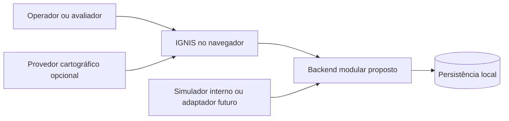
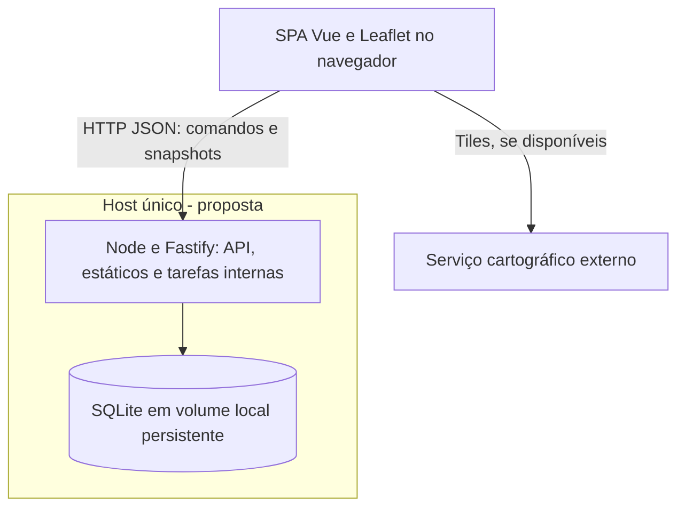
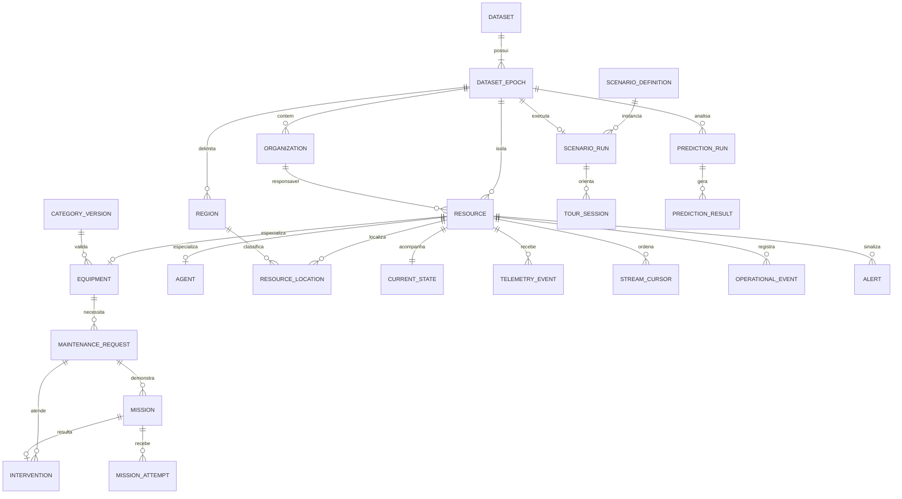

# Arquitetura proposta

Estado: **`ARCHITECTURE_REVIEW`**. Todas as escolhas abaixo são recomendações, sem aprovação registrada. Data-base: 23/10/2026. Escopo normativo: [PROJECT_BRIEF](PROJECT_BRIEF.md); contratos e fórmulas: [MVP_TECHNICAL_DESIGN](MVP_TECHNICAL_DESIGN.md). Registro de aprovação: [ADRs](adr/README.md).

## Revisão de viabilidade v1.1

Parecer: **recomendada para aprovação com ressalvas**, sem aprovação registrada. Mantêm-se stack, módulos e invariantes. Inconsistências documentais comprovadas: testes integrais citados antes de suas funcionalidades existirem; T0009 condicionado ao histórico analítico; jogos independentes condicionados ao primeiro jogo; gates de interface sem distinguir definição funcional e acabamento. Não são defeitos de código: não existe aplicação. Velocidade da equipe, compatibilidade Windows e capacidade preditiva continuam hipóteses não verificadas.

### Fundação mínima e introdução incremental

O contrato final permanece no design técnico. Cada mecanismo passa a ser exigido apenas quando a operação correspondente for introduzida, sem aceitar implementação provisória insegura dessa operação.

| Mecanismo / problema concreto | Primeiro ticket e mínimo seguro | Evolução / garantia que não pode ser removida | Evidência futura |
|---|---|---|---|
| Autorização/sessão: impedir escrita não autorizada | T0002: operador local único, capability de sessão, loopback, origem e CSRF; sem cadastro de contas | Sessões demo por visitante/quotas apenas em T0019 se publicação interativa for escolhida; antes disso exposição pública somente leitura | V00 local; V10/V11 antes de escrita pública |
| Dataset/epoch: impedir referência cruzada e efeito após reset | T0002: contexto demo único e epoch inicial com FKs compostas | T0005 prepara outra geração de teste; T0009 acrescenta staging/CAS/token; nunca omitir contexto das chaves | V00/V02, depois V04 |
| Versões: impedir edição perdida | T0002 fornece comparação/revisão; T0003 aplica em recurso | Versionar solicitações ao introduzir Maintenance e missões em T0015; sem vetor de versões distribuído | V01, V06/V09 nos respectivos tickets |
| Idempotência: retry não repetir efeitos | T0002 fornece recibo SQL simples e hash; T0003 usa em cadastro | T0007 adiciona chaves de evento/seq; T0015 unicidade de intervenção; não implementar framework genérico de comandos | V00/V01/V05/V09 por etapa |
| Recibos persistidos: resposta perdida após commit | Mesma tabela e mesma transação da primeira mutação, sem fila | Guardar só chave/hash/resposta segura; nenhuma limpeza na geração ativa antes da entrega | Retry após commit e chave divergente |
| Isolamento: demo não alterar operação ou outra sessão | T0002 resolve contexto no servidor; T0005 restringe gerador | T0019 reserva contexto próprio ao tour; sem plataforma de multitenancy ou painel de gestão | FK cruzada, acesso alheio e tour paralelo |
| Ordenação: atraso não retroceder estado | T0007: cursor por fonte/recurso/canal, sequência e tempo | Fonte única vinculada; sem consenso ou reordenação global | V05, incluindo sequência maior com tempo regressivo |
| Transações: evitar fatos parciais | T0002: unidade de trabalho SQLite; T0003 primeiro fluxo real | Serviços entram na mesma transação; não adiar alertas/efeitos de manutenção para callback volátil | Injeção de falha entre writes |
| Scheduler: progressão e regras temporais | T0009: laço único, tick limitado e relógio injetável | T0010 conecta avaliação temporal; T0013 adiciona cálculo limitado; sem biblioteca de jobs/broker | V04/V06 e ausência de sobreposição |
| Validação de missão: cliente não autorizar reparo | T0015: ciclo comum + adaptador de teste; T0016–18 validadores reais | Não antecipar puzzles na fundação; validar solução/nonce/TTL e efeito único no servidor | V09 do motor, depois por jogo |

T0001 entrega somente processo/saúde/build técnico; T0002 entrega persistência/contexto e guardas mínimos, sem tabelas de features futuras, provisionamento público ou scheduler. T0003 é a primeira fatia de negócio. Dividir a execução de T0002 em checkpoints internos de persistência e guardas é permitido; o ticket só termina com ambos verificados. Não há novo ticket nem redução de integridade.

### Gates proporcionais de System Design

Após aprovação arquitetural e autorização separada, preparar **System Design funcional mínimo** por jornada: navegação, estados de interação/erro, operações/formulários, interações de mapa/alerta, evidência de solução dos jogos e progresso do tour. Depende dos contratos aprovados de contexto, estados, snapshot e missões. Deve anteceder a implementação da respectiva interação, sem exigir especificação visual de toda a aplicação. Nenhuma dessas interações é desenhada aqui.

**System Design visual e experiencial** é gate separado para identidade, composição, tipografia, cores, Design System, animações/microinterações e apresentação narrativa. Não bloqueia backend nem a funcionalidade mínima com apresentação neutra; qualquer trabalho visual deliberado depende de sua aprovação. Isso não autoriza Codex a inventar branding.

| Tickets | Gate funcional mínimo | Gate visual/experiencial |
|---|---|---|
| T0001/T0002/T0007/T0008/T0015 | Não exigido para backend/entrada técnica sem jornada | Somente se o escopo vier a incluir trabalho visual, atualmente proibido nesses tickets |
| T0003–T0006, T0009–T0014 | Aprovar interação da fatia antes de sua UI; backend pode ser verificado separadamente | Necessário para acabamento visual, não para demonstrar comportamento mínimo |
| T0016/T0017/T0018 | Aprovar interação e condição verificável de solução de cada jogo | Aprovar experiência visual antes de produzir acabamento/efeitos |
| T0019 | Aprovar fluxo funcional do roteiro e navegação | Aprovar apresentação narrativa/visual se incluída |
| T0020 | Sem novo design; validar interações já aprovadas | Sem redesign; apenas consolidar o autorizado |

## Resumo executivo

Recomenda-se uma SPA em Vue/TypeScript e um backend Node.js/Fastify em **monólito modular**, com SQLite e SQL parametrizado. Um processo de aplicação concentra API, tarefas curtas de simulação, avaliação de alertas e cálculos analíticos. O banco permanece em disco local persistente. Na distribuição construída, o backend também serve os arquivos estáticos.

O backend controla estados e efeitos; o navegador envia comandos e consulta snapshots consistentes. Telemetria e comandos usam transações curtas para gravar histórico, estado e alertas juntos. A atualização inicial será por polling de snapshots. Simulação e missões ficam isoladas por conjunto de dados e geração; resultados antigos não podem afetar uma demonstração reinicializada.

As capacidades preditivas serão scores heurísticos versionados, com fatores e cobertura explícitos. Esta escolha reduz o trabalho de dados e validação no prazo, mas não constitui uma previsão estatística validada. Não há serviço de IA externa, fila, microsserviços ou necessidade de Kubernetes.

## Requisitos significativos e premissas

| Direcionador | Consequência arquitetural |
|---|---|
| R01–R04: categorias heterogêneas e localização | Núcleo relacional e atributos validados por categoria; localização cadastral separada de posição observada |
| R06–R07: atualização, atraso, duplicação | Pipeline único, ordenação por fluxo, qualidade de comunicação separada do estado físico |
| R08–R10: explicabilidade | Resultados com versão, janela histórica, horizonte, fatores, cobertura e limites |
| F03/F05/F07: reproduzir e reiniciar | Relógio lógico, seed e geração com bloqueio de escritas antigas |
| F06/F08: reparos por jogos | Motor independente das mecânicas; somente Maintenance autoriza efeitos |
| Prazo do briefing | Priorizar fatias executáveis; manter um processo e banco único; sem arquitetura para escala hipotética |

Premissas a validar: desenvolvedor com conhecimento básico de TypeScript/SQL; demonstração com até 200 equipamentos, 30 agentes, 10 regiões, 50 mil eventos por geração e até 10 navegadores; meta inicial de até 5 eventos/s. Esses números são **orçamento de projeto, não capacidade medida**. Sem integração com hardware nem dados pessoais reais no MVP. Internet pode falhar durante o mapa; o núcleo operacional deve continuar consultável.

## Alternativas de stack

Comparação qualitativa por julgamento arquitetural, sem benchmark ou conhecimento comprovado da equipe. Se houver experiência forte em outra stack, reavaliar antes da liberação.

| Componente | A — recomendada | B — alternativa |
|---|---|---|
| Frontend/linguagem | Vue 3, TypeScript, Vue Router, Vite | React, TypeScript, Vite |
| Backend/linguagem | Fastify, TypeScript, Node.js 24 LTS | FastAPI, Python, Uvicorn |
| Persistência/acesso | SQLite, better-sqlite3, SQL parametrizado; sem ORM | PostgreSQL, SQLAlchemy e Alembic |
| Mapa | Leaflet estável, integração direta; polígonos GeoJSON locais | Leaflet, mesma política cartográfica |
| Atualização | HTTP polling inicialmente; SSE como evolução | HTTP polling ou SSE, decisão equivalente |
| Testes | Vitest, injeção HTTP do Fastify, Playwright | Vitest frontend, pytest/cliente HTTP backend, Playwright |
| Build/execução propostos | npm, workspaces; build da SPA e compilação do backend | npm + ambiente Python; build SPA e Uvicorn |
| Deploy construído | Um processo Node + arquivo SQLite em volume local | Um processo Python + serviço PostgreSQL |

| Critério | A | B |
|---|---|---|
| Adequação funcional | Alta para volume demonstrativo | Alta, melhor espaço para análises Python e geografia avançada |
| Aprendizado presumido | Médio: uma linguagem e SQL explícito | Médio/alto: duas linguagens e dois ciclos de ferramentas |
| Complexidade operacional | Baixa: um serviço, banco embutido | Média: serviço e banco separado |
| Velocidade estimada | Favorável ao prazo pela redução de integrações | Favorável se já houver experiência Python/PostgreSQL |
| Ecossistema | Adequado a web, mapa e testes | Adequado a web e análise de dados |
| Testabilidade | Alta, relógio injetável e banco temporário real | Alta, exige PostgreSQL de teste representativo |
| Risco de integração | Médio: módulo SQLite nativo e consultas síncronas | Médio: configuração entre runtimes e banco |

Recomenda-se A: as análises escolhidas são aritméticas e não exigem ecossistema científico; transações e agregações SQL são explícitas e pequenas. O custo é escrever e testar mapeamento SQL e evolução de esquema. ORM adicionaria API e geração de esquema sem benefício decisivo neste volume; Drizzle seria alternativa caso a equipe prefira tipagem de consultas, sujeita a revisão da decisão. Não haverá camada genérica de repositório para bancos hipotéticos.

Vue é escolha de trabalho, não superioridade medida sobre React; falta confirmação de familiaridade da equipe. Node 24 está listado como LTS na [fonte oficial](https://nodejs.org/en/about/previous-releases). A [política do Fastify](https://fastify.dev/docs/latest/Reference/LTS/) vincula suporte a linhas Node LTS. Versões exatas de ferramentas/plugins e compatibilidade do binário SQLite no Windows precisam ser fixadas e verificadas no primeiro ticket; não foram instaladas aqui. [Vite](https://vite.dev/guide/), [Vue](https://vuejs.org/guide/introduction.html), [better-sqlite3](https://github.com/WiseLibs/better-sqlite3), [FastAPI](https://fastapi.tiangolo.com/features/), [SQLAlchemy](https://docs.sqlalchemy.org/en/20/intro.html) e [Drizzle](https://orm.drizzle.team/docs/overview) fundamentam os componentes comparados. Avaliação de velocidade/complexidade é inferência desta proposta.

## Estilo arquitetural e limites

[ADR-0001](adr/0001-monolito-stack-persistencia.md) registra alternativas e condições de revisão. Uma SPA sem backend obrigaria confiar no cliente e não satisfaria os fluxos persistentes. Microsserviços adicionariam deploy, falhas parciais e coordenação transacional sem carga ou equipes independentes que os justificassem.

### Contexto

### Unidades de implantação recomendadas

Setas não representam serviços já existentes. Em desenvolvimento, Vite seria um processo adicional; na distribuição, apenas o backend executa a aplicação. Nenhum worker ou broker externo é necessário.

### Módulos e propriedade dos dados

Cada módulo expõe serviços de aplicação. Outro módulo não altera suas tabelas diretamente. Orquestradores recebem uma unidade de trabalho comum; serviços participantes não abrem transações independentes. Consultas consolidadas podem fazer joins por uma camada de leitura de Operations, sem conceder propriedade de escrita.

| Módulo | Responsabilidade e dados próprios | Operações e eventos relevantes |
|---|---|---|
| Inventory | Equipamentos, agentes, categorias/versionamento, endereços, órgãos e regiões | Criar/editar/listar, validar atributos; `resource.created`, `resource.updated` |
| Maintenance | Necessidades, prioridade, agenda, intervenções e resolução | Solicitar/iniciar/concluir/cancelar; `maintenance.requested`, `maintenance.completed` |
| Operations | Estado atual, posição observada, histórico de mudanças e snapshots de indicadores | Aplicar observação autorizada/transição, consultar Central; `state.changed`, `position.changed` |
| Telemetry | Eventos normalizados, hashes de entrada, cursores e rejeições de processamento | Validar/deduplicar/ordenar/ingerir; `telemetry.accepted`; rejeição não é mudança física |
| Alerts | Ciclos de alertas e reconhecimento | Avaliar/reconhecer/resolver; `alert.opened`, `alert.resolved` |
| Simulation | Definições/versionamento de cenário, execuções, seed, relógio e cursor | Preparar/iniciar/pausar/avançar/reiniciar; `scenario.started`, `scenario.reset` |
| Prediction | Execuções, fatores e resultados por recurso/região | Agregar/calcular/consultar; `prediction.computed` |
| Game Missions | Missões, desafios, tentativas, sessões e resultados validados | Iniciar/submeter/expirar/cancelar; `mission.completed`, `mission.failed` |
| Guided Experience | Progresso de roteiro versionado e referências à execução de cenário | Iniciar/avançar/retomar/encerrar; `tour.started`, `tour.ended` |
| Demo Data | Manifesto determinístico de geração e proveniência | Gerar baseline via serviços Inventory/Maintenance/Telemetry; `demo.prepared` |

### Dependências, invariantes e testes por módulo

| Módulo | Dependências autorizadas | Invariante / risco de acoplamento | Teste principal |
|---|---|---|---|
| Inventory | Contexto de dados e validação compartilhada | Não escreve estado operacional; evitar atributos livres sem schema | Série única, categoria/versionamento, edição concorrente |
| Maintenance | Inventory para existência; Operations para efeito via orquestrador | Uma intervenção não conclui necessidades alheias; não depender de minigame | Duplicação, resolução parcial, rollback |
| Operations | Leitura Inventory/Maintenance/Telemetry/Alerts | Snapshot usa uma revisão e filtros únicos; não recalcular no cliente | Denominador, ausência de dados e snapshot concorrente |
| Telemetry | Inventory e serviços Operations/Maintenance/Alerts na mesma transação | Evento repetido sem novos efeitos; evitar chamadas externas na transação | Fora de ordem, fontes não autorizadas, crash antes do commit |
| Alerts | Leitura dos fatos e relógio do contexto | Um ciclo ativo por regra/recurso; reconhecimento não resolve causa | Oscilação, recorrência, atraso de heartbeat |
| Simulation | Demo Data, pipeline Telemetry e contexto de execução | Sem escrever estado diretamente; evitar bypass de validação | Mesma seed, pausa, retomada e eventos de geração antiga |
| Prediction | Leituras históricas e snapshot de Inventory/Maintenance/Operations | Não altera estado nem agenda; evitar consulta a futuro no treino/validação | Fórmulas de referência, insuficiência e corte temporal |
| Game Missions | Maintenance e catálogo de capacidades | Nunca confia em `success` do cliente; sem SQL em mecânicas | Dupla conclusão, expiração, equipamento alterado |
| Guided Experience | Operações públicas de Simulation e consultas dos módulos | Sem backdoor administrativo; encerrar cancela ações futuras, não fatos passados | Retomada, cancelamento e isolamento entre sessões |
| Demo Data | Serviços de domínio, sem tabelas próprias de equipamentos | Gerar registros válidos; não esconder incoerência por SQL direto | Cobertura de categorias, identidade determinística e unicidade |

Fluxo de dependências de escrita: entradas HTTP/scheduler → serviço de aplicação → módulos de domínio → adaptadores SQLite. Domínio não importa HTTP, mapa, UI nem implementações de jogos. Eventos internos são registros de integração transacionais, sem event sourcing completo; as tabelas correntes são fonte operacional de verdade, vinculadas ao histórico pela mesma transação.

## Modelo conceitual e persistência

`RESOURCE` possui exatamente uma especialização; `CURRENT_STATE` existe desde o cadastro. Relacionamentos de rastreio de resultados para recurso/região estão especificados no [catálogo de entidades](MVP_TECHNICAL_DESIGN.md#dados); não há FK polimórfica sem validação.

Estratégia: colunas relacionais para dados filtráveis e integridade; JSON validado somente para atributos de categoria, parâmetros e fatores. Categorias têm código estável e versões imutáveis de schema mantidas pelo sistema, nunca schemas executáveis recebidos de usuários. Migração de atributos é explícita; editar categoria não invalida silenciosamente registros existentes.

Identificadores, campos, índices, transações, retenção e regras geográficas são normativos no [design técnico](MVP_TECHNICAL_DESIGN.md#dados). Repositórios usam SQL parametrizado; filtros/ordenação têm lista permitida. Habilitar e verificar FKs em cada conexão é obrigatório: [SQLite não garante sua ativação por padrão](https://www.sqlite.org/foreignkeys.html). Recomenda-se WAL com transações curtas, `busy_timeout` limitado e banco no disco do mesmo host; WAL permite leitura concorrente, mas continua havendo um escritor e não serve para sistema de arquivos de rede, conforme [documentação SQLite](https://www.sqlite.org/wal.html).

A versão SQLite embutida no driver deve incluir correção do WAL-reset: a [documentação oficial](https://www.sqlite.org/wal.html#walreset) indica correção em 3.51.3 ou posterior e backports específicos. A versão efetivamente instalada será verificada em T0002; não basta verificar a versão do pacote Node.

Não usar PostGIS no MVP: filtros por bounding box e classificação em polígonos locais bastam ao orçamento presumido. O backend determina a região da posição; o mapa apenas representa resultados. Reavaliar PostgreSQL/PostGIS se houver múltiplas instâncias escritoras, consultas espaciais complexas ou desempenho insuficiente medido.

Evolução futura: migrations SQL numeradas, checksum e tabela de versão, com backup e teste em banco vazio e versão anterior. Nunca inferir esquema de modelos automaticamente ao iniciar. Retenção não pode eliminar o histórico exigido por análises ou auditoria durante avaliação.

## Telemetria, eventos e atualização

Pipeline, ordenação, relógios e limites estão em [telemetria](MVP_TECHNICAL_DESIGN.md#telemetria). Escolhe-se registro + projeções + alertas na mesma transação, evitando necessidade de outbox no MVP. Após crash, reenviar a mesma chave retorna o resultado persistido. Tarefas por tempo são reavaliadas no próximo ciclo; não dependem de uma notificação volátil.

| Estratégia | Benefício | Custo/limite | Decisão |
|---|---|---|---|
| Polling de snapshot | Recuperação simples, HTTP comum, sem cursor de entrega | Consultas periódicas e atraso limitado pelo intervalo | Inicial: uma consulta a cada 2 s por aba visível, sem sobreposição |
| SSE | Servidor → navegador, reconexão nativa | Conexão longa, replay/cursor e configuração de proxy | Evolução se a latência/carga do polling não atender meta medida |
| WebSocket | Canal bidirecional contínuo | Reconexão, autorização e protocolo mais complexos | Só reconsiderar para interação bidirecional frequente comprovada |

Não implementar as três opções. O [ADR-0002](adr/0002-eventos-snapshots-e-isolamento.md) registra a decisão. SSE não é requisito; suas características estão descritas na [MDN](https://developer.mozilla.org/en-US/docs/Web/API/Server-sent_events/Using_server-sent_events). O contrato de snapshot funciona independentemente do transporte futuro. Polling não sobrepõe requisições; pausa em aba oculta, consulta ao retornar ao foco e usa backoff limitado a 30 s em erros, indicando a última atualização válida.

Meta a verificar: alteração confirmada visível em até 5 s na carga presumida; snapshot p95 até 500 ms no ambiente de teste registrado. São metas, não garantias observadas. Se falhar, medir consultas, tamanho de resposta e bloqueios antes de adicionar infraestrutura. Frontend indica erro/última atualização e conserva o último snapshot; nunca apresenta dado antigo como atualizado.

## Simulação, missões e previsão

Uma execução usa seed, versões de cenário/gerador e relógio lógico persistido. Reset prepara uma nova geração, valida e troca o ponteiro ativo atomicamente. Todo comando exige a geração esperada. Eventos e sessões anteriores ficam inertes. O contrato completo, incluindo retomada após crash, está em [simulação](MVP_TECHNICAL_DESIGN.md#simulacao).

Game Missions valida desafio e tentativas no servidor; Maintenance decide efeitos autorizados, limitados a dados simulados. Mecânicas não conhecem tabelas nem mudam estado. Ver [missões](MVP_TECHNICAL_DESIGN.md#missoes) e J03.

Prediction usa agregações de histórico e scores heurísticos de manutenção (horizonte de 7 dias) e risco regional (24 horas), com atualização sob demanda e periódica. Fórmulas, frequência, falta de dados e validação temporal estão em [predição](MVP_TECHNICAL_DESIGN.md#predicao). As diferenças entre regra, score, anomalia e probabilidade e suas limitações estão ali, sem algoritmos concorrentes implícitos. O [ADR-0003](adr/0003-predicao-explicavel-e-missoes.md) justifica a abordagem.

## Segurança e limites de confiança

Ambiente local: bind em loopback por padrão. Publicação futura: HTTPS, mesma origem, leitura pública de dados exclusivamente fictícios e escrita somente em demonstração isolada. Um segredo de operador configurado no servidor abre sessão por cookie HttpOnly/SameSite e Secure em HTTPS; nunca embutir segredo no bundle. Cenários públicos interativos podem receber sessão limitada a um dataset próprio, com quota e expiração. Sem dataset isolado disponível, a publicação fica somente leitura. Não exigir contas corporativas.

Todas as escritas verificam sessão, dataset, geração, versão de entidade e capacidade da operação. Check de origem e proteção CSRF nas mutações; CORS restrito no desenvolvimento. Credencial de ingestão é separada da sessão de navegador e vinculada a fonte/recurso. A fonte informada pelo cliente não concede autorização. O contexto `simulated` é atribuído pelo servidor.

Validar corpo, parâmetros, timestamps, coordenadas e atributos; limites em [contratos](MVP_TECHNICAL_DESIGN.md#contratos). Não aceitar schemas arbitrários: o [Fastify alerta sobre compilação de schemas](https://fastify.dev/docs/latest/Reference/Validation-and-Serialization/). Consultas parametrizadas e conteúdo textual escapado impedem injeções por filtros e detalhes do mapa. Não armazenar CPF, contato pessoal ou nomes reais de agentes; usar identidade fictícia e vínculo organizacional mínimo. Logs não incluem cookies, segredos ou payload bruto com dados pessoais. Configuração sensível somente no servidor, com exemplos sem valores reais em fase futura.

## Testes, observabilidade e diagnóstico

Norma de aceitação: [VERIFICATION_GUIDE](VERIFICATION_GUIDE.md). Unitários cobrem transições, relógio/seed, scores e validadores. Integração usa SQLite real temporário para unicidade, FKs, rollback e concorrência. Contratos validam entrada/saída e respostas de erro. Ponta a ponta verifica J01–J05; não testar minigames apenas por resposta simulada do servidor.

Ferramentas propostas: [Vitest](https://vitest.dev/guide/) e [Playwright](https://playwright.dev/docs/intro), com versões compatíveis a fixar. Nenhum teste da aplicação foi executado nesta fase.

Logging JSON: horário de parede UTC, nível, request/correlation ID, dataset/geração, módulo, operação, duração, código de erro e IDs relevantes. Medidas mínimas: aceitos/duplicados/fora de ordem/rejeitados, latência de ingestão/snapshot, conflitos, duração de tarefas, eventos pendentes, falhas de previsão e quantidade de comunicação atrasada. Sem stack de observabilidade externa obrigatória. Saúde: liveness do processo e readiness da versão do banco/consulta, sem revelar caminhos ou segredos.

Diagnóstico deve permitir partir de `requestId` até comando, evento, transição e alerta. Erros de domínio são estáveis e legíveis; erros internos preservam causa no log, mas retornam resposta sanitizada. Tarefa que falha não avança cursor; retry limitado com erro visível, sem loop infinito.

## Execução local e distribuição propostas

| Alternativa | Processos e persistência | Avaliação |
|---|---|---|
| Local em desenvolvimento | Vite + backend; SQLite local | Menor risco para implementação e demonstração assistida |
| Distribuição local construída | Um backend serve SPA; SQLite em diretório gravável | Preferencial para avaliador: Node compatível e navegador; sem banco externo |
| Host persistente único | Mesmo build, um processo, volume local, HTTPS/proxy | Publicação possível após validação de escrita/sessões, backup e reset |
| Hospedagem efêmera/serverless | Disco e vida do processo não assegurados por esta proposta | Inadequada sem rever banco e tarefas; não presumir persistência |

Docker é alternativa de distribuição se trouxer reprodução verificável, não dependência obrigatória nem artefato criado nesta fase. Hospedagens gratuitas podem suspender processo, apagar disco ou impor quotas; provedor, preço e garantias não foram escolhidos/verificados. Evitar depender de hospedagem pública para a única demonstração.

Configuração futura: `PORT`, `HOST`, `DATABASE_PATH`, `APP_MODE`, `SESSION_SECRET`, `OPERATOR_SECRET`, origem permitida e provedor/atribuição de tiles. Falta de segredo em modo público deve impedir escrita, não gerar credencial padrão. Dados de demonstração preparados por ação explícita e idempotente; não reiniciar banco em cada boot. Reinício do processo recupera banco/cursor, pausa cenário e pede retomada explícita, sem disparar rajada para compensar tempo desligado. Backup por mecanismo consistente do SQLite ou parada controlada; não copiar somente o arquivo principal enquanto houver WAL ativo.

O mapa usará [Leaflet](https://leafletjs.com/reference.html). Provedor de tiles é dependência opcional de apresentação; não há geocodificação externa obrigatória. Se forem utilizados tiles públicos OSM, respeitar atribuição, cache e proibição de download em massa/offline da [política oficial](https://operations.osmfoundation.org/policies/tiles/). Sem tiles, polígonos/recursos locais e lista de recursos devem continuar verificáveis. Seleção do provedor e eventuais garantias seguem pendentes.

Comandos futuros e procedimentos de recuperação estão no [guia](VERIFICATION_GUIDE.md#comandos). Não há comandos executáveis disponíveis agora.

## Organização futura do repositório

### Resiliência da demonstração cartográfica

Contrato funcional, sem especificação de layout: polígonos regionais simplificados e fictícios acompanham os dados demo locais, com código/nome e sistema de coordenadas documentados. Nenhuma geocodificação é necessária: cadastro recebe coordenadas manualmente ou pelo gerador. Nunca deduzir ponto pelo CEP sem serviço explicitamente escolhido.

| Falha/ausência | Comportamento mínimo exigido |
|---|---|
| Internet indisponível ou tiles falhando | Camada base pode desaparecer; recursos/polígonos locais continuam no Leaflet, com enquadramento pelos dados. Identificar indisponibilidade da base e evitar retries ilimitados |
| Geocodificação indisponível | Não impedir cadastro com endereço/coordenação fornecidos; validação local mantém regras; não inventar localização |
| Recurso sem coordenadas | Permanecer na consulta/lista, indicadores e alertas conforme filtros sem bbox; informar ausência e excluir apenas da representação pontual/bbox, sem ponto artificial |
| Região sem cobertura analítica | Expor nome, contagens, cobertura e motivo com score null; nunca tratar como risco zero ou preencher por vizinhança |
| Mapa indisponível por erro do componente | Consulta tabular de recursos/regiões por ID/nome, detalhes, indicadores, alertas e fatores analíticos permanecem acessíveis por dados locais do backend |

Região cadastral pode permanecer conhecida por vínculo validado, mesmo sem posição dinâmica; a ausência de coordenada não cria atribuição regional automática. No MVP, sem ponto ou vínculo regional verificável, usar unassigned e relatar exclusão. Se bbox estiver ativo, recursos sem ponto ficam explicitamente fora daquele conjunto; limpar bbox recupera a consulta geral. Filtros/revisão devem permanecer iguais nas representações equivalentes. Não obter nem espelhar tiles para offline nesta revisão; fontes cartográficas externas continuam opcionais e condicionadas às políticas já citadas. Teste de aceite em [verificação v1.1](VERIFICATION_GUIDE.md#validacao-v11).

Proposta apenas textual; nenhum diretório executável foi criado:

| Área futura | Conteúdo |
|---|---|
| `apps/web/` | Navegação, consultas HTTP, mapa e adaptadores de mecânicas |
| `apps/server/` | Entrada HTTP, módulos, orquestradores, scheduler e infraestrutura SQLite |
| `packages/contracts/` | Schemas estáticos e tipos de transporte, sem acesso a banco |
| `tests/` | Contratos, integração e jornadas |
| `docs/` | Documentação e decisões |

Não criar biblioteca compartilhada genérica de domínio. Browser não deve importar infraestrutura do servidor. `packages/contracts/` não substitui validação no backend.

## Riscos, trade-offs e decisões pendentes

O registro único de riscos/pendências está em [KNOWN_ISSUES](KNOWN_ISSUES.md). Os maiores riscos são o prazo, compatibilidade do driver nativo no Windows, crescimento das transações/snapshots, domínio pouco calibrado dos scores e interferência entre demos. Limitar carga e medir evita uma migração antecipada de infraestrutura. SQL direto economiza ferramentas, mas exige disciplina de mapeamento e testes de integridade. Polling simplifica recuperação em troca de latência. Isolamento por geração adiciona contexto às chaves para impedir efeitos antigos após reset.

Decisões a aprovar: ADR-0001 (stack e persistência); ADR-0002 (consistência, atualização e isolamento); ADR-0003 (métodos analíticos e fronteira das missões). Valores iniciais de limites/pesos são parâmetros propostos de demonstração, não fatos de domínio calibrados.

## Critérios para aprovação e liberação

1. Confirmar cobertura R01–R10 e F01–F09 pelo [brief](PROJECT_BRIEF.md), módulos e gates J01–J05.
2. Revisar [contratos](MVP_TECHNICAL_DESIGN.md): estados separados, denominadores, ordenação, atomicidade, reset e conclusão de missão.
3. Validar stack/premissas, registrar aceite ou revisão nos três ADRs e resolver bloqueios de decisão em [KNOWN_ISSUES](KNOWN_ISSUES.md).
4. Revisar viabilidade do [backlog](TICKETS.md), métodos analíticos, riscos e critérios do [guia](VERIFICATION_GUIDE.md).
5. Manter explícita a distinção entre proposta e código existente. Confirmar ausência de implementação e de decisões visuais antecipadas.
6. Somente depois da revisão, emitir autorização humana inequívoca para o ticket específico e alterar expressamente o estado em `AGENTS.md` ou fornecer instrução humana inequívoca posterior à aprovação. Aprovar arquitetura não autoriza automaticamente todos os tickets.

Nesta entrega, o gate permanece fechado. Nenhum ticket foi executado.
